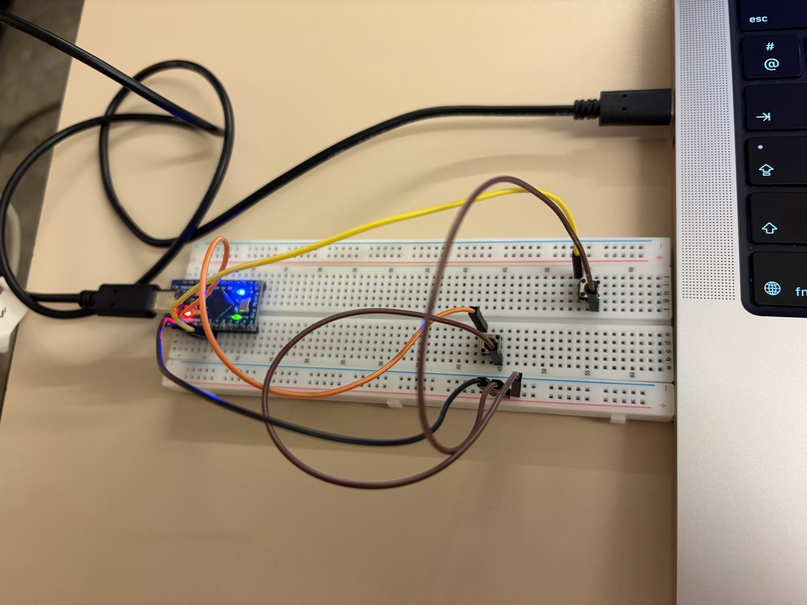

In Samen in Balans, players won't use a keyboard. They'll stand on pedals and lean left or right. Before building those, I wanted to know if our own hardware could move a Boxling at all. So I built the simplest controller possible: an Arduino with two buttons, one for left and one for right.

<video autoplay loop muted playsinline preload="metadata" poster="../../videos/arduino-buttons-poster.jpg" style="display: block; width: 100%; max-width: 22rem; margin: 1.5rem auto; border-radius: 14px;">
  <source src="../../videos/arduino-buttons.mp4" type="video/mp4" />
  Your browser can't play this video.
</video>

## Step 1: the hardware

For the test I used an **Arduino Pro Micro**, two push buttons and a breadboard.

- **One pin per button.** The left button is connected to pin 2, the right button to pin 3.
- **No resistors needed.** Each button sits between its pin and ground. The Arduino has a built-in pull-up resistor that keeps the pin "high" while the button is up. Pressing the button connects the pin to ground, so it reads "low".
- **One cable.** The Arduino gets its power and talks to the laptop over the same USB cable.

## Step 2: the Arduino pretends to be a keyboard

The Pro Micro has a special chip that can act as a USB keyboard. That makes things simple: the left button presses the **left arrow key**, the right button presses the **right arrow key**. As long as you hold a button, the key stays pressed, just like on a real keyboard.

A few details make the buttons reliable:

- **Debouncing.** When you press a button, the metal contacts bounce for a few milliseconds and the Arduino sees a quick flicker of presses. The code ignores changes within 15 ms of each other, so one press is one key press.
- **Safety first.** A button only becomes active after the Arduino has seen it released once. If a wire is wrong or a button is stuck, the Arduino won't keep sending arrow keys to the laptop.
- **A way to check.** The Arduino also writes every press and release to the Serial Monitor, so I could see straight away whether a button worked without opening Unity.

## Step 3: no changes in Unity

This is where the earlier work paid off. The movement in Unity doesn't listen to specific keys, but to one *Move* action, and that action already includes the arrow keys. To Unity, the Arduino is just another keyboard. I plugged it in, pressed Play and the Boxlings walked: no extra code and no drivers.

As you can see in the video, all four Boxlings move at the same time. That's expected for now: they all listen to the same *Move* action, so one controller moves the whole team.

## What's next

Buttons on a breadboard were only a test. The real game is played with your body, so the next step is trying the same idea with **foot pedals**: a player leans left or right and the pedal does what the buttons do now. After that, every player needs their own controller that moves only their own Boxling.

## What I'm taking with me

- **Test the hardware as early as possible.** Two buttons and a few wires were enough to prove that our own controller can move a Boxling.
- **Let the hardware speak a language the computer already knows.** Because the Arduino acts like a keyboard, Unity needed no changes at all.
- **Small details make it reliable.** Debouncing and the safety check make sure a button press is one clean key press, and that a loose wire can't take over the game.
