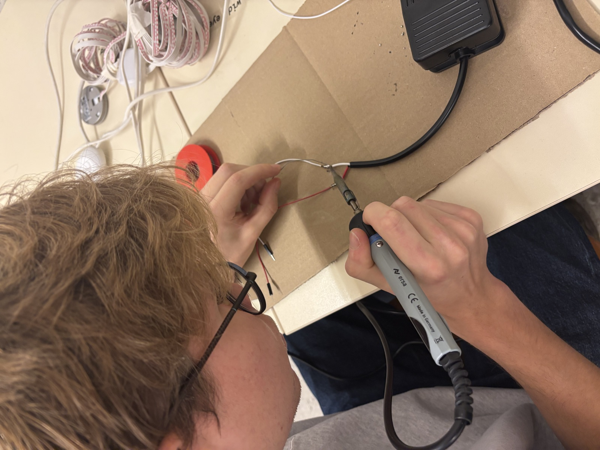
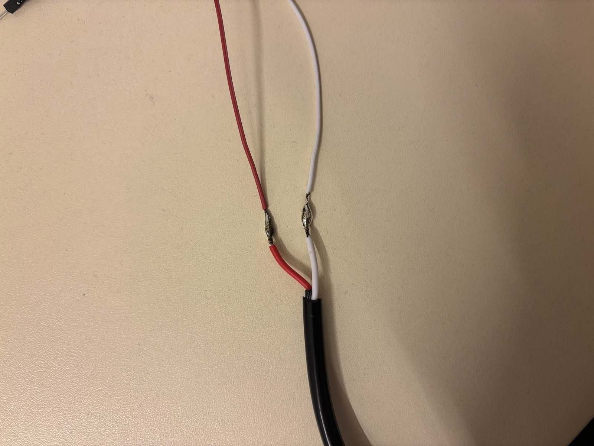
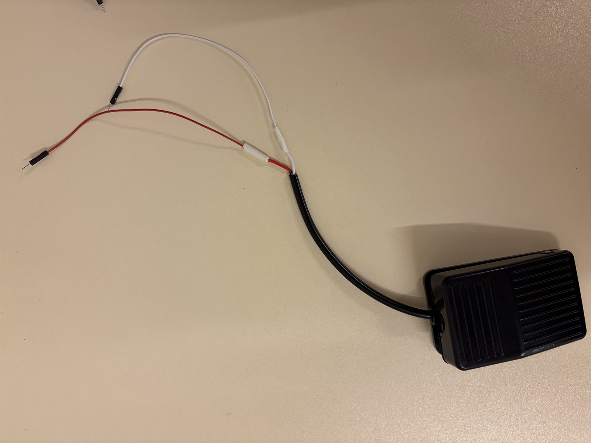
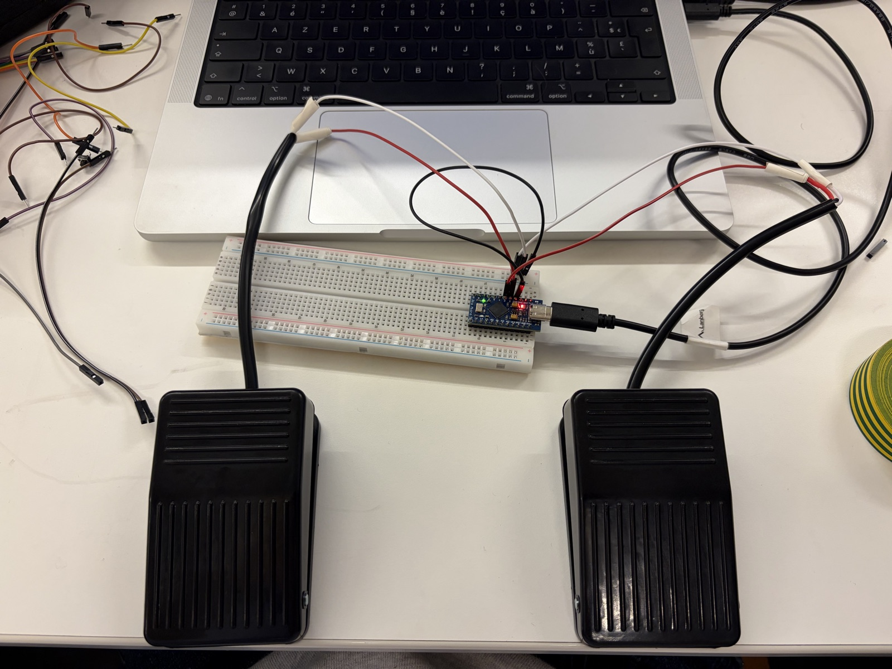

Today the new foot switches arrived. These are the pedals that will go inside the [wooden foot boxes](../foot-box-build/), one under every foot plate. Unlike the USB pedals from the [foot pedals post](../foot-pedals-movement/), these are simple switches with a cable. They don't do anything on their own: an Arduino has to read them and tell the game when a pedal is pressed.

## The cables were too thick

Every foot switch has a thick black cable with three wires inside: white, red and black. Those wires were too thick to plug into the breadboard and the Arduino. So I soldered a thinner Arduino wire onto each of them.

I only needed two of the three wires:

- **White** is the common wire. It goes to the ground (GND) of the Arduino.
- **Red** is only connected to white while the pedal is pressed. It goes to one of the pins of the Arduino.
- **Black** is the opposite: connected while the pedal is *not* pressed. We don't need it.

After soldering, I covered the joints so the bare metal can't touch anything. At the end of the thin wires are pins that go straight into the breadboard.

## Connecting everything

Then I connected two pedals to an Arduino on a breadboard: one for left and one for right.

The Arduino does three things:

- **It reads the pedals.** Every pedal has its own pin. In the end there will be eight: a left and a right pedal for KRABBEL, PUK, RITS and SPRIET.
- **It ignores bouncing.** When you press a switch, the metal bounces for a moment and the signal flickers between on and off. The Arduino only accepts a change when the signal stays the same for a short while.
- **It tells Unity.** Every time something changes, it sends a short line with eight numbers to the laptop, one for each pedal: 1 is pressed, 0 is not. It also sends that line every tenth of a second, so the game knows the Arduino is still connected.

In Unity, the game reads those lines and turns every pedal into a button. Every Boxling's left and right movement is linked to its own two pedals.

## The first test

For now, I only tested two pedals, so I could make one Boxling walk left and right. And it worked straight away: press the left pedal and KRABBEL walks left, press the right one and he walks right.

<video autoplay loop muted playsinline preload="metadata" poster="../../videos/arduino-pedals-test-poster.jpg" style="display: block; width: 100%; max-width: 22rem; margin: 1.5rem auto; border-radius: 14px;">
  <source src="../../videos/arduino-pedals-test.mp4" type="video/mp4" />
  Your browser can't play this video.
</video>

In this video I press the pedals with my hand, so you can see both the pedals and the screen. In the game, the children will of course stand on them.

## What's next

The cables of the foot switches are very short. The Arduino and the Mac mini will stand in the [cabinet next to the installation](../technical-setup/), so in the next step we'll make the cables long enough to reach it. Then we'll put the pedals in a real box, and connect all eight of them.

## What I'm taking with me

- **Check how the parts fit together.** The pedals worked, but their cables didn't fit the breadboard. A bit of soldering fixed that.
- **Know your wires.** Of the three wires, we only needed two. Knowing which one is which saved a lot of trial and error.
- **Start small.** Testing with two pedals and one Boxling showed that everything works, before we connect all eight.
