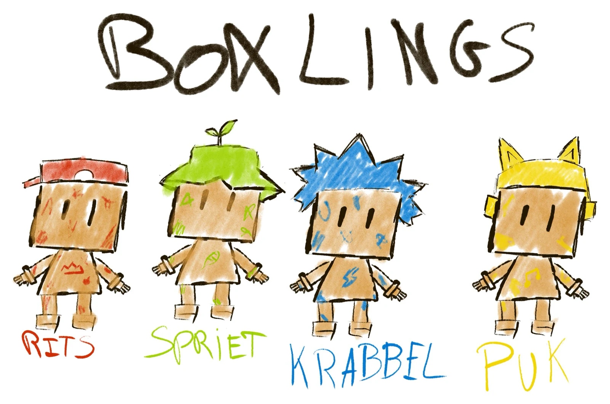
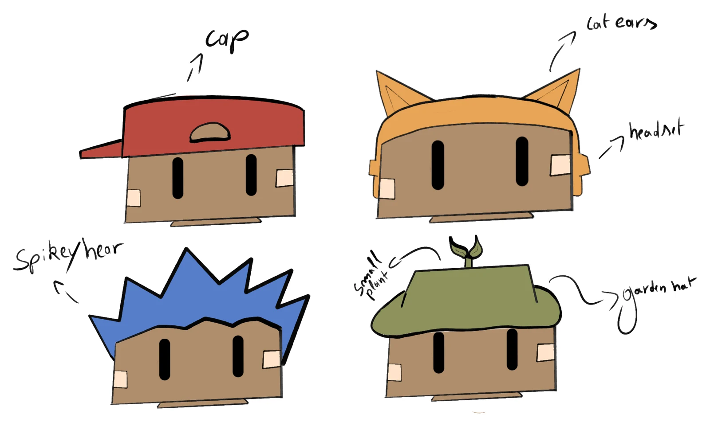
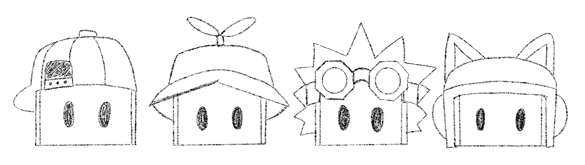
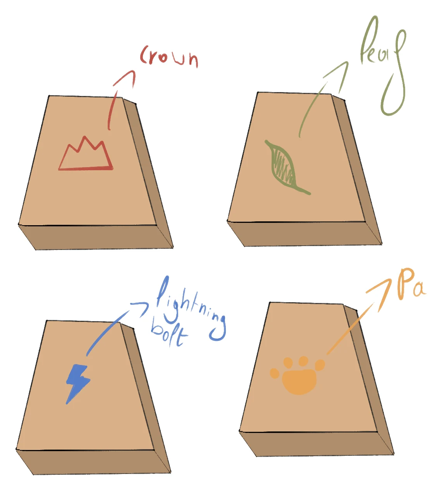
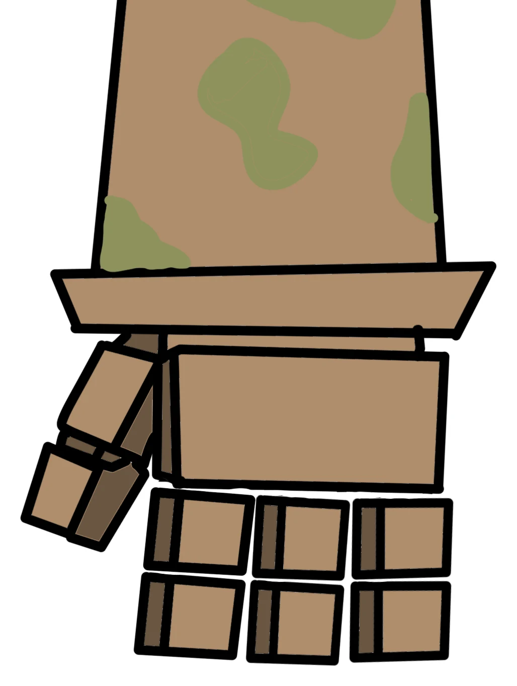

Before we built anything in 3D, we drew the Boxlings on paper. In this post you can see how they grew from one rough sketch into four characters with their own headgear, emblem and colour.

## Step 1: Who are the Boxlings?

The very first sketch was meant to give us a rough idea of who the Boxlings are. We drew four small cardboard figures next to each other and gave each one a name, a colour and something on their head. The bodies are still simple: a box for a head, a box for a body and short arms and legs.

Even in this rough sketch, the most important choices were already there. Every Boxling has the same body, so the players can only tell them apart by their colour and headgear. That colour returns everywhere: on the screen, on the foot panels and in the player's lives.

  
<strong>RITS</strong><dl><dt>Colour</dt><dd>Red</dd><dt>Headgear</dt><dd>A cap worn backwards</dd><dt>Emblem</dt><dd>A crown</dd></dl>

  
<strong>SPRIET</strong><dl><dt>Colour</dt><dd>Green</dd><dt>Headgear</dt><dd>A garden hat with a small plant</dd><dt>Emblem</dt><dd>A leaf</dd></dl>

  
<strong>KRABBEL</strong><dl><dt>Colour</dt><dd>Blue</dd><dt>Headgear</dt><dd>Spiky hair and goggles</dd><dt>Emblem</dt><dd>A lightning bolt</dd></dl>

  
<strong>PUK</strong><dl><dt>Colour</dt><dd>Orange</dd><dt>Headgear</dt><dd>A headset with cat ears</dd><dt>Emblem</dt><dd>A paw</dd></dl>

## Step 2: The heads

The head is what you see most in the game, so that is where we started working out the details. We drew the four heads bigger and wrote down what each one wears: a cap for RITS, a garden hat with a small plant for SPRIET, spiky hair for KRABBEL and a headset with cat ears for PUK.

The colours also changed a little here. The bright green and yellow from the first sketch became a softer olive green and orange, so they fit better with the cardboard and with our [colour palette](../styleboard/).

## Step 3: More details on the heads

Next we drew the heads again in pencil, this time with more detail. The cap got seams, a button on top and a patch. SPRIET's small plant became a sprout with two leaves. KRABBEL got goggles on top of his spikes, and PUK's headset got real ear cups. The eyes became simple ovals, the same for all four.

## Step 4: An emblem for every Boxling

Because the bodies are all the same, we gave every Boxling an emblem on their chest that matches their personality: a crown for RITS, a leaf for SPRIET, a lightning bolt for KRABBEL and a paw for PUK. We sketched the emblems on the body block, in the colour of the Boxling.

## Step 5: Cardboard hands

The last detail was the hands. We wanted them to look like they were built from small pieces of cardboard too. The hand is a block with a separate thumb, and the fingers are small cardboard cubes. The sleeve shows the green stains we also use on SPRIET.

## From sketch to 3D

With these sketches we had everything we needed to start modelling. The first Boxling we built in 3D was RITS: you can read about it in [Making RITS: Boxling 1 of 4](../rits-boxling/). After that, SPRIET, KRABBEL and PUK followed in [Meet SPRIET, KRABBEL and PUK](../new-boxlings/).
