During the game, a Boxling walks towards the camera and the camera moves along. That means the background can't be a flat picture: it has to react when the camera moves. So for this background I didn't make one image, but a full 3D environment in Blender: a **canyon** with a big island in the middle, in the same cardboard style as the rest of our world.

## The idea

The idea was a canyon with a big plateau in the middle, steep cliffs, forests and clouds. I liked the feeling of depth: you look past close cliffs into a deep canyon towards one big island. I sketched it first: the view from the camera on top, and the layout seen from above underneath. The central island has a big forest on top, clouds fill the canyon, and close cliffs on both sides frame the view. From above, the side islands form a path that leads the eye to the central island.

Building all of that at once would get messy, so I split it into steps and checked the result after every step before going further.

## Step 1: one island in clay

The first step was only the **central island**: a wide plateau with a flat top and tall, almost vertical walls. No trees, no clouds, no cardboard yet, just grey clay, so I could focus on the shape. The walls are built out of blocks that stand next to each other and step back a little, so it already feels like a stack of cardboard pieces.

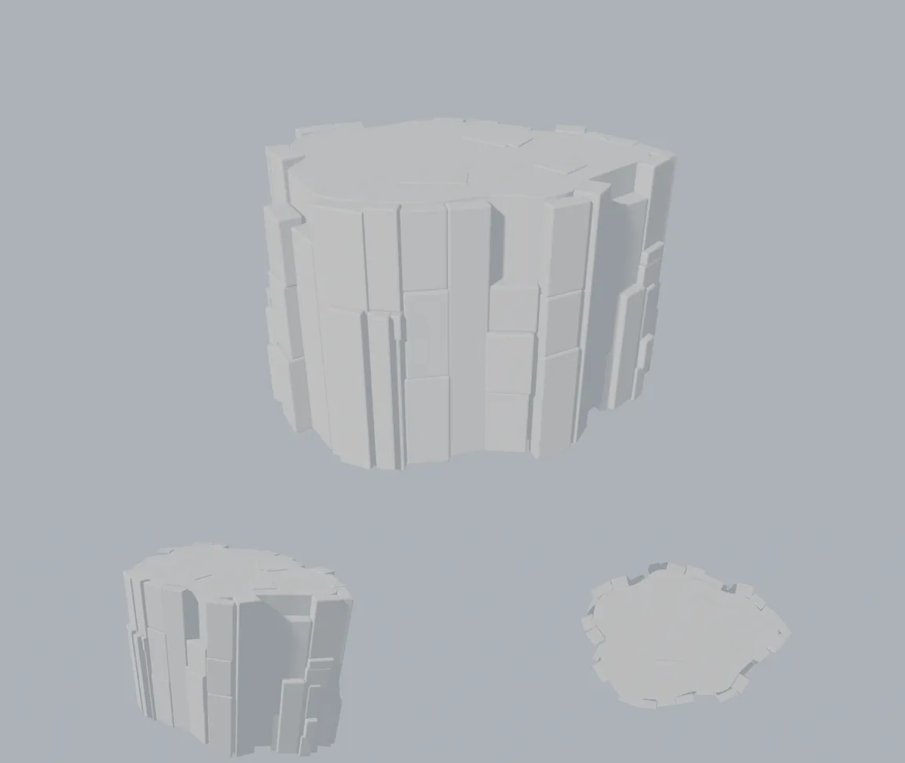

## Step 2: islands around it

Next came the **side islands**. They sit in a horseshoe around the central island, high on the outside and stepping down towards the canyon, so the eye is guided to the middle.

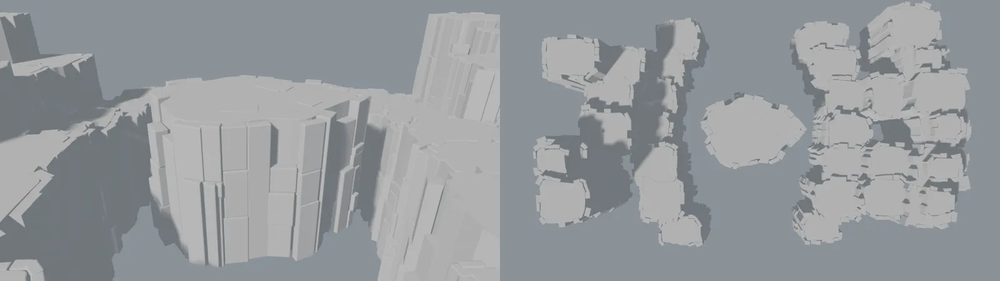

## Step 3: cardboard

Then the clay became **cardboard**: orange-brown walls with stains and straight seams between the panels, small squares of tape here and there, and yellow-green grass on everything that faces up.

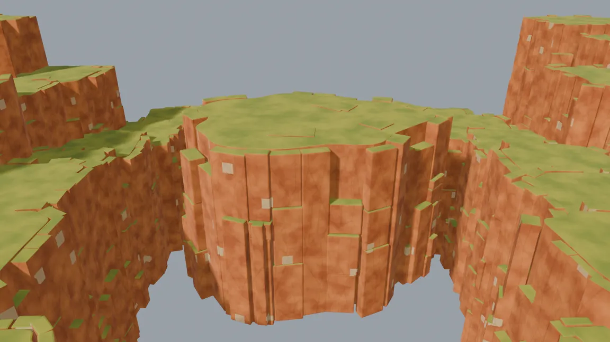

## Step 4: trees

For the trees I used the **same cardboard trees as in our first scene**, so everything belongs to the same world. They grow in small forests on all the tops and ledges, with open grass in between.

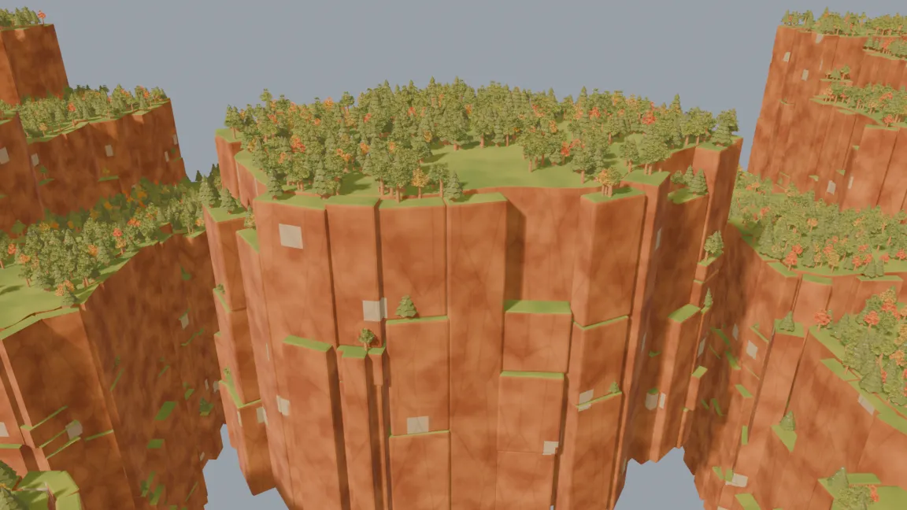

## Step 5: a game camera and a stronger foreground

I added a camera that looks the way it will in the game: low, almost straight ahead, through the canyon towards the island. From there the composition felt too far away, so I added big **foreground plateaus** close to the camera, cut off by the edges of the image. Now you look through a window of close cliffs into the canyon.

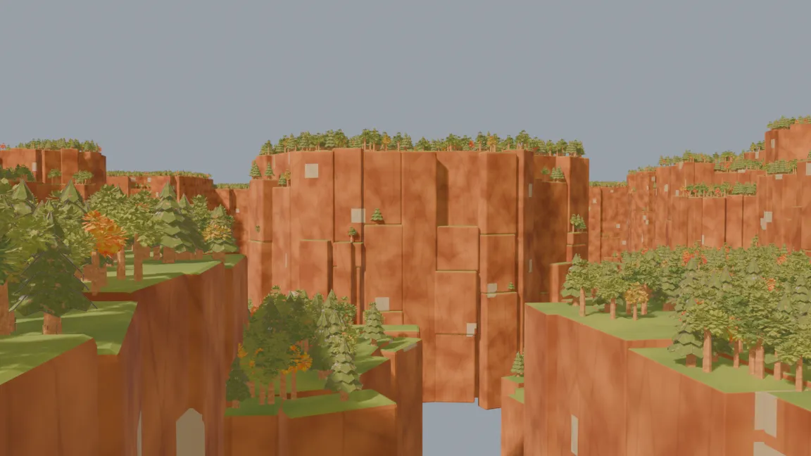

## Step 6: clouds and fog

The bottom of the canyon was empty. Soft round **clouds** now hang between the islands, and a light **fog** makes everything that is far away fade a little. That gives the canyon depth.

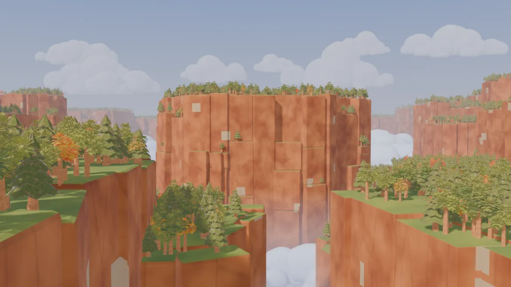

## Step 7: light

For the light I used the same setup as our other cardboard background: a low, golden sun, a soft pink fill light and the same sky. This way I can give Lomme the same light values for Unity, and the background and the game will match.

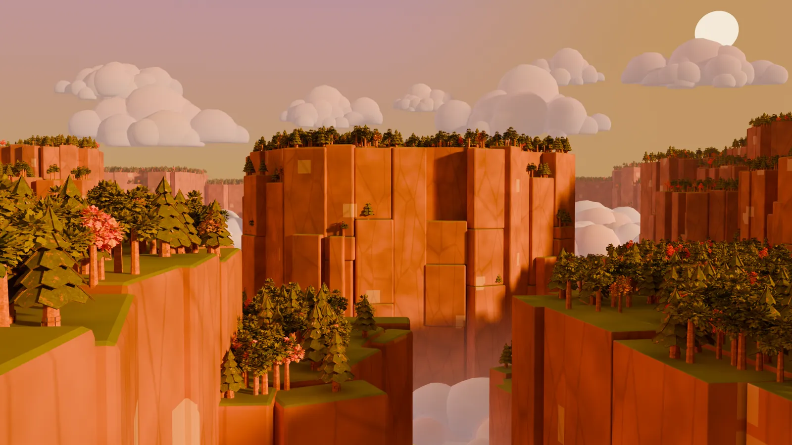

## Changing the style: terraces and a stepped island

When I looked at it in the game camera, the side islands still felt like separate drums. I wanted the sides to look like the cliffs in our older background: lots of small **terraces** going down towards the canyon, with trees on every step.

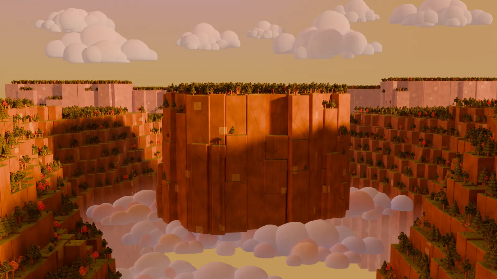

The central island also looked too flat. I wanted a big stepped plateau: wide layers stacked on top of each other, each a bit smaller, with a row of trees on every layer.

After a few rounds of feedback, the island got three big layers and a full crown of trees, it continues far down into the canyon so it doesn't just stop, and there are small islands under the clouds so the canyon doesn't look empty. I also made the canyon narrower so the sides fill more of the screen, and made the light a bit brighter.

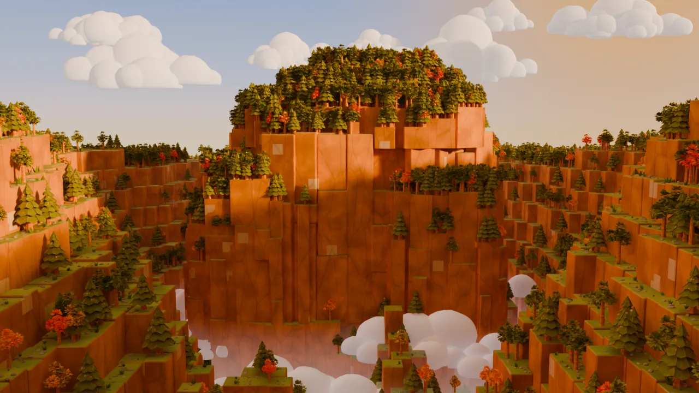

## Moving the camera

For Unity, I rendered the canyon as **separate layers**: the sky, the far cliffs, the middle with the island, the left and right foreground and the front clouds. Each layer is a transparent image, with a little extra room around the edges. In Unity, every layer moves at its own speed depending on how far away it is. This is called parallax, and it makes a flat background feel 3D.

These are the six layers the video below is made of, from back to front:

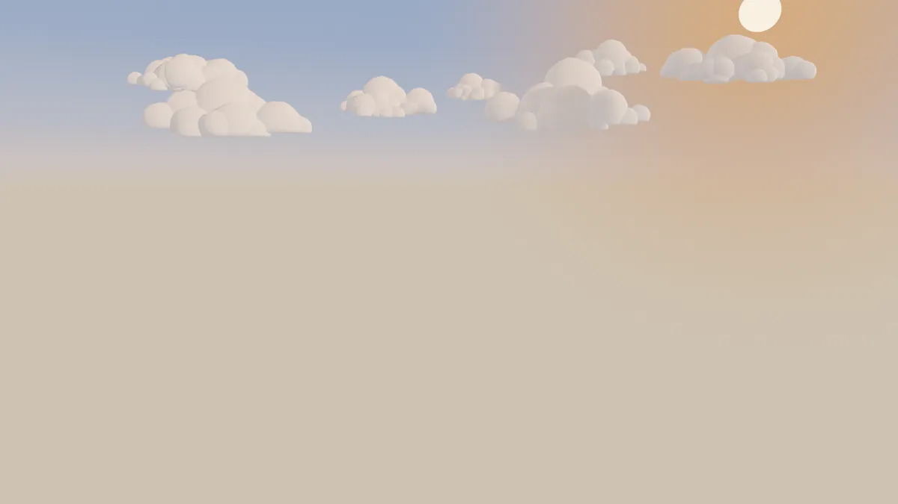

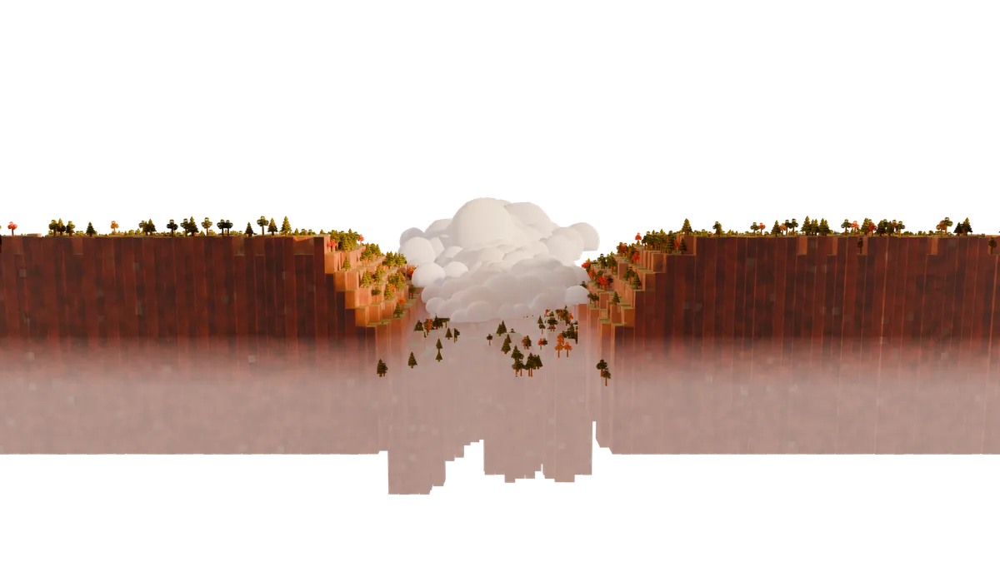

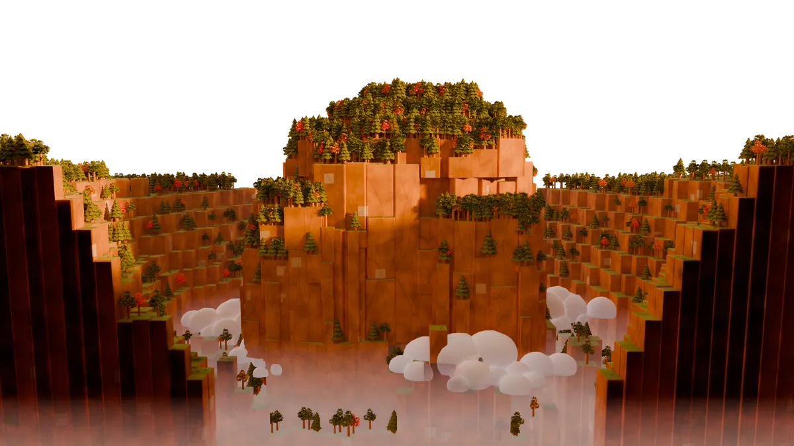

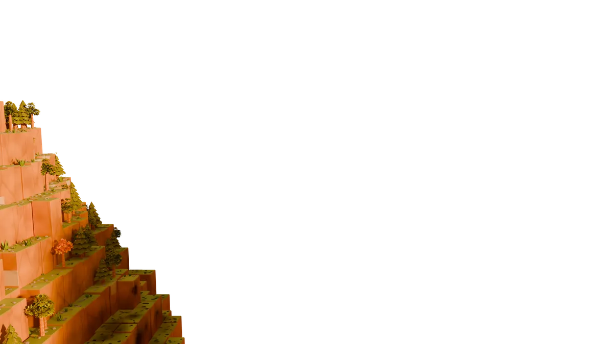

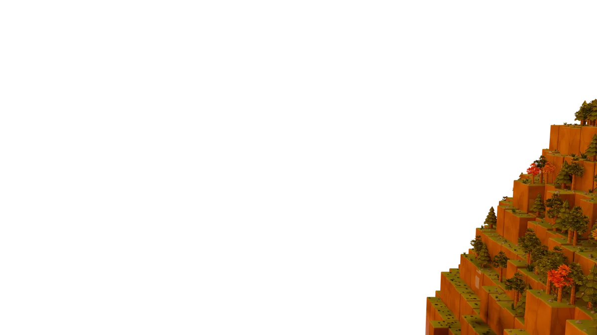

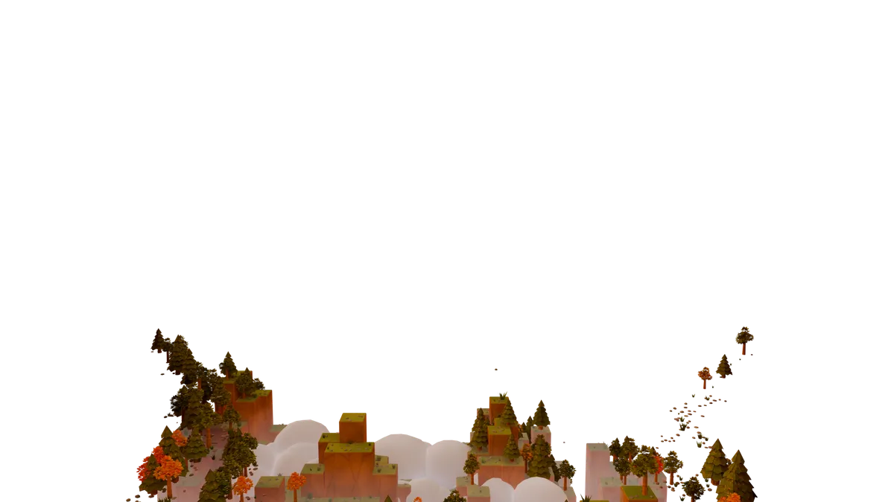

Put on top of each other, they make the full image again. In the video, the camera flies straight back: the close layers move and shrink the most, the island less, and the sky stays where it is.

<video autoplay loop muted playsinline preload="metadata" poster="../../videos/canyon-parallax-poster.jpg" style="width: 100%; max-width: 720px; display: block; margin-inline: auto; border-radius: 14px; margin-block: 1.5rem;">
  <source src="../../videos/canyon-parallax.mp4" type="video/mp4" />
  Your browser can't play this video.
</video>

Separate layers only work for small camera moves, though. For a longer move I rendered the real 3D scene: the camera flies straight back, away from the central island, through the narrow canyon.

<video autoplay loop muted playsinline preload="metadata" poster="../../videos/canyon-flight-poster.jpg" style="width: 100%; max-width: 720px; display: block; margin-inline: auto; border-radius: 14px; margin-block: 1.5rem;">
  <source src="../../videos/canyon-flight.mp4" type="video/mp4" />
  Your browser can't play this video.
</video>

## What I learned

- **Working in steps helps.** Checking one thing at a time (shape, composition, material, trees, atmosphere, light) made it much easier to give clear feedback and to see what wasn't working.
- **Look through the real camera.** The canyon looked fine from above, but in the game camera the side islands were too far away. The composition only really worked after I added the foreground.
- **Light changes colour.** The same cardboard looked bright orange in grey light and salmon pink in the warm sunset light. I had to adjust the cardboard colours and the exposure together with the light.
- **Fog can hide too much.** At one point the fog made the lowest cliffs disappear into the sky, while the green trees on top stayed visible. It looked like the trees were floating. Lower, softer fog fixed it.

## Next steps

- Render the parallax layers again for the final version of the canyon and put them in Unity with Lomme.
- Set the light in Unity with the same values as in Blender, so the Boxlings fit into the background.
- Test in the game how far the camera moves, and how much extra room the layers need.
