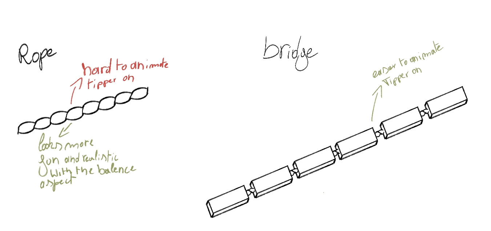
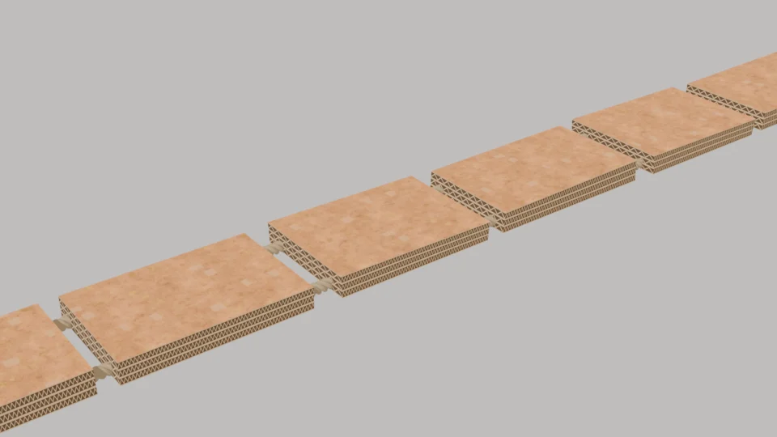
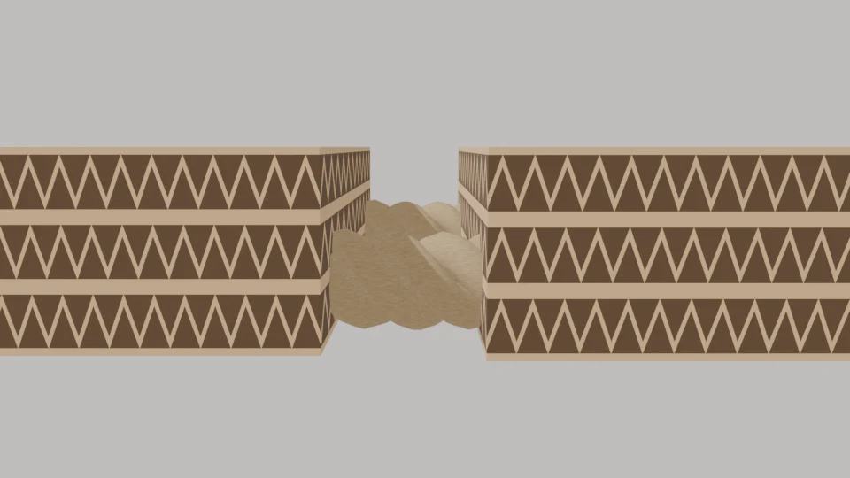
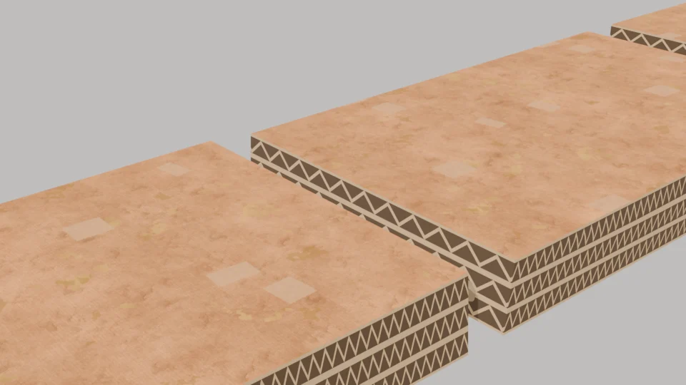
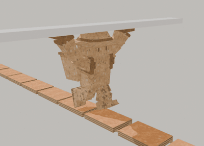

In our story, TIPPER carries the supplies home across the ropes that hang between the ravines. So the first idea was simple: TIPPER walks on a rope. But when we started working on his animations, that turned out to be harder than it sounds.

## Rope or bridge?

I made a quick sketch to compare the two options.

- **A rope** looks the most fun and fits the balance idea best. But TIPPER is a giant with big boxy feet. Placing those feet on a thin rope, step after step, looks strange and is very hard to animate.
- **A bridge** of small planks gives his feet something flat to stand on. His normal walk cycle works on it straight away, and it still looks wobbly and dangerous, because the planks only hang together with rope.

So we chose the bridge. It keeps the feeling of a rope, but TIPPER can actually walk on it.

## Cardboard planks

The planks are made the same way as the plank TIPPER carries in the game: a simple block with the same cardboard material, and corrugated cardboard on the edges. That way the bridge looks like it was cut from the same boxes as the rest of the world.

There are three versions of the plank, each just a little different in size, so the bridge doesn't look too perfect. At first, the gaps between the planks were wide, and sometimes TIPPER stepped right into the air. So I made the gaps smaller: one plank and one gap together are now exactly as long as two of his steps. That way his left foot always lands at the back of a plank and his right foot at the front, and he never steps into a gap.

## Real rope

My first version had a small knot between the planks, but that didn't look like rope at all. So I made real rope, using the method from the tutorial "Blender: Make Rope Fast & Easy":

1. **A few small circles** around a centre line, one for every strand.
2. **A Screw modifier** turns them around each other, so they become twisted strands.
3. **A Curve modifier** lets the rope follow a curve, so it hangs down a little between two planks.

At the end, I turned it into a normal mesh, so it also works in Unity.

Every gap has two ropes: one on the left and one on the right, just like a real rope bridge.

## A bridge that never ends

In the game, TIPPER walks in place and the world moves under him. So the bridge doesn't need to be very long: a row of about twelve planks slides backwards under his feet, and every plank that disappears behind him comes back at the front. Because the ropes always disappear into the cardboard, you never see where one piece stops. The two ropes look like they go on forever.

The speed of the bridge has to match the speed of his feet. If it's too fast or too slow, his feet look like they're sliding over the planks. In my walk cycle, his left foot moved back faster than his right foot, and his feet sometimes sank a bit into the ground. So I kept the walk as it was, but made the foot that stands on the ground move back at one steady speed, the same for both feet, with the sole exactly on the ground. Now the bridge can move at that same speed, and his foot stays exactly where it lands.

## What's next

- Put the planks and the rope in Unity, and build the moving bridge there.
- Let the bridge come to life: the plank under his foot dips a little, and the whole bridge sways when the plank on his head tips over.
- Connect the bridge to the cliffs at the start and the end of the level.

## What I'm taking with me

- **A quick sketch helps you choose.** Putting both options next to each other made the choice clear right away.
- **Pick what you can animate.** A rope looked nice, but the bridge keeps the same feeling and works with the animations we already have.
- **Small details make it real.** The knot looked fake. Twisted strands that hang down a little immediately look like rope.
