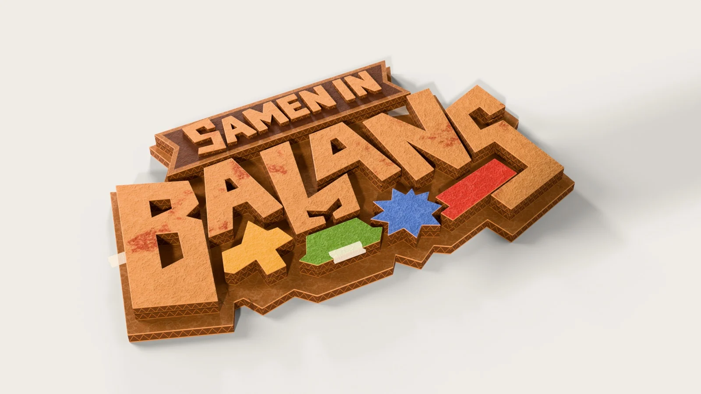
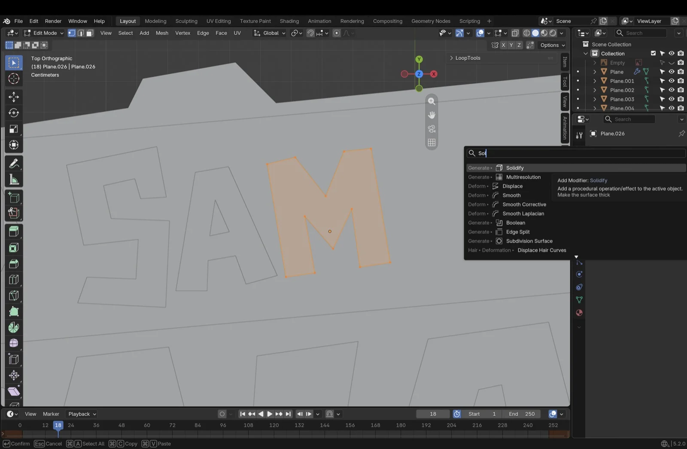
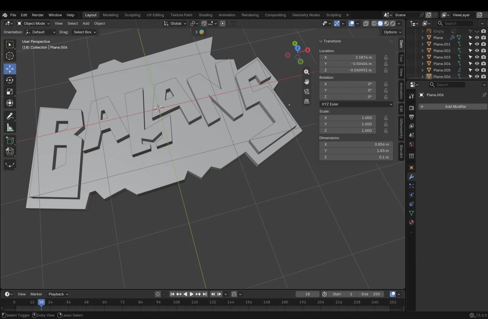
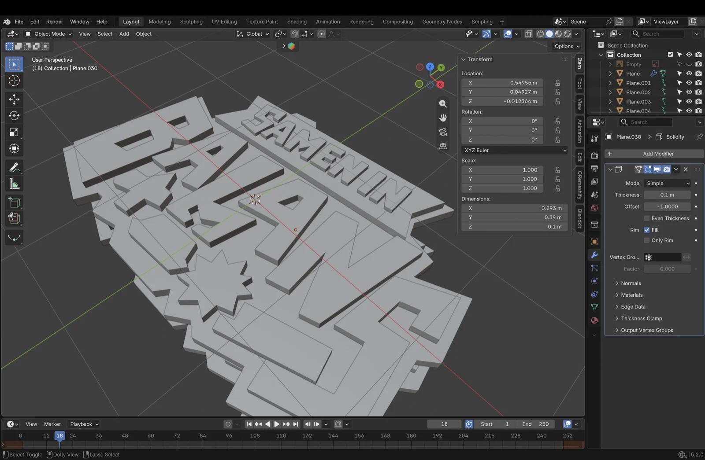
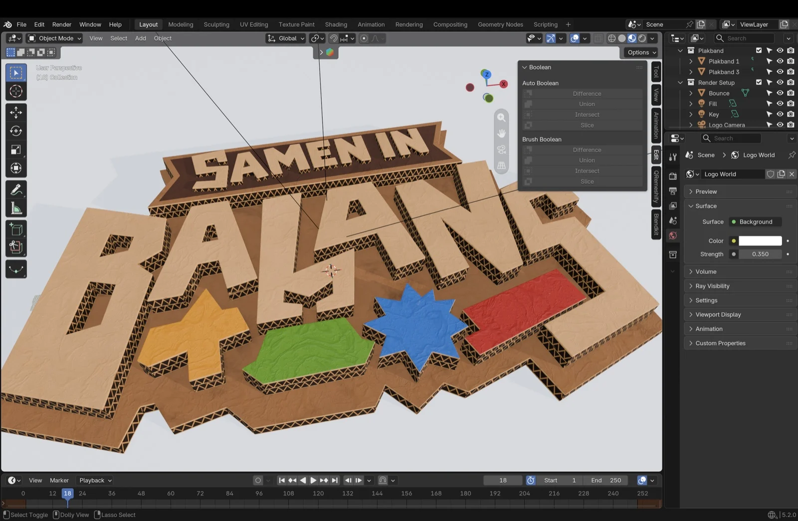
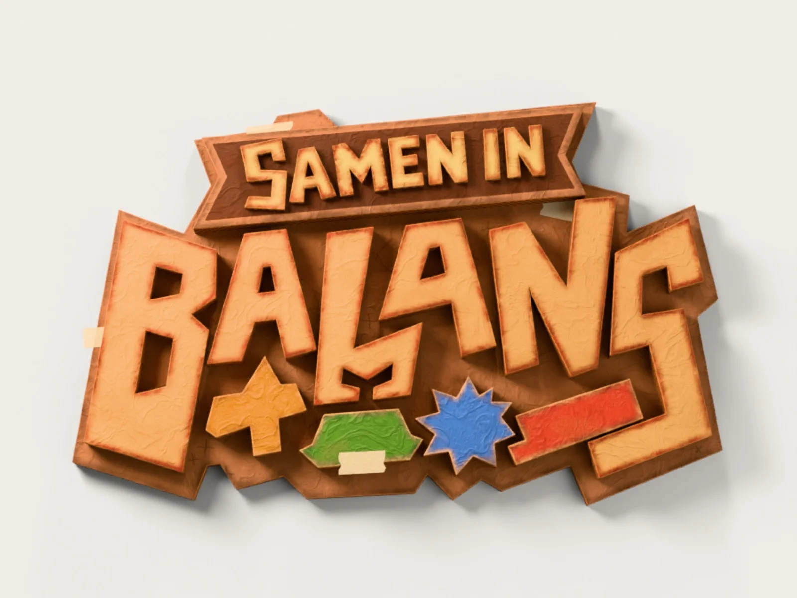
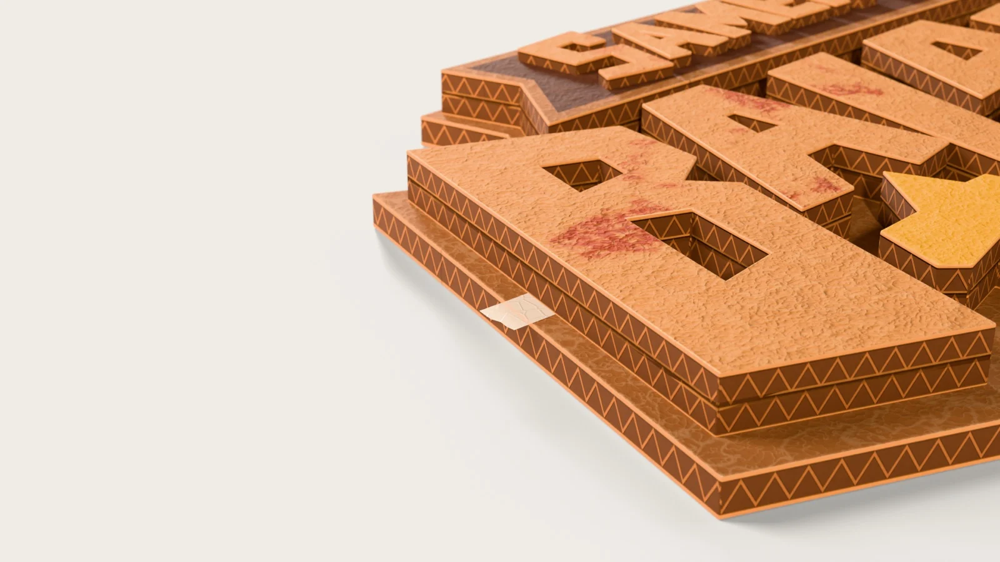

The Samen in Balans logo should look like it was cut out of old cardboard boxes by hand and glued together. That was the goal: it had to feel like something you could make yourself at the kitchen table, not like a clean digital logo. In this post I show how I built it in Blender, starting from the [logo Nikola designed](../logo-design/).

## The idea

Cardboard is cheap, everyone has it, and you can see right away that something was made by hand. It also fits the rest of our game, where the whole world is made of cardboard. So the logo is built from layers of cardboard: a big board as the base, a dark banner for "Samen in" and thick letters for "Balans". Under the letters are four painted shapes in the colours of the Boxlings: a yellow cross, a green hexagon, a blue star and a red bar.

## From sketch to 3D

I traced every letter and shape as a flat surface and then gave it thickness. That way everything stays angular and a little crooked, just like real cut cardboard.

1. **Tracing in top view.** In Top Orthographic I traced the outline of each letter point by point, for example the M of "Samen", and then filled the shape.
2. **Thickness with Solidify.** Every shape gets a Solidify modifier of 0.1 m: the thickness of one layer of cardboard.
3. **The board as the base.** First came the big board with its jagged edge, then the letters of "Balans" on top.
4. **Stacking layers.** Every letter has a copy underneath, a little lower. That makes the letters look like they're made of two layers of cardboard.
5. **Shapes and banner.** Then came the four coloured shapes, the banner and finally the letters of "Samen in".
6. **Finishing.** Every piece got a small Bevel modifier, so the edges just catch the light.

In total, the logo is made of thirty separate pieces of cardboard, plus a few pieces of tape.

## The cardboard material

The shape was done quickly, but making the cardboard really feel like cardboard took the most time. My first version used image textures and looked too smooth and too orange. In the end I made one procedural material without any images, which all pieces share. Only the colour and a few sliders differ per piece.

This is what's in it:

- **Crinkled paper on top.** Layers of noise and Voronoi cells make small folds, as if the paper was crumpled up and then flattened again.
- **Corrugated cardboard on the sides.** On the side faces, a triangle wave draws the zigzag of the flutes between two thin paper liners. The pattern adapts to the thickness of each piece.
- **Light, torn edges.** Where the top meets the side, a light paper edge appears, just like on a torn piece of cardboard.
- **Rust-coloured stains.** The letters of "Balans" have reddish-brown stains, mostly near the edges. The painted shapes don't.
- **Pencil marks on the board.** Little crosses and lines on the base, as if someone traced it out first.
- **Tape.** White and semi-transparent, so you can still see the cardboard underneath.

In the material you can set three things per piece: how many stains it has (Stain Amount), how much it crinkles (Crinkle) and whether it's painted (Paint).

## Camera and light

For the final images I placed the camera at an angle above the logo, as if it's lying on a table. That way the text stays readable and you also see the thick, layered corrugated edges.

- **Light:** a low, warm sun from the side brings out the crinkles and edges and casts a soft shadow on the table. The other lights are softer, so the whole thing doesn't get too orange.
- **Depth of field:** a little blur in the background (f/4 for the overview, f/2.4 for the close-up) makes it feel more tangible, like a photo of a real object.
- **Render:** Cycles, 1920 × 1080, 256 samples with denoising.
