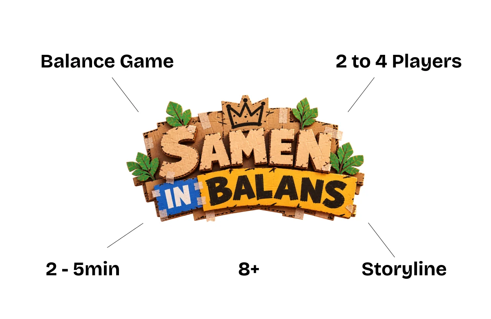
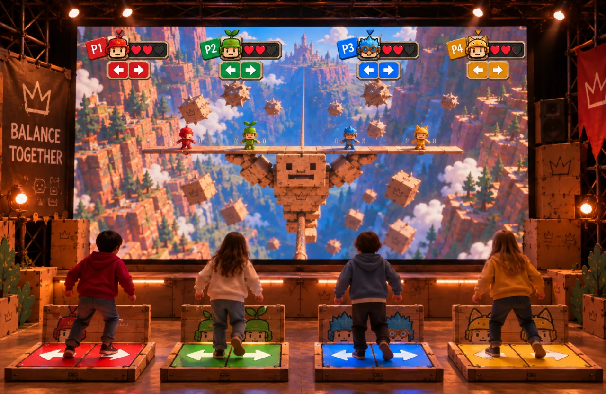
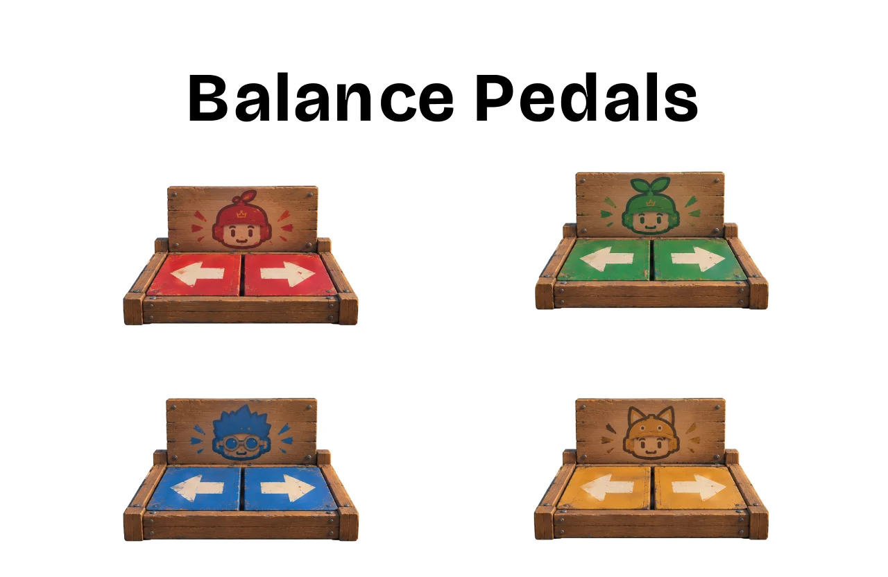
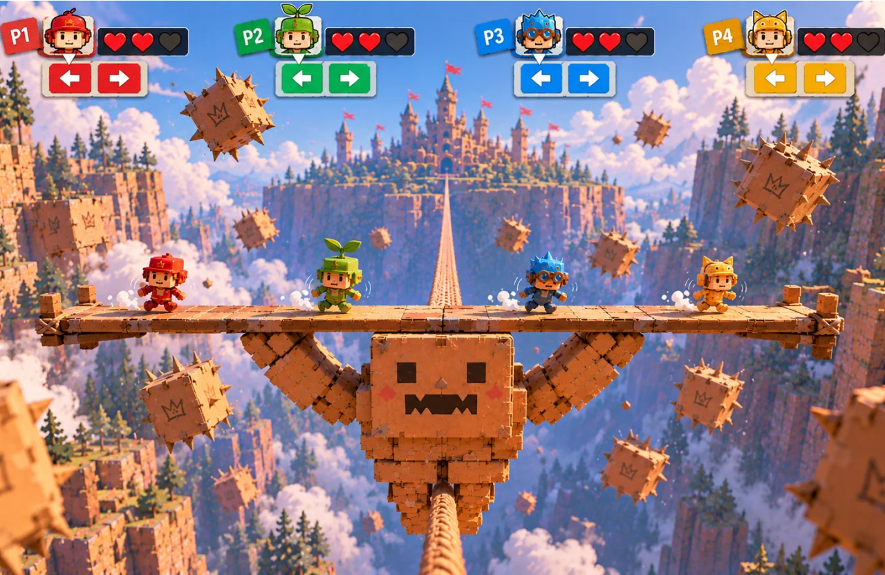
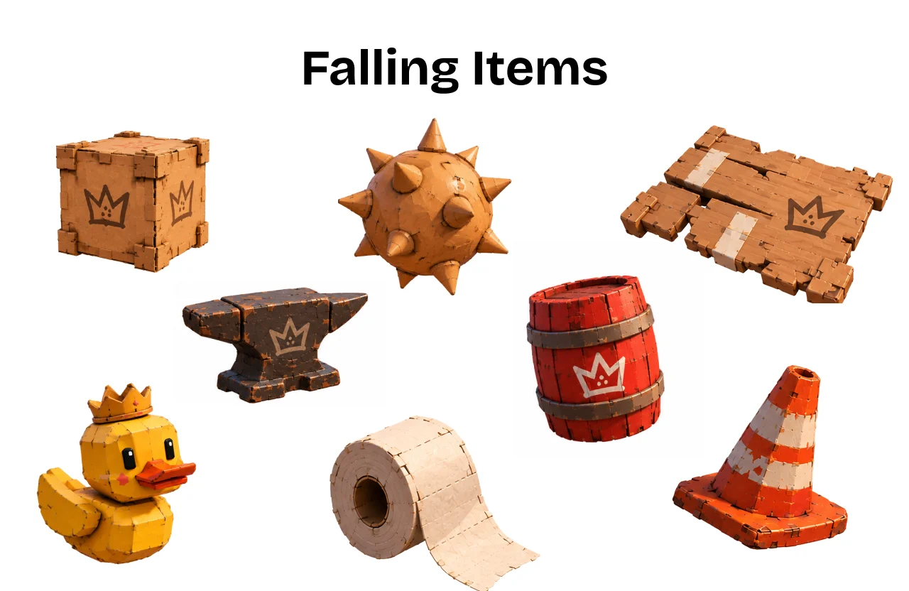
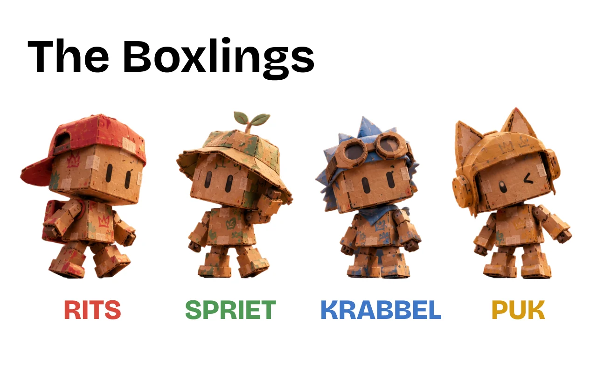
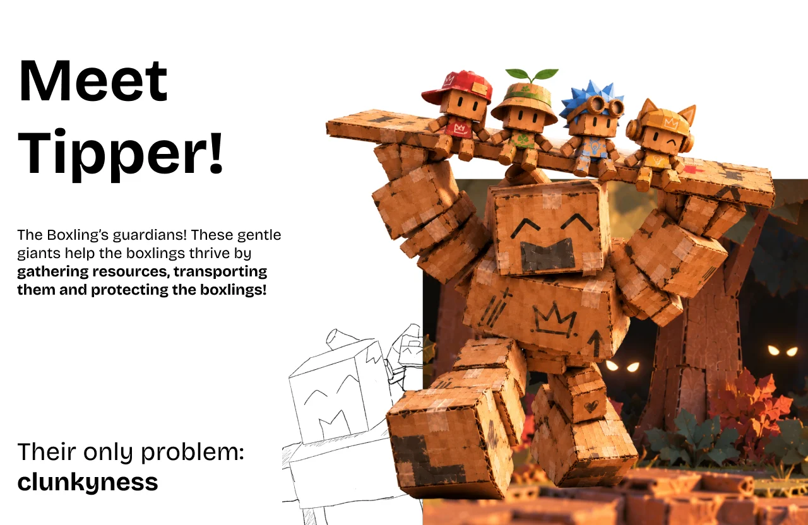

On 30 October we pitched our concept, Samen in Balans, to the other student teams working on a project for JEF. It was the first time we showed the whole idea to people outside our team: the game, the controllers, the characters and the story. Later we also sent the recording of this pitch to our client.

<video controls preload="metadata" poster="../../videos/jef-pitchdeck-poster.jpg" style="width: 100%; border-radius: 14px; margin-block: 1.5rem;">
  <source src="../../videos/jef-pitchdeck.mp4" type="video/mp4" />
  Your browser can't play this video.
</video>

## The game in one slide

Samen in Balans is a balance game for 2 to 4 players aged 8 and up. A session takes about 2 to 5 minutes and is built around a short storyline.

## How you play

The players stand next to each other on pressure pads in front of a big screen. On the screen, a big cardboard creature carries the players' characters on a plank across a ravine. Every player controls one character on that plank.

Each player has their own pedal with a left and a right side. Leaning to one side moves your character that way on the plank. Every pedal has its own colour, which matches the colour of your character on the screen.

The screen shows every player with their character, their lives and the direction they are leaning. That way each child can quickly see which character is theirs.

While the plank crosses the ravine, objects fall from the sky: crates, barrels, traffic cones, a rubber duck and more. The players have to react to them while they keep the plank in balance.

## The characters and the story

The players' characters are the Boxlings: small cardboard figures called RITS, SPRIET, KRABBEL and PUK.

They live in a kingdom that hangs high above the ravines on ropes, safe from the dangers of the world below. To gather supplies and bring them home, they rely on the Tipper: a gentle giant that collects and carries everything. Its only problem is that it is very clumsy. That is where the players come in: the Boxlings have to balance the Tipper across the ropes, so the supplies get home safely.

## What happened next

After the pitch, the other teams gave us feedback on the number of players, the pressure pads, the connection to the film festival, the start of a session and Tipper's story. You can read everything they said, and what we plan to do with it, in the [feedback report on this pitch](../../feedback/peer-concept-pitch/).

We also sent the pitch video to our client. Her feedback was about the use of AI, our team introduction, the research behind the concept and the durability of the foot controllers. You can read it in the [client's feedback on the pitch video](../../feedback/client-pitch-feedback/).
