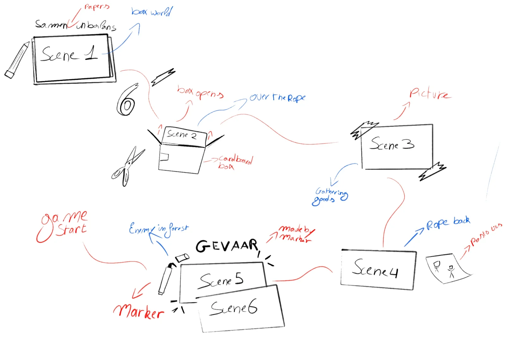

Before the game starts, the players see a short cutscene of about 10 to 15 seconds. It gives the children a small storyline to follow during the game, so they know why the Tipper is standing on that rope and why they have to keep it in balance.

## Inspiration: Slime Rancher 2

Our inspiration was the intro of Slime Rancher 2. Before you start playing, a short and playful intro shows you where you are and why you are there. It doesn't explain everything, but it gives you just enough story to understand the world. That is what we want too: no long introduction, only enough context to make the game make sense.

  <iframe src="https://www.youtube-nocookie.com/embed/fA_TP8WBQRA" title="Slime Rancher 2 intro" style="position: absolute; inset: 0; width: 100%; height: 100%; border: 0;" allow="accelerometer; clipboard-write; encrypted-media; gyroscope; picture-in-picture; web-share" referrerpolicy="strict-origin-when-cross-origin" allowfullscreen loading="lazy"></iframe>

## Cutting the storyboard down

We started from the [storyboard we made earlier](../storyboard/). That storyboard tells the full story in many panels, which is far too long for an intro. Children at a festival should not have to wait a whole minute before they can start playing.

So we played an elimination game: we took the most important scenes from the storyboard and asked ourselves, scene by scene, whether the story still works without it. These are the eight scenes we could choose from. The two faded ones are the scenes we cut:

  <figure>
    
    <figcaption>1. The kingdom at dawn</figcaption>
  </figure>
  <figure>
    
    <figcaption>2. Setting out</figcaption>
  </figure>
  <figure>
    
    <figcaption>3. Gathering in the woods</figcaption>
  </figure>
  <figure class="cut">
    
    <figcaption>4. Fully loadedCut</figcaption>
  </figure>
  <figure>
    
    <figcaption>5. Back on the rope</figcaption>
  </figure>
  <figure>
    
    <figcaption>6. Something is watching</figcaption>
  </figure>
  <figure class="cut">
    
    <figcaption>7. Ambush!Cut</figcaption>
  </figure>
  <figure>
    
    <figcaption>8. The Tipper tips</figcaption>
  </figure>

We removed **scene 4** and **scene 7**. Their message could be combined with the other scenes by changing those slightly, so the story still comes across. The Tipper being fully loaded can already be seen while gathering supplies, and the danger of the ambush can be shown in the moment the creatures appear and the Tipper starts to tip. That leaves six scenes.

## The concept: photos on a table

The cutscene is shown from a **top-down view**. The camera moves over a table on which photos of our cardboard world are lying.

The camera glides smoothly **from photo to photo**, and every photo tells the next part of the story. During these transitions, small handwritten notes, keywords and drawings appear on the table to support the story. For example, the word **"GEVAAR!"** ("danger") is drawn around a photo with a thick black marker, while a pencil writes the title **"Samen in Balans"**.

By combining camera movements, photos and animated drawings, we want to introduce the story in a playful and creative way, fully in the **handmade cardboard style** of our game.

## How the cutscene flows

The sketch shows the order of the scenes and what happens around each photo:

1. **Scene 1, the box world.** The first photo shows the kingdom. Next to it, a pencil writes the title "Samen in Balans" on paper.
2. **Scene 2, the box opens.** A cardboard box opens, with scissors lying next to it, and the Tipper sets out over the rope.
3. **Scene 3, gathering goods.** A picture taped to the table shows the Tipper and the Boxlings gathering supplies in the forest.
4. **Scene 4, the rope back.** The Tipper walks back over the rope. Post-its with little drawings sit next to the photo.
5. **Scene 5, an enemy in the forest.** Eyes appear between the trees, and a marker draws "GEVAAR!" around the photo.
6. **Scene 6, the Tipper tips.** The last photo lies on top of the previous one: the Tipper starts to lose its balance.

Right after the last photo, the game starts. The children now know what is happening, and it is up to them to keep the Tipper in balance.

## Next steps

Our client agreed that an intro of about 10 seconds works well and that it should play right before the game, without a waiting queue. We will make a first version, test different lengths during user testing and make sure the switch from the cutscene to the game is clear. You can read more in the [feedback report of that meeting](../../feedback/client-meeting-2026-11-10/).
