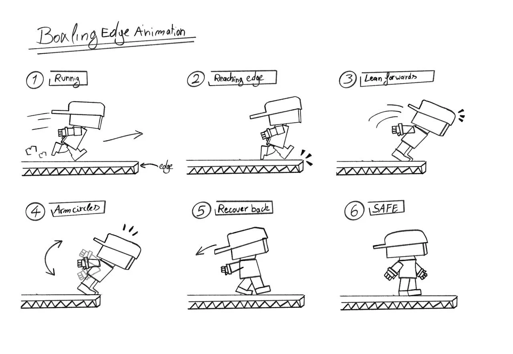

In our game the Boxlings stand together on a plank that tilts. The players have to keep it in balance by moving the Boxlings around. There's one thing they can't do: walk off the side of the plank. If a Boxling could just fall off there, the game would get way too hard, especially for young children who are still figuring out how the foot pedals work.

So the side of the plank works like an invisible wall. But a wall that suddenly stops you doesn't feel good. You don't understand why your Boxling won't move any further. That's why I made an **edge animation**: when a Boxling gets too close to the edge, he leans over it, stands on the tip of one foot and waves his arms wildly to keep his balance. That way the player sees right away: careful, this is the edge, go back.

## The sketch

Before animating, I first sketched the whole moment in six steps: the Boxling runs, reaches the edge, leans forward over it, circles his arms to keep his balance, steps back and is safe again. Steps 3 and 4 are the part I animated in this post.

## Animating in Blender

I animated [RITS](../rits-boxling/) first, because he was the first Boxling I made. The edge animation is a short loop of 18 frames, so it can keep playing for as long as the Boxling stands at the edge.

1. **The base pose.** I started from a copy of the idle animation and tilted the whole body forward with the spine bones, until RITS hangs over the edge. He stands on the toes of one foot, and the other leg comes up behind him.
2. **The arms.** In the Action Editor I keyed the left arm on frames 1, 6, 9, 12, 14 and 18. The upper arm makes a big circle and the forearm follows a little later (on frames 1, 4, 7, 11, 14 and 18). Because the forearm is a bit behind, the movement feels loose and panicked instead of stiff.
3. **The legs.** The lifted leg swings gently along on frames 1, 9 and 18, as if he's trying to find his balance with it.
4. **A clean loop.** Frame 18 is exactly the same as frame 1, so the animation loops without a jump.
5. **The other arm.** The right arm got the same movement as the left arm, but mirrored and half a loop later. When the left arm is stretched out, the right one is bent, so the arms keep going around one after the other, like windmills.

I worked in Solid view the whole time, without textures. That way Blender stays fast and I could focus on the pose and the timing.

## The process as a timelapse

I recorded the whole session on screen. Here are those 32 minutes sped up to one minute: from the first pose to the finished loop in the Action Editor.

<video autoplay loop muted playsinline preload="metadata" poster="../../videos/edge-timelapse-poster.jpg" style="width: 100%; border-radius: 14px; margin-block: 1.5rem;">
  <source src="../../videos/edge-timelapse.mp4" type="video/mp4" />
  Your browser can't play this video.
</video>

## The result

This is the loop with RITS's own textures, standing on the edge of a plank.

<video autoplay loop muted playsinline preload="metadata" poster="../../videos/edge-loop-poster.jpg" style="width: 100%; border-radius: 14px; margin-block: 1.5rem;">
  <source src="../../videos/edge-loop.mp4" type="video/mp4" />
  Your browser can't play this video.
</video>

## Next steps

- Bring the animation into Unity and play it when a Boxling reaches the edge of the plank.
- Make the same animation for the other three Boxlings, so every Boxling reacts to the edge in the same way.
