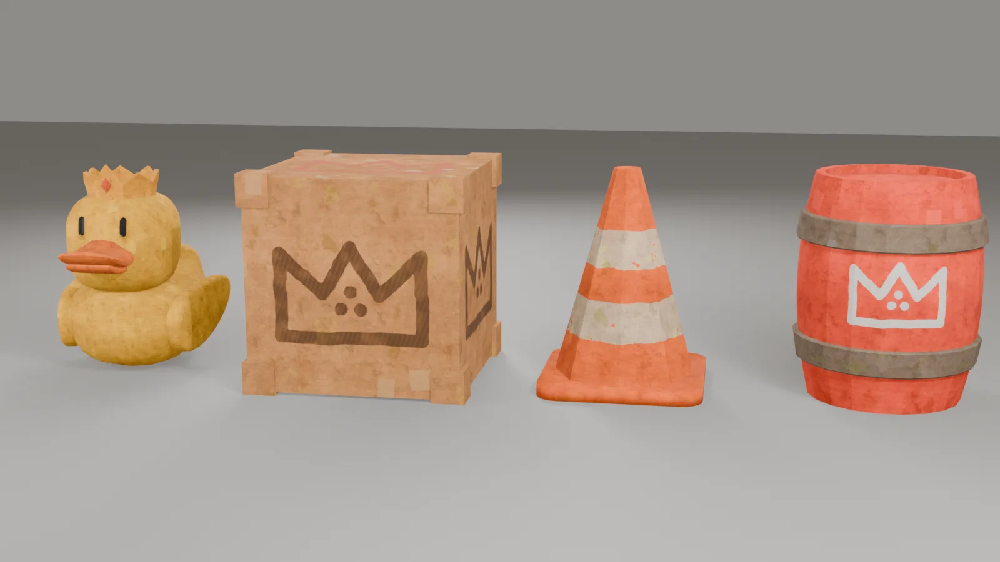
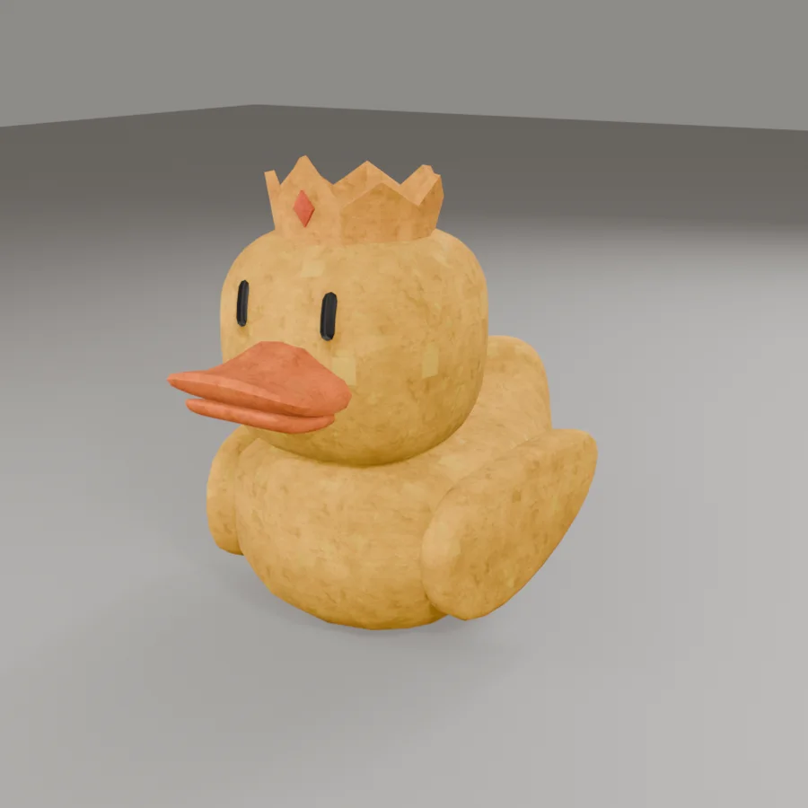
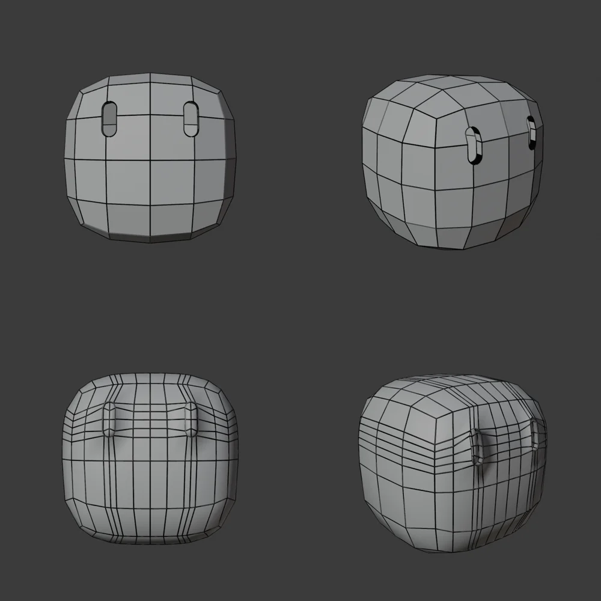
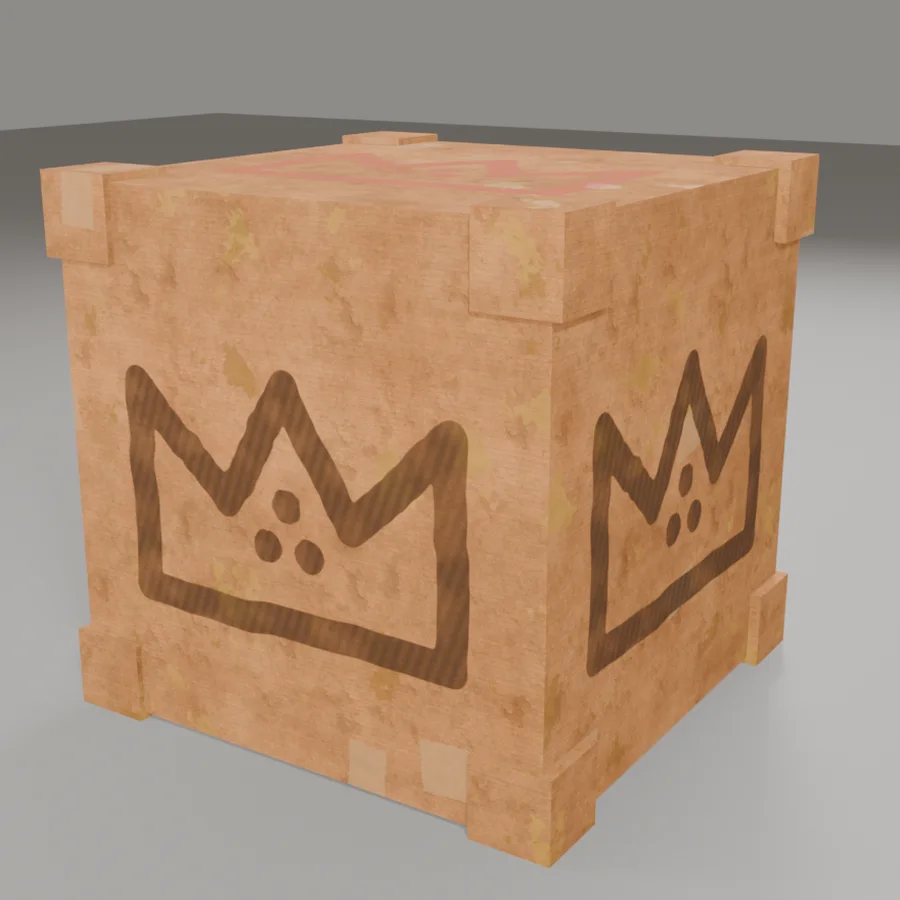
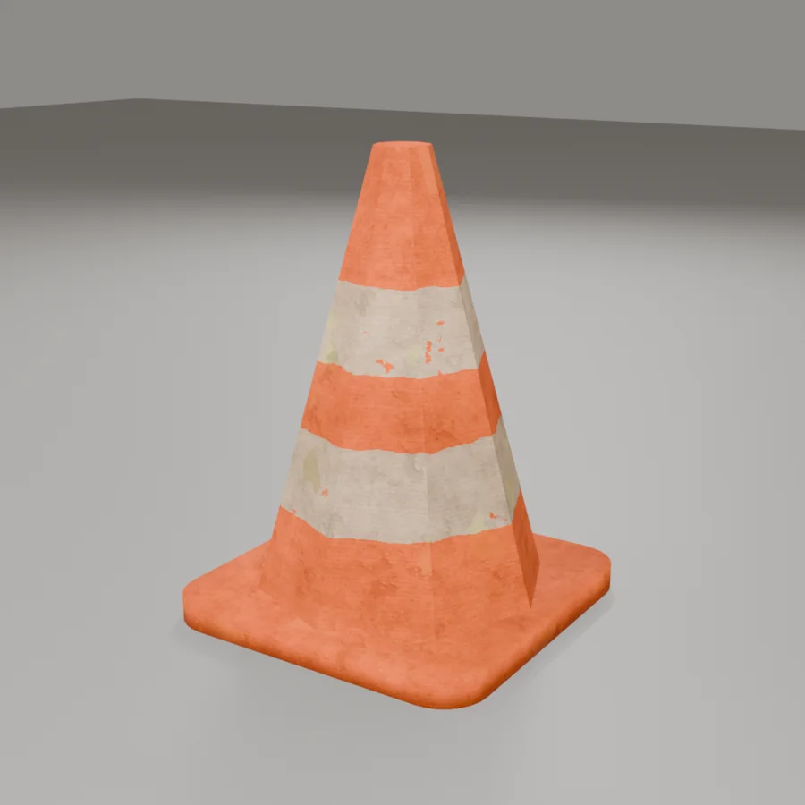
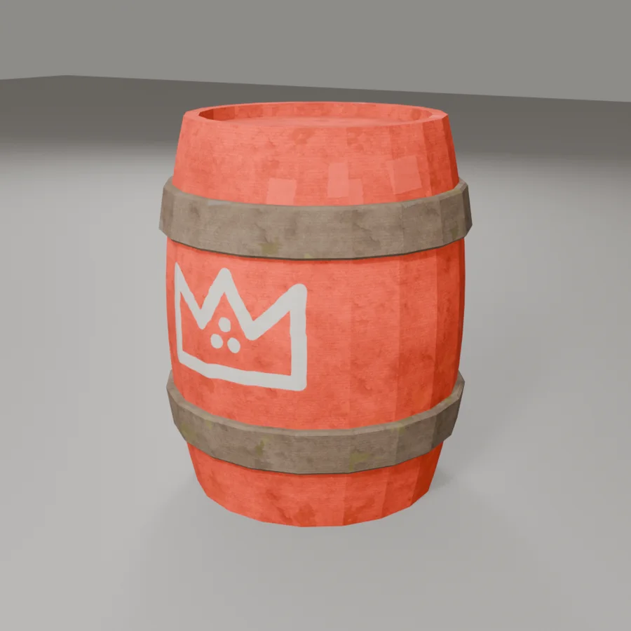

In Samen in Balans, the four Boxlings stand together on one long plank. To make keeping that plank in balance harder, things will fall from above and land on it. This week I made the first four of those falling objects: a rubber duck, a box, a traffic cone and a barrel.

## One world, one material

The most important rule for these props: they have to look like they belong in the same world as the Boxlings. Everything in the game is made of old cardboard, so every object uses exactly the same cardboard material as RITS, SPRIET, KRABBEL and PUK, with the same grain, wear and pieces of tape. The only thing that changes per object is the colour of the paint on top.

The crown keeps coming back as well. It's the symbol of the Boxlings, so it shows up on the box and the barrel in the same hand-painted style as on RITS's chest, and the duck wears one on its head.

## The duck

The duck is the cutest object of the four: yellow, with an orange beak and a little crown.

The head needed some work. I had cut the eyes straight into the head, through the existing grid. That left big polygons with 14 to 22 corners around the eyes, which looked messy once the model was smoothed. I rebuilt the head with the same shape, but now with extra edge loops running exactly along the eyes, so the whole head is made of clean four-sided faces. The eyes are now small sockets pushed into the head.

The eyes also had to match the Boxlings: the same black capsule shape, about three times as tall as they are wide, and set slightly into the head. My first sketch had a white highlight in the eyes, but the Boxlings don't have one, so I left it out.

## The box

A plain cardboard box, which fits a cardboard game perfectly. Each side has a painted crown with three dots, dark brown on the sides and red on top.

My first crown looked like it was sprayed on with a spray can, with very rough, fuzzy edges. That didn't match the reference at all, so I repainted it as one thick, solid brush stroke with a smooth, slightly hand-drawn edge.

## The traffic cone

The cone is orange cardboard with two cream-white stripes. The stripes have a slightly wavy edge, as if they were painted by hand, and in a few places the white paint has worn off so the orange shows through. The stripes follow the height of the cone itself, so they stay in place when it tumbles down.

## The barrel

The barrel was the trickiest to keep in style. In the reference it looked like wood, but in our game everything is cardboard, so it got red cardboard with grey cardboard bands instead of metal ones. I also changed the proportions to match the reference better: taller than it is wide, bulging in the middle, with a sunken lid and two raised bands. On the front is the same painted crown as on the box, in white.

## What I'm taking with me

- **Reuse your materials.** One shared cardboard material made four very different objects look like they belong together right away.
- **Repeat your symbols.** The crown links the props to the Boxlings without having to explain anything.
- **Clean topology pays off.** Cutting details straight into a mesh is quick, but it breaks as soon as you smooth the model. A few extra edge loops fix that.
- **Stay true to your world.** Even when a reference shows wood or metal, in a cardboard world it stays cardboard.
