In the [foot pedals post](../foot-pedals-movement/), the players stood on loose USB foot switches on the floor. In the [setup post](../technical-setup/), every player got a foot box with two panels. This time I worked out what's inside those boxes: how a foot panel presses a foot switch, how strong it has to be for jumping children, and what we need to buy to build four of them.

## My sketches

I started with two sketches. The first one shows the four foot boxes from above and from the front. Every box has the colour of its Boxling, a left and a right arrow, and a sign at the back with the face of the Boxling.

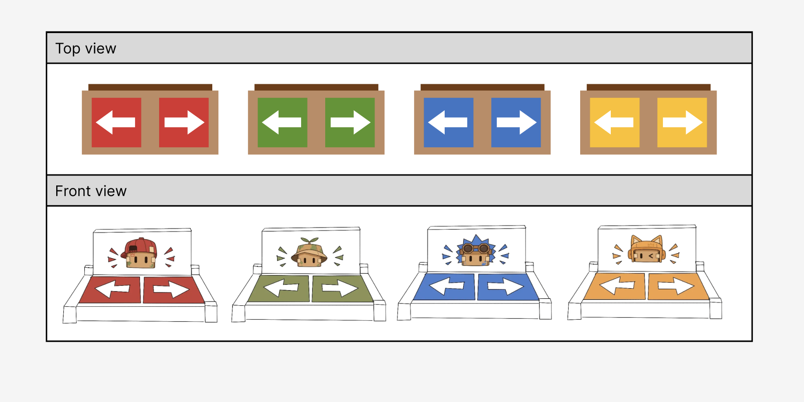

The second sketch shows the idea on the inside. The foot panel rests on springs. Under the panel there's a wooden block, and under that block lies the foot switch. When you step on the panel, the springs are pressed in, the block pushes the foot switch and the Boxling moves. When you step off, the springs push the panel back up.

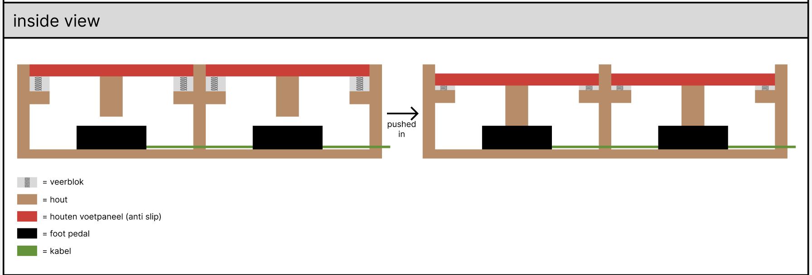

## From sketch to 3D

From these sketches, I let Claude make 3D drawings of one foot box. One box is 90 cm wide, 81 cm deep and only 9 cm high, so children can easily step on it. The sign at the back is 49 cm high.

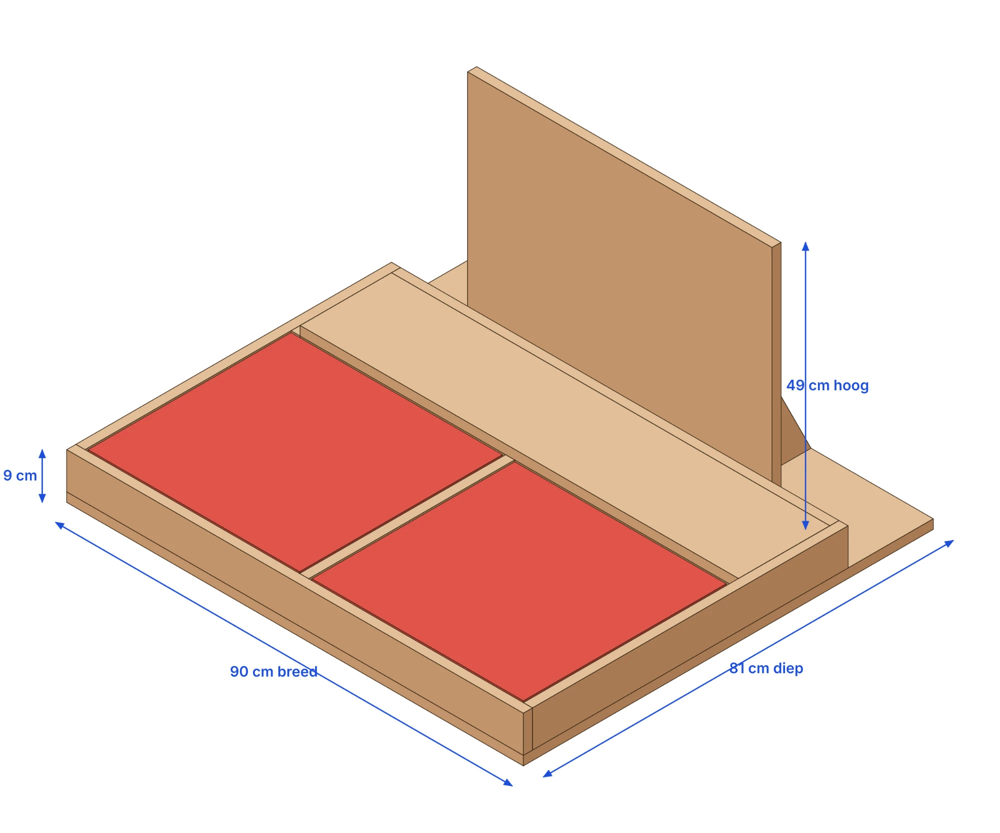

The exploded view shows all 17 parts at once: from the base plate at the bottom to the two red foot plates on top.

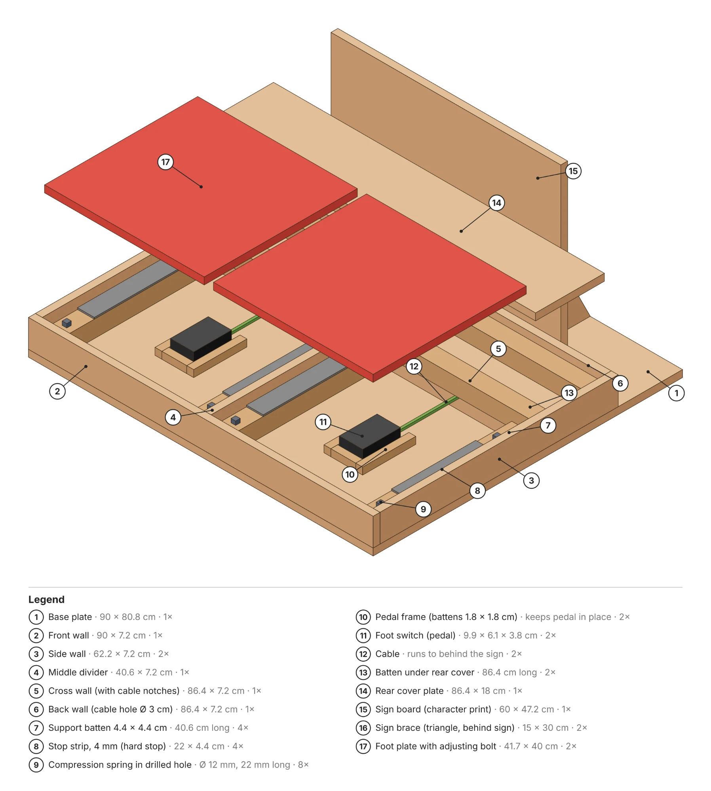

## Step by step

To make it easier to build, the box is drawn in five steps.

**1. The frame.** A base plate with a front wall, two side walls, a middle divider between the left and right panel, a cross wall and a back wall. The cross wall has notches and the back wall has a hole of 3 cm, so the cables can go to the back.

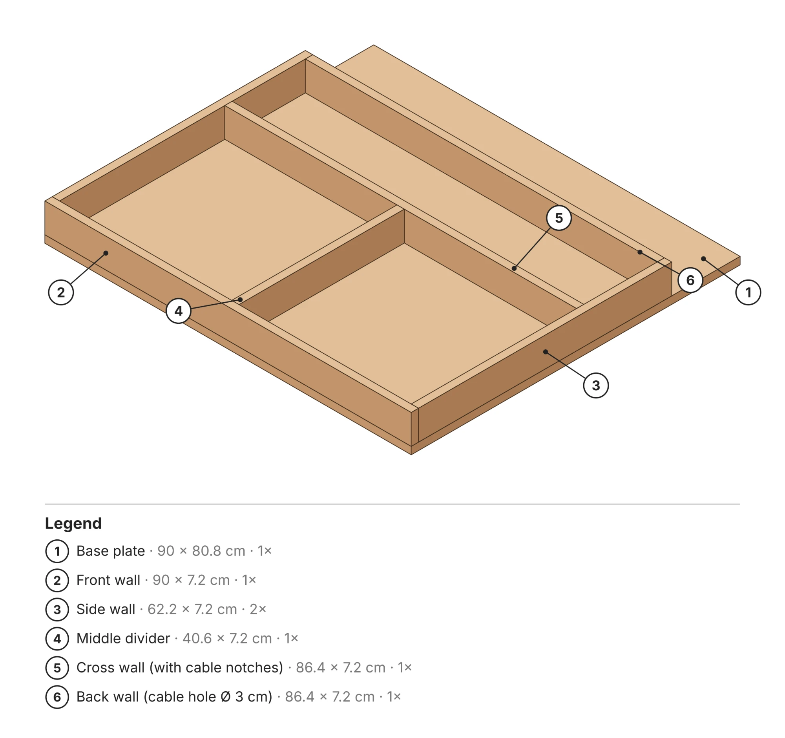

**2. The battens.** Support battens along the walls carry the foot plates. On top of them lie thin stop strips of 4 mm. Two more battens carry the cover plate at the back.

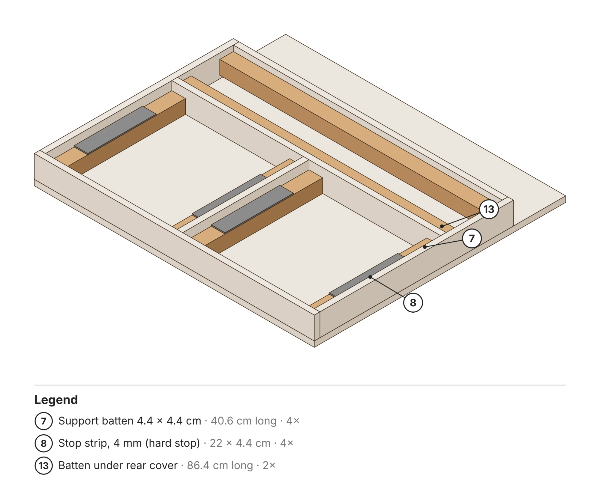

**3. The foot switches.** Every compartment gets one FS221-P foot switch, the same ones from the pedals test. A small frame of thin battens keeps it in place, and its cable runs to the back.

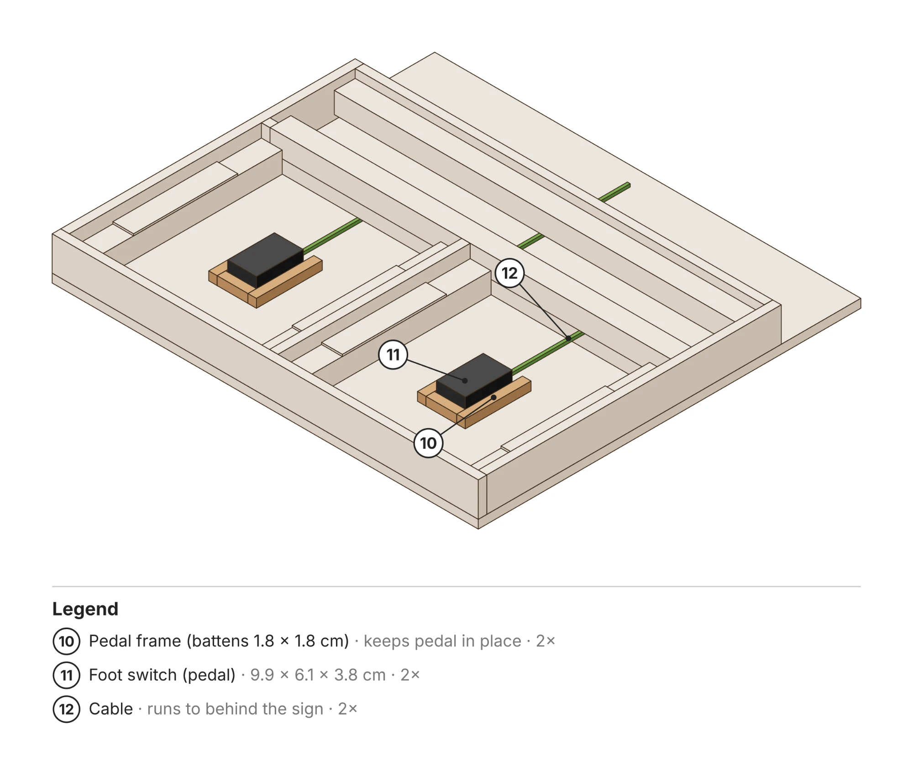

**4. The cover and the sign.** A cover plate closes the back part, where the cables are. The sign with the Boxling stands behind it, held by two triangles.

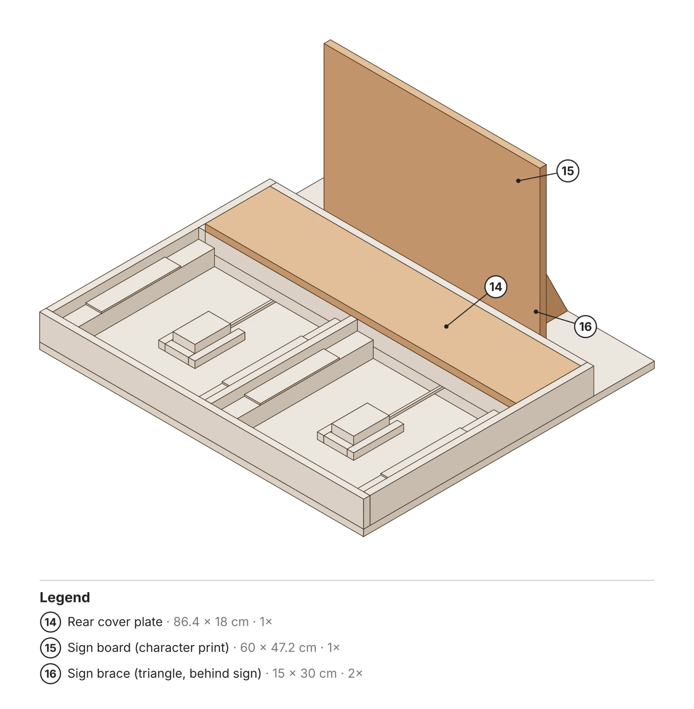

**5. The springs and the foot plates.** Four springs sit in drilled holes in the support battens of each compartment. The foot plates lie loose on top of them.

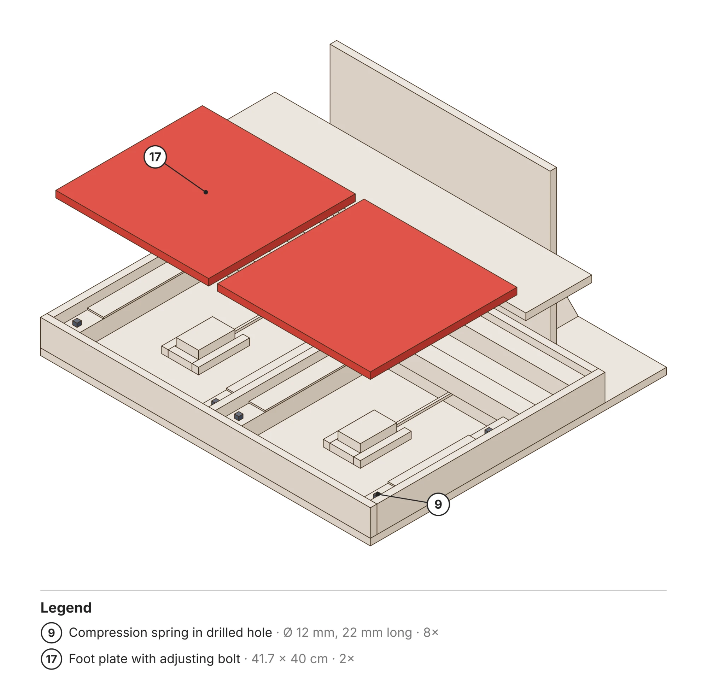

## How a step works

The most important part is what happens when a child steps on a foot plate. A foot switch can't carry the weight of a jumping child, so the weight must never go to the switch itself.

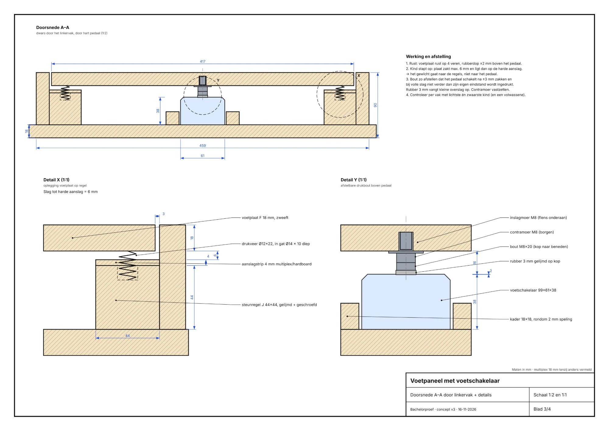

- **At rest,** the foot plate rests on four springs. Under the plate is a bolt with a little rubber on its head, about 2 mm above the foot switch.
- **When a child steps on it,** the plate goes down. After about 3 mm, the bolt presses the foot switch and the Boxling moves.
- **At 6 mm,** the plate lands on the stop strips. From there, all the weight goes to the wooden battens, and not to the foot switch. The rubber catches the last bit.
- **When the child steps off,** the springs push the plate back up.

The bolt can be turned higher or lower, so we can adjust exactly when the switch is pressed. We'll test every compartment with the lightest and the heaviest child (and an adult).

A few things are there for safety:

- **A gap of 3 mm** around every foot plate. That's enough to move freely, but too narrow for children's fingers. It must not be made bigger.
- **Rounded edges** on all the top edges and the corners of the sign.
- **A removable cover plate** that's only screwed and not glued, so we can still get to the cables and the foot switches.

## The technical drawings

Claude also made four technical drawings, with every measurement in millimetres. With these we can cut and build the boxes.

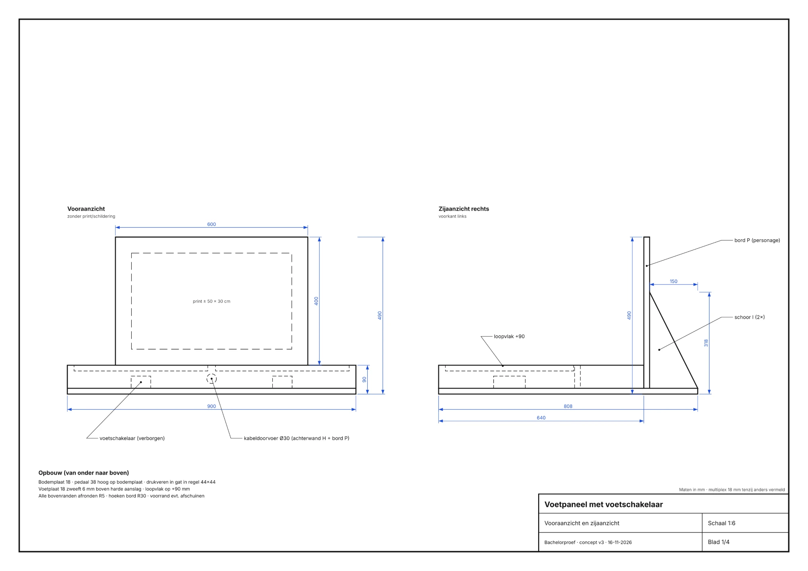

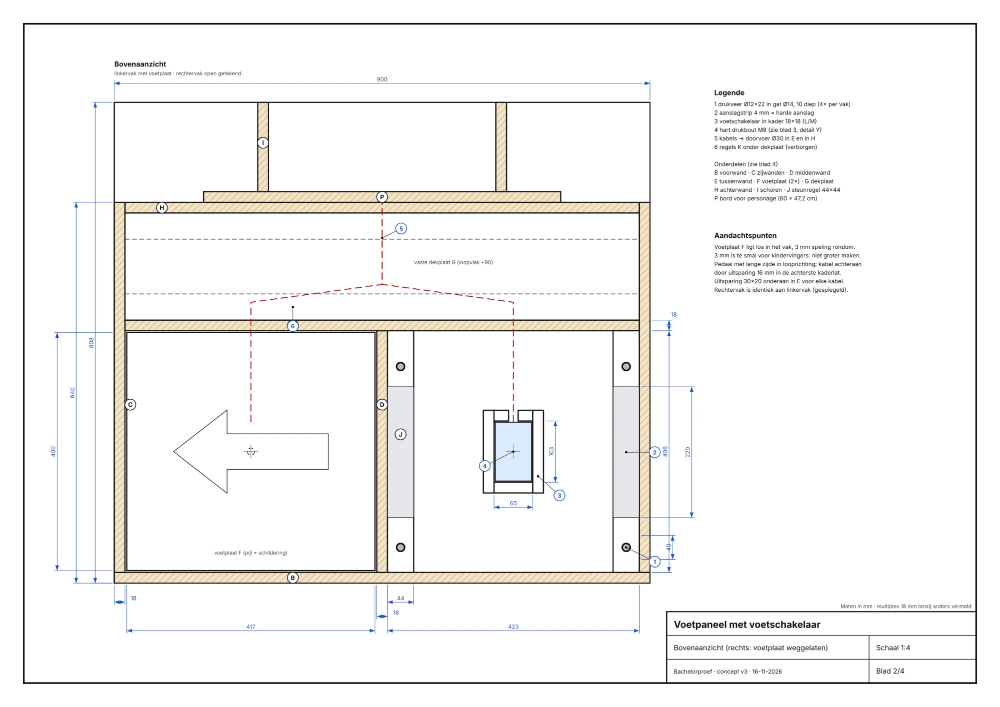

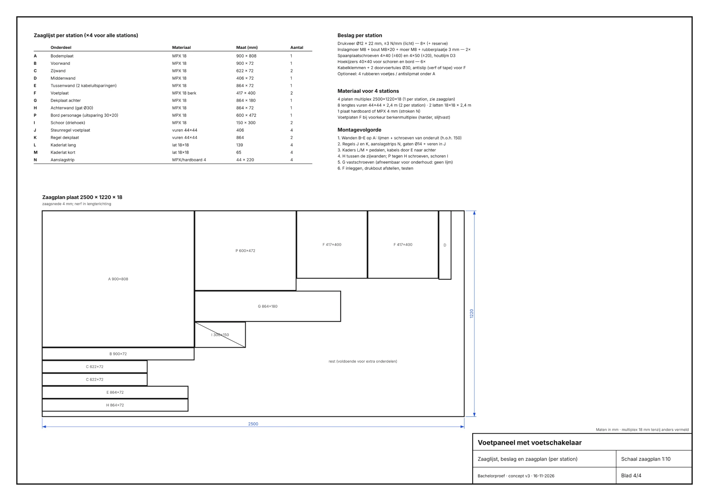

The cutting plan on the last sheet shows that all the plywood parts of one box fit on one sheet of 250 by 122 cm, with some left over for extra parts.

## The shopping list

Claude also turned the drawings into a shopping list for all four foot boxes, with prices from Gamma and Hubo. To keep it cheap, it changes a few things compared to the drawings:

- **MDF instead of multiplex.** It's cheaper, and the support battens and pedal frames can be cut from what's left of the boards.
- **Rubber draught strip instead of springs.** Two layers on the ends of every support batten, and the foot plate springs back on them.
- **A screw instead of the M8 bolt.** One screw under every foot plate, above the foot switch. We can still turn it in or out to adjust it.

The photos come from the web shops, and the links go to the product. Prices include VAT and were checked on 16 November 2026.

  
<b>€ 219.62</b>in total, foot switches included

  
<b>€ 164.67</b>still to buy

  
  

    
MDF board 18 mm

    
244 × 122 cm · <b>buy 4 boards</b>

    
Base plate, walls, foot plates, cover plate, sign and braces, and the support battens and pedal frames, cut from what's left.

    
<a href="https://www.gamma.be/nl/assortiment/mdf-plaat-244-x-122-cm-18-mm/p/B284873">View at Gamma ↗</a>

  

  
<b>€ 123.96</b>4 × € 30.99

  
  

    
Hardboard 3.2 mm

    
122 × 61 cm · <b>buy 1 sheet</b>

    
The stop strips: the foot plate lands on them, so the foot switch never gets the full weight.

    
<a href="https://www.gamma.be/nl/assortiment/hardboard-plaat-naturel-122-x-61-cm-3-2-mm/p/B110088">View at Gamma ↗</a>

  

  
<b>€ 3.89</b>1 × € 3.89

  
  

    
Rubber draught strip, P-profile

    
self-adhesive, 2 × 3 m · <b>buy 2 packs</b>

    
Replaces the springs: two layers on the ends of every support batten. The foot plate springs back on it.

    
<a href="https://www.gamma.be/nl/assortiment/handson-tochtband-p-profiel-2x-3-m-antraciet/p/B555383">View at Gamma ↗</a>

  

  
<b>€ 11.18</b>2 × € 5.59

  
  

    
Chipboard screws 4 × 40 mm

    
box of 200 · <b>buy 1 box</b>

    
For the walls, the support battens and the cover plate. And one screw under every foot plate, as the adjusting screw above the foot switch.

    
<a href="https://www.hubo.be/nl/p/pgb-fasteners-spaanplaatschroeven-vzk-t-drive-voldraad-4x40-mm-verzinkt-200-stuks/393767/">View at Hubo ↗</a>

  

  
<b>€ 6.69</b>1 × € 6.69

  
  

    
Universal screws 4 × 30 mm

    
box of 200 · <b>buy 1 box</b>

    
For the frames around the foot switches, the sign and the braces. They're shorter, so they don't go through two layers of wood.

    
<a href="https://www.gamma.be/nl/assortiment/ok-schroef-universeel-4-0x30-mm-verzinkt-200-stuks/p/B458439">View at Gamma ↗</a>

  

  
<b>€ 6.99</b>1 × € 6.99

  
  

    
Paint testers, matt wall paint, 55 ml

    
red, green, blue and orange · <b>buy 4 pots</b>

    
The foot plates in the colour of each Boxling, one pot per foot box.

    
<a href="https://www.gamma.be/nl/assortiment/gamma-mengbare-kleurtester-muurverf-mat-55-ml/p/B371774">View at Gamma ↗</a>

  

  
<b>€ 11.96</b>4 × € 2.99

**Already there, nothing to buy**

- **Foot switches:** a set of 8, one under every foot plate. We already bought them for € 54.95.
- **Prints of the Boxlings:** A3 or A2 in colour, glued onto the signs. We can print them at school.
- **Sandpaper,** grit 80 and 120, to round off all the edges. We can borrow it from school or bring it from home.
- **Wood glue** is optional: the screws hold everything together.

## What's next

With the drawings and the shopping list, we can buy the materials and start building. We'll build one box first and test it with children, to check the springs and the adjusting bolts, before we make the other three.

## What I'm taking with me

- **A rough sketch is enough to start.** My two sketches had the whole idea in them. The 3D and technical drawings worked it out in detail.
- **Protect the electronics.** The foot switch only has to be pressed, not carried. The stop strips take the weight, so the switch survives jumping children.
- **Make it adjustable.** Every child is different, and every foot switch too. The adjusting bolt lets us fix that without rebuilding the box.
- **Think about building it too.** Drawing the box in steps, with a cut list and a cutting plan, makes building four of them much easier.
