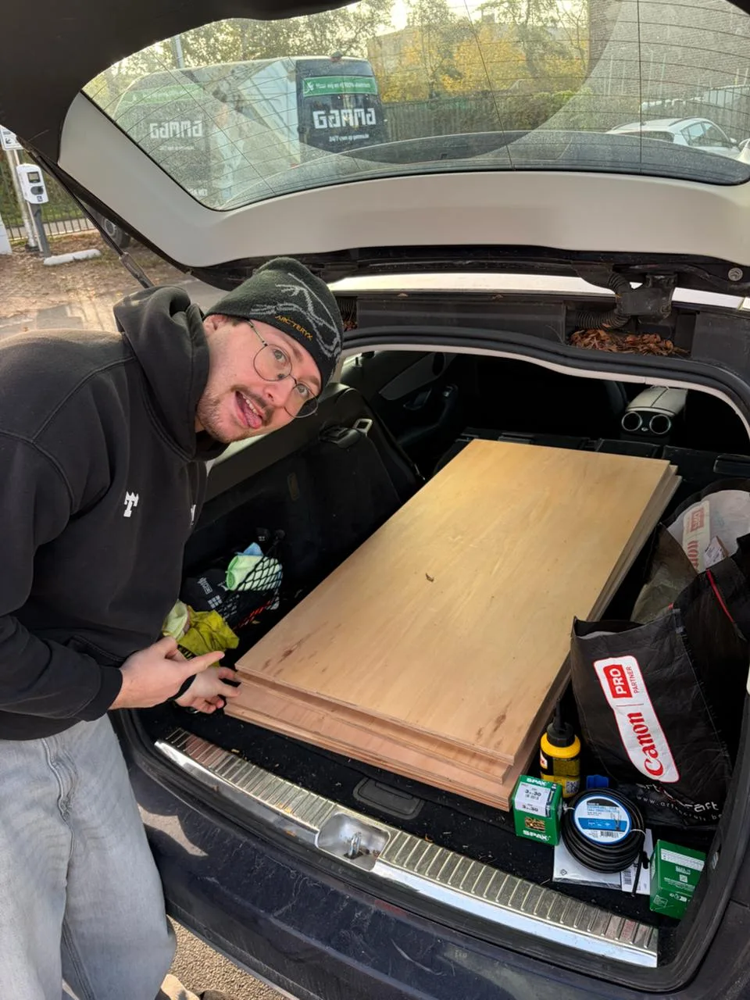
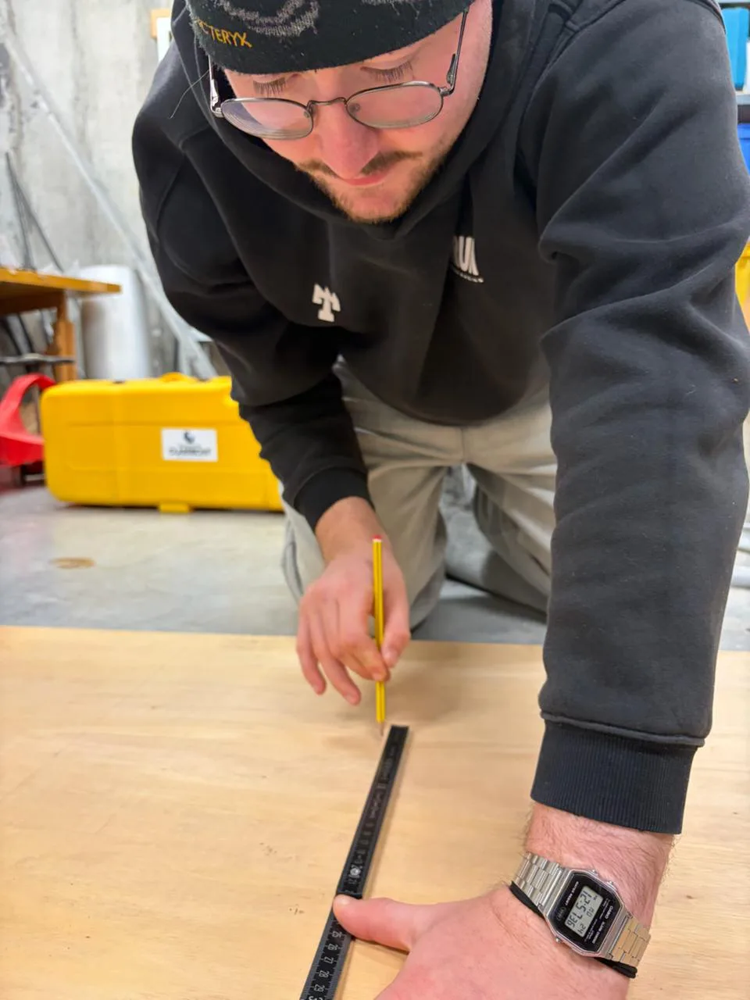
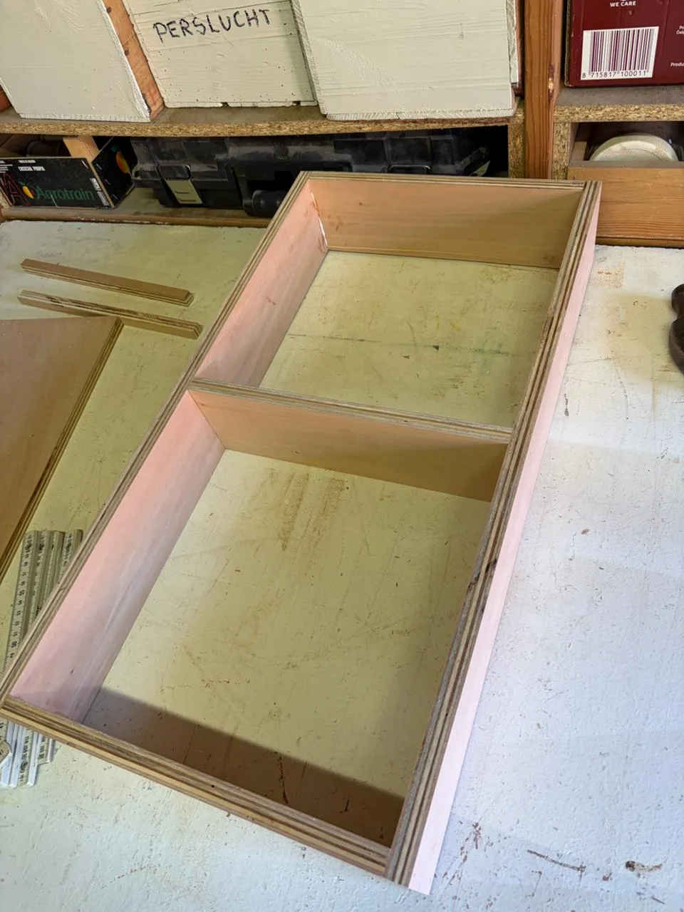
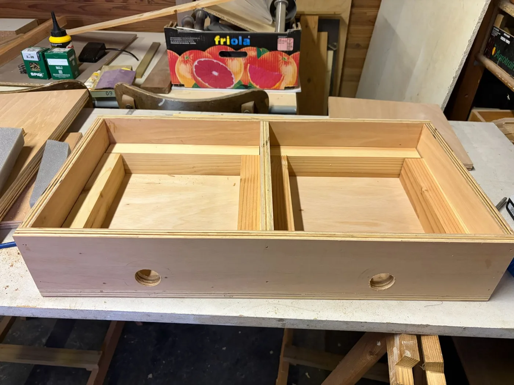
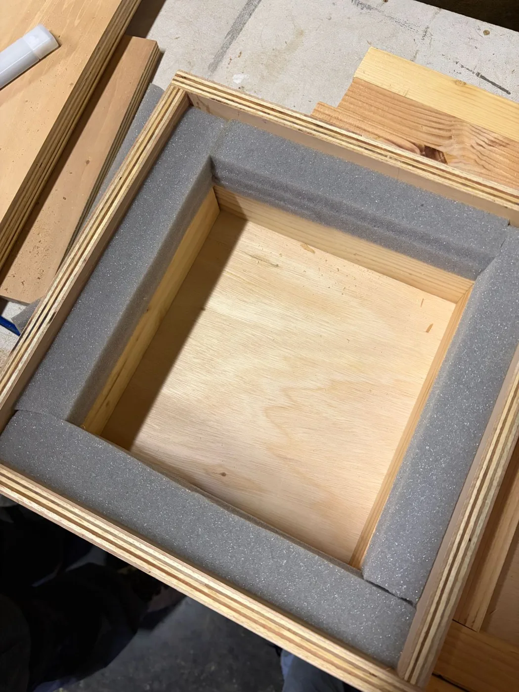

In the [technical post about the foot boxes](../foot-box-build/), we drew the foot boxes in 3D and made a shopping list. Now it was time to build one for real. Before we make all four, we built **one prototype** of the foot pads, to see if the idea works with real children standing on it.

## The measurements

The prototype is smaller than the box in our drawings. We left out the sign at the back and only built the part you stand on, because that's the part we want to test first. All the measurements are in centimetres:

| Part | Size (cm) | How many |
| --- | --- | --- |
| Long side walls | 62 × 10 | 2 |
| Short walls and middle divider | 29.4 × 10 | 3 |
| Base plate | 32.5 × 62 | 1 |
| Foot plates | 29.3 × 28.5 | 2 |

So the box is 62 cm long, 32.5 cm wide and 10 cm high, with two compartments: one for the left foot and one for the right foot.

## Getting our materials

With the measurements ready, we went shopping. We went to **Euroshop**, **Gamma** and **Brico** to collect everything we needed: wooden boards, battens, screws and foam. Everything fit in the back of the car, just about.

## Building it

We measured and marked everything on the boards before cutting. Measure twice, cut once.

We got a lot of help from **Lomme's grandpa**. He has a full workshop, with a table saw and all the tools we didn't have. He also knows a lot more about working with wood than we do, so he showed us how to do it properly.

<video autoplay loop muted playsinline preload="metadata" poster="../../videos/foot-pad-sawing-poster.jpg" style="display: block; width: 100%; max-width: 22rem; margin: 1.5rem auto; border-radius: 14px;">
  <source src="../../videos/foot-pad-sawing.mp4" type="video/mp4" />
  Your browser can't play this video.
</video>

After cutting, we put the walls together with glue and nails. That gave us the frame: two long walls, two short walls and the middle divider, which splits the box into a left and a right compartment.

Inside the compartments, we added battens along the walls. They carry the foot plates, so the weight of a child goes to the wood and not to the foot switch underneath. We also drilled two holes in the front, so the cables of the foot switches can come out of the box.

Finally, we put strips of grey foam along the walls of each compartment, as a soft edge around the foot plate.

## Testing with children

The best part: we could already test it with children. They stood on the foot pads and shifted their weight from one foot to the other, just like they will in the game.

  <video autoplay loop muted playsinline preload="metadata" poster="../../videos/foot-pad-test-1-poster.jpg" style="width: 100%; border-radius: 14px;">
    <source src="../../videos/foot-pad-test-1.mp4" type="video/mp4" />
    Your browser can't play this video.
  </video>
  <video autoplay loop muted playsinline preload="metadata" poster="../../videos/foot-pad-test-2-poster.jpg" style="width: 100%; border-radius: 14px;">
    <source src="../../videos/foot-pad-test-2.mp4" type="video/mp4" />
    Your browser can't play this video.
  </video>
  <video autoplay loop muted playsinline preload="metadata" poster="../../videos/foot-pad-test-3-poster.jpg" style="width: 100%; border-radius: 14px;">
    <source src="../../videos/foot-pad-test-3.mp4" type="video/mp4" />
    Your browser can't play this video.
  </video>

The box was strong enough for the children to stand and move on, and they understood straight away what to do: left foot, right foot.

## What's next

- Put the foot switches in the compartments and connect them to the game.
- Test it a lot. In the [peer-to-peer feedback](../../feedback/peer-2026-11-20/) we were told to test the pads really often. They have to survive three weeks of festival use.
- When the prototype works well, build the other three foot boxes, each in the colour of its Boxling.

## What I'm taking with me

- **Ask for help.** Lomme's grandpa made this so much easier. With the right tools and someone who knows how to use them, we built it a lot faster and better than we could have alone.
- **Start small.** By building only the part you stand on, we could test the most important thing first.
- **Test with real children early.** Seeing children stand on it tells us more than any drawing.
