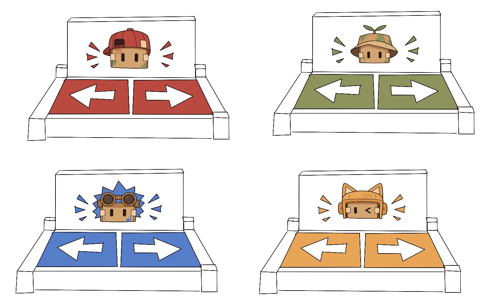

In Samen in Balans, the players don't hold a controller. They stand on foot panels. In this post we explain why, and how we got to this idea.

## Why foot panels?

We want children to feel that they are balancing themselves, not just pressing buttons. On the panels, a player moves their character by shifting their weight from one foot to the other. That way they also move their own centre of gravity, just like the Tipper on the rope.

Every player has their own panel with a left and a right side. Each panel has its own colour and features that link it to the Boxling it controls: red with the cap for RITS, green with the sprout hat for SPRIET, blue with the spikes and goggles for KRABBEL and orange with the cat ears for PUK. This way every child can quickly see which character on the screen is theirs.

## How we got there

The foot panels didn't come out of nowhere. On our FigJam board you can follow the steps that led to them.

### Brainstorm

We started with a brainstorm about an interactive installation for children. Around the centre we collected ideas in groups. The highlighted words are the ones that led us to the foot panels.

  
Interactive installation for children

  

    

      <h4>Controllers</h4>
      <ul><li>pumps</li><li>swing</li><li>rotary knob</li><li>ropes</li><li class="hit">balance ball</li><li>drum</li><li>steering wheel</li><li class="hit">pedals</li></ul>
    

    

      <h4>Movement</h4>
      <ul><li class="hit">balancing</li><li>climbing</li><li>rolling</li><li>blowing</li><li>pulling</li><li>pushing</li><li>swinging</li><li>lifting</li><li class="hit">tilting</li><li>jumping</li></ul>
    

    

      <h4>Senses</h4>
      <ul><li>touching</li><li>seeing</li><li>smelling</li><li class="hit">feeling</li></ul>
    

    

      <h4>Working together</h4>
      <ul><li>switching roles</li><li>helping each other</li><li>communicating</li><li>duo</li><li class="hit">steering together</li><li class="hit">at the same time</li><li class="hit">multiplayer</li><li>dividing roles</li><li>trust</li></ul>
    

    

      <h4>Gameplay</h4>
      <ul><li>collecting</li><li>puzzling</li><li>timing</li><li>protecting</li><li>escaping</li><li>rescuing</li><li>navigating</li><li>racing</li><li>obstacles</li><li>levelling up</li></ul>
    

    

      <h4>Story and mission</h4>
      <ul><li>going home</li><li>preventing a disaster</li><li>fixing a machine</li><li>searching for something</li><li>solving chaos</li><li>discovering a secret</li><li>rescuing someone</li></ul>
    

    

      <h4>Characters</h4>
      <ul><li>dragon</li><li>clothes peg</li><li>alien</li><li>robot</li><li>little cloud</li><li>shadow creature</li><li>slime monster</li><li>little ghost</li></ul>
    

    

      <h4>Obstacles</h4>
      <ul><li>traps</li><li>moving platforms</li><li>lasers</li><li>foam</li><li>tunnels</li><li>spinning things</li><li>falling objects</li><li>time pressure</li></ul>
    

    

      <h4>Worlds</h4>
      <ul><li>miniature world</li><li>factory</li><li>jungle</li><li>clouds</li><li>dreams</li><li>space</li><li>underwater</li><li>sewers</li><li>pirates</li><li>candy world</li></ul>
    

  

Balancing, moving your whole body and playing together kept coming back. That fits a festival audience well: children want to move, not sit still.

### Possible controllers

Next we collected physical controllers that we could use for the game. These were all options, and we looked at what feels good to use, what is easy to understand and what survives a lot of use. From these options we chose the **foot pedal**: it is simple, works without your hands and lets you use your whole body.

  <figure><figcaption>Arcade joystick</figcaption></figure>
  <figure><figcaption>Air pump</figcaption></figure>
  <figure><figcaption>Steering wheel</figcaption></figure>
  <figure class="chosen"><figcaption>Foot pedalChosen</figcaption></figure>
  <figure><figcaption>Hand pump</figcaption></figure>
  <figure><figcaption>Big button</figcaption></figure>
  <figure><figcaption>Trackball</figcaption></figure>
  <figure><figcaption>Fishing game</figcaption></figure>
  <figure><figcaption>Figure portal</figcaption></figure>
  <figure><figcaption>Swing</figcaption></figure>
  <figure><figcaption>Step pads</figcaption></figure>
  <figure><figcaption>Arcade game</figcaption></figure>

### Design sketches

With the pedal as a starting point, we sketched four ways to control the game with your feet, and wrote down the pros and cons of each one.

  

    <h4>1. Pressure pads</h4>
    
    <ul>
      <li class="pro">Easy to make</li>
      <li class="pro">Affordable</li>
      <li class="con">No instability: children can just lift up their feet</li>
    </ul>
  

  

    <h4>2. Pressure plates Chosen</h4>
    
    <ul>
      <li class="pro">Easy to make</li>
      <li class="pro">Affordable</li>
      <li class="pro">A little instability, without safety issues</li>
    </ul>
  

  

    <h4>3. OneWheel concept</h4>
    
    <ul>
      <li class="pro">A good way to tip players off balance, making them stand on one leg</li>
      <li class="con">Can introduce safety concerns</li>
      <li class="con">Hard to make</li>
    </ul>
  

  

    <h4>4. Balance concept</h4>
    
    <ul>
      <li class="pro">A good way to tip players off balance, making them stand on one leg</li>
      <li class="con">Hard to make</li>
    </ul>
  

The OneWheel concept was inspired by the real OneWheel, a board on a single wheel that you steer by leaning.

### Why pressure plates?

We chose **concept 2, the pressure plates**, because they are the best middle ground:

- **Flat pressure pads** are easy to make, but they give no feeling of balance at all. Children can just lift up their feet instead of shifting their weight.
- **The OneWheel and the balance concept** really do make you lose your balance. That is fun, but risky for young children at a festival, and both are hard to build.
- **Pressure plates** move slightly under your feet. You feel that you are balancing and you have to shift your weight, but there is no risk of falling. They are also easy and affordable to make.

## What's next

We presented the foot panels in our [concept pitch](../concept-pitch/). The other teams asked why we don't use a half-circle balance board. Our answer was the same as the result of these sketches: separate plates are more stable and safer for children. You can read more in the [feedback report on the pitch](../../feedback/peer-concept-pitch/).

Our client also warned us that the controllers have to survive three weeks of festival use. So next we will work out how the plates are built, make prototypes and test them with children.
