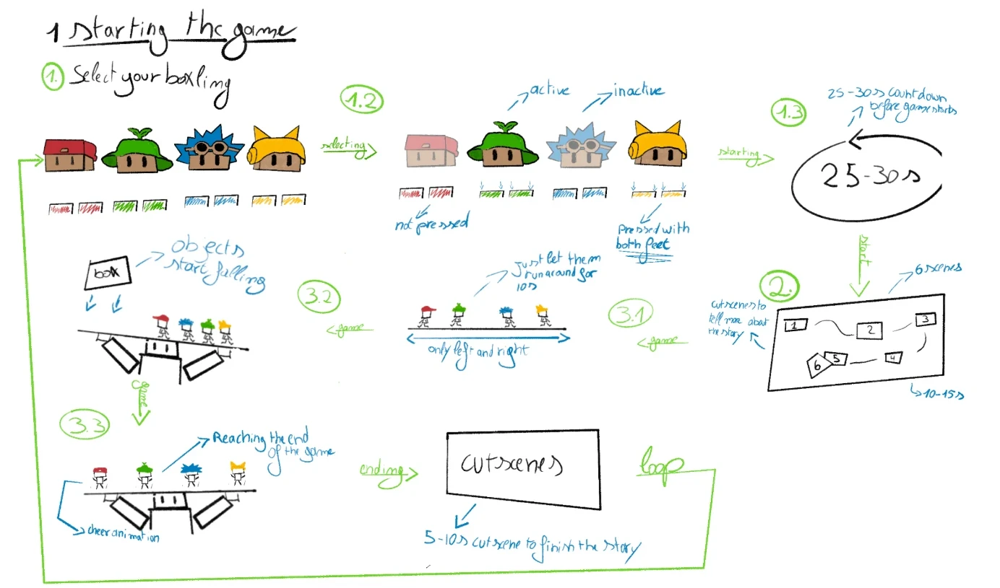
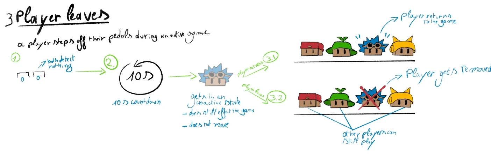

Before continuing with the development of Samen in Balans, we decided to take a step back and define how players will interact with our game. Our [visual design expert](../../feedback/experts-visual-design-2026-11-10/) advised us to do exactly that: focus on the user experience before building more.

Our game is made for children and uses physical pedals instead of normal controllers, so we want the experience to be as intuitive and accessible as possible. We made a series of UX sketches to visualise the complete game flow: from choosing a character, to controlling the Boxlings, to what happens when a player leaves during a game.

## 1. Starting the game

The game starts with a character selection screen, where all four Boxlings are shown together with their pedals.

Players join by standing on both pedals of their character. Their Boxling then lights up, so it is clear which characters are already chosen and which are still free.

As soon as at least two players have joined, a countdown of 25 to 30 seconds starts. During this countdown, other players can still join. After the countdown, the game moves on to a short [intro cutscene](../cutscene/) that tells the story and shows where we are.

Our current game flow:

| Step | What happens | Duration |
| --- | --- | --- |
| Character selection | Players join with their pedals | Until at least 2 players have joined |
| Countdown | More players can still join | 25 to 30 seconds |
| Intro cutscene | The story and the setting | About 10 to 15 seconds |
| Gameplay | Keep the Tipper in balance | About 2 minutes |
| Ending cutscene | The end of the story | About 5 to 10 seconds |
| Restart | Back to the character selection | Automatic |

This makes one continuous loop, so new groups of children can play without someone having to help them.

## 2. Player controls

Each player controls one Boxling with two pedals: one for moving left and one for moving right. We went through every combination of the two pedals, so every possible input has a clear result.

  <figure><figcaption>0 – 0: nobody on the pedals</figcaption></figure>
  <figure><figcaption>1 – 1: stands still</figcaption></figure>
  <figure><figcaption>1 – 0: moves left</figcaption></figure>
  <figure><figcaption>0 – 1: moves right</figcaption></figure>

- **Neither pedal pressed (0 – 0):** the Boxling stays where it is. If this lasts, the player has probably stepped off, see point 3.
- **Both pedals pressed (1 – 1):** the Boxling also stands still. This way two inputs at once can never cause strange movement.
- **Left pedal pressed (1 – 0):** the Boxling moves to the left along the plank.
- **Right pedal pressed (0 – 1):** the Boxling moves to the right along the plank.

By keeping the controls to two simple movements, children can focus on the real challenge: working together to keep the balance.

## 3. When a player leaves

Samen in Balans will be played at a festival, so we also have to think about children walking away in the middle of a game. That is why we added a grace period of 10 seconds.

When a player steps off both pedals, a countdown starts. During that time their Boxling is inactive: it stays where it is and doesn't move. Then one of two things happens:

- **The player comes back within 10 seconds.** Their Boxling becomes active again, and they can play on straight away.
- **The player doesn't come back within 10 seconds.** Their Boxling is removed from the game. The other players keep playing normally, with one teammate less.

This way, the whole game doesn't stop when someone suddenly walks away.

## 4. Why we made these UX sketches

These sketches help us spot problems before we build the systems in Unity. Instead of only thinking about the ideal game, we think about how children will really use the installation.

By writing down the different states and interactions, we can make clearer choices about the gameplay, the physical controls and the visual feedback. Our goal is an experience that is easy to understand, needs almost no explanation and keeps working when players do something unexpected.

## Next steps

These are our first sketches: later we will make a more detailed version. We will also explore more situations, like what happens when all players leave, how the game handles losing lives, and how falling objects affect the balance.

Once these rules are clear, we can turn them into gameplay systems in Unity and test them with our [pedal setup](../foot-pedals-movement/).
