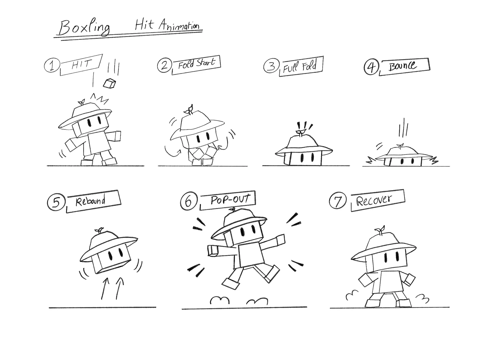

In our game, things fall from the sky onto the plank: a duck, a box, a traffic cone and a barrel (you can read about them in [Falling Objects](../falling-objects/)). When one of them lands on a Boxling, that Boxling loses a life. The player has to see that right away, and it has to feel fun instead of mean, because our players are young children. So no falling over or crying, but a **hit animation** that fits who the Boxlings are: little figures made of cardboard boxes.

## The sketch

My idea was simple: when a Boxling gets hit, he folds up into what he really is, a cardboard box. Then he bounces, pops back out and carries on. I sketched it in seven steps:

1. **Hit.** The object lands on his head and he flinches.
2. **Fold start.** His arms and legs start folding inwards.
3. **Full fold.** Only the head and body are left: he's just a box now.
4. **Bounce.** The box squashes flat against the plank from the impact.
5. **Rebound.** The box springs back up into the air.
6. **Pop-out.** Arms and legs shoot back out, wide open, like a jack-in-the-box.
7. **Recover.** He lands on his feet with a little puff of dust and stands ready again.

## Animating in Blender

I animated it on [RITS](../rits-boxling/) again. All four Boxlings share the same skeleton, so the animation will work on the others too. The whole animation is 38 frames, so about 1.5 seconds at 24 frames per second.

1. **Folding in (frames 0 to 5).** Within five frames the upper arms and thighs scale down and slide into the body, until RITS is only a head on a box. Because it happens so fast, it reads as one snap instead of a slow shrink.
2. **The bounce (frames 5 to 12).** I keyed the scale of the spine to squash the box flat against the plank and stretch it a bit again. That squash and stretch makes the box feel soft and springy, like real cardboard.
3. **Popping out (frames 12 to 16).** The arms and legs grow back out of the box, and on frame 16 they're back at full size. Even the fingers spread out on that frame.
4. **The jump and landing (frames 16 to 33).** RITS shoots up into the air with his arms and legs spread wide, like a jack-in-the-box. He comes down with his arms still out, and on frames 32 and 33 the knees bend to catch the landing.
5. **Recover (frames 33 to 38).** He straightens up and ends in the same pose he started in, so the game can go straight back to the idle or running animation.

This time I kept the textures on while animating, in two views next to each other: one close-up to pose the bones and one from further away to check the whole movement.

## The process as a timelapse

I recorded both sessions on screen, about half an hour in total. Here they are sped up to under a minute: from the first keys on the hit to the finished animation in the Action Editor.

<video autoplay loop muted playsinline preload="metadata" poster="../../videos/hit-timelapse-poster.jpg" style="width: 100%; border-radius: 14px; margin-block: 1.5rem;">
  <source src="../../videos/hit-timelapse.mp4" type="video/mp4" />
  Your browser can't play this video.
</video>

## The result

This is the hit animation with RITS's own textures, on a plank. To show what triggers it, a stone falls on his head: the moment it hits, RITS folds up, and the stone bounces off and rolls away over the plank. I also adjusted the last frame, so he lands back in his normal pose more smoothly.

<video autoplay loop muted playsinline preload="metadata" poster="../../videos/hit-render-poster.jpg" style="width: 100%; border-radius: 14px; margin-block: 1.5rem;">
  <source src="../../videos/hit-render.mp4" type="video/mp4" />
  Your browser can't play this video.
</video>

## Next steps

- Add the puff of dust from the sketch when he lands.
- Give the action a clear name ("Hit") and export it to Unity together with the other animations.
- Let Lomme play it in Unity when a falling object touches a Boxling, together with losing a heart in the [UI](../ui-sketches/).
