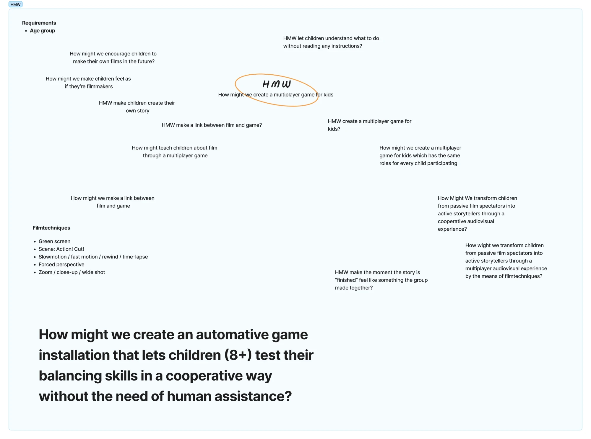
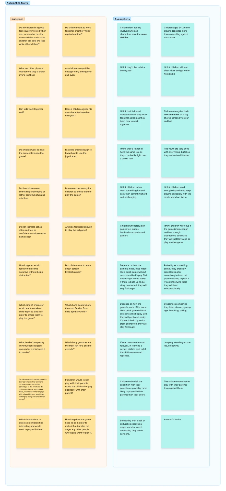
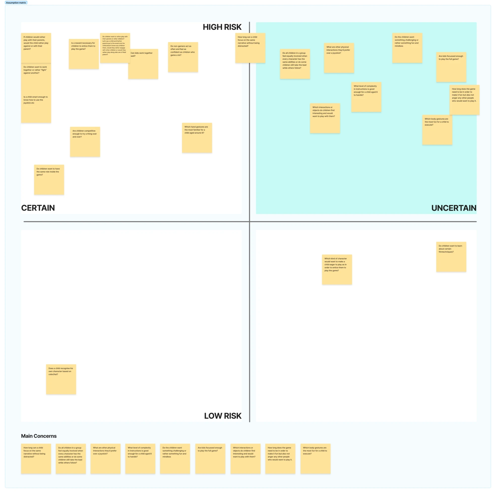
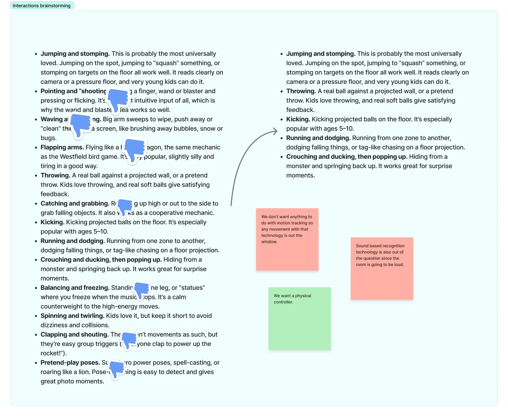

Samen in Balans didn't start as a balance game. At the start of the project we only had a brief: make an interactive installation for children at the Jeugdfilmfestival. This post shows the steps we took to get from that open brief to a concept: How Might We questions, an assumption matrix and an interaction brainstorm.

## How Might We

We started with **How Might We** questions: short questions that turn the brief into design challenges. Because the installation is for a film festival, a lot of our first questions were about film:

- How might we make children feel as if they're filmmakers?
- How might we encourage children to make their own films in the future?
- How might we make a link between film and game?
- How might we transform children from passive film spectators into active storytellers through a cooperative audiovisual experience?

We also listed film techniques that could be part of it, like green screen, "Action! Cut!", slow motion and time-lapse, forced perspective, and zooming from a close-up to a wide shot.

Other questions were about the players themselves:

- How might we create a multiplayer game for kids?
- How might we create a multiplayer game for kids which has the same roles for every child participating?
- How might we let children understand what to do without reading any instructions?
- How might we make the moment the story is "finished" feel like something the group made together?

The question we kept coming back to was the simplest one, **"How might we create a multiplayer game for kids?"**, which we circled in the middle of the board. After the steps below, it grew into our final question:

> **How might we create an automative game installation that lets children (8+) test their balancing skills in a cooperative way without the need of human assistance?**

Every part of that question came out of the next steps: the age group, the cooperation, the balancing, and the fact that the installation has to work on its own, without someone from the festival explaining it.

## The assumption matrix: questions and assumptions

We didn't know our players yet, so we first wrote down everything we were unsure about. On the left, we wrote our **questions**. On the right, we wrote what we **assumed** the answer would be.

A few examples:

| Question | What we assumed |
|---|---|
| Do children want to work together or rather "fight" against another? | Children aged 6 to 12 enjoy playing together more than competing against each other. |
| Do all children in a group feel equally involved when every character has the same abilities? | Children feel equally involved when all characters have the same abilities. |
| Does a child recognise their own character based on colour or hat? | Children recognise their own character on a big shared screen by colour and hat. |
| Do non-gamers feel as confident as children who game a lot? | Children who rarely play games feel just as involved as experienced gamers. |
| Which body gestures are the most fun for a child to do? | Jumping, standing on one leg, crouching. |
| What level of complexity in instructions can a child aged 8 handle? | Visual cues work best: to learn a skill, let the child do it and copy it. |
| How long does the game need to be, so it's fun without making other people wait? | Around 2 to 3 minutes. |

## The assumption matrix: risk and certainty

Then we placed every question on a matrix with two axes: **how risky** it is for the concept if we're wrong, and **how certain** we already are of the answer.

- **High risk, but certain.** Things that matter a lot, but that we were already fairly sure about, like whether children want to work together, whether they're competitive enough to try again, and whether they want the same role in the game.
- **Low risk.** Things that matter less, like whether a child recognises their character by colour or hat, what kind of character would make them want to play, and whether children want to learn about film techniques.
- **High risk and uncertain.** These are the dangerous ones: if we guess wrong, the concept fails, and we didn't know the answer. They became our **main concerns**.

Our main concerns were:

1. How long can a child focus on the same story without getting distracted?
2. Do all children in a group feel equally involved when every character has the same abilities, or do some children still take the lead while others follow?
3. What other physical interactions would they prefer over a joystick?
4. What level of complexity in instructions can a child aged 8 handle?
5. Do children want something challenging, or rather something fun and mindless?
6. Are kids focused enough to play the full game?
7. Which interactions or objects do children find interesting and want to play with?
8. How long does the game need to be, so it's fun without making other people wait?
9. Which body gestures are the most fun for a child to do?

These concerns told us what to research and test first. The questions about age, focus and challenge became the start of our [target audience research](../user-definition/). The questions about physical interaction led straight to the next step.

## Interaction brainstorm

Three of our main concerns were about movement: which physical interactions, which gestures and which objects children enjoy. So we brainstormed every way a child could play with their body: jumping and stomping, pointing and "shooting", waving and wiping, flapping their arms like a bird, throwing, catching and grabbing, kicking, running and dodging, crouching and popping back up, balancing and freezing, spinning, clapping and shouting, and pretend-play poses.

Before choosing, we set three clear constraints:

- **No motion tracking.** We didn't want anything that depends on camera-based tracking, so every movement that needs it was out.
- **No sound recognition.** The festival room is going to be loud, so clapping or shouting as input wouldn't work.
- **A physical controller.** We wanted something real for children to stand on or hold.

With those rules, we gave a thumbs down to pointing, waving, flapping, catching and grabbing, clapping and shouting, and pretend-play poses. Balancing and freezing got a thumbs down too, as a calm "statues" game where you freeze when the music stops. This shortlist was left:

- **Jumping and stomping**, probably the most universally loved movement, and easy to read on a pressure floor.
- **Throwing** a real soft ball against a projected wall.
- **Kicking** projected balls on the floor, especially popular with ages 5 to 10.
- **Running and dodging** from one zone to another, dodging falling things.
- **Crouching and ducking, then popping up**, which works great for surprise moments.

Balancing didn't make the shortlist as a game of freezing in place, but it came back in a different form: in Samen in Balans you balance actively, by shifting your weight on a pedal, while running and dodging falling objects together. Running and dodging from the shortlist became a core part of the game.

## What we're taking with us

- **Start wide, then narrow down.** We began with film, filmmaking and storytelling, and ended with one focused question about cooperative balance.
- **Write down your assumptions.** Seeing questions and assumptions side by side showed us how much we were guessing.
- **Research the risky unknowns first.** The high-risk, uncertain quadrant told us exactly what to look into next.
- **Constraints make choices easier.** No motion tracking, no sound and a physical controller removed half of the list at once.
