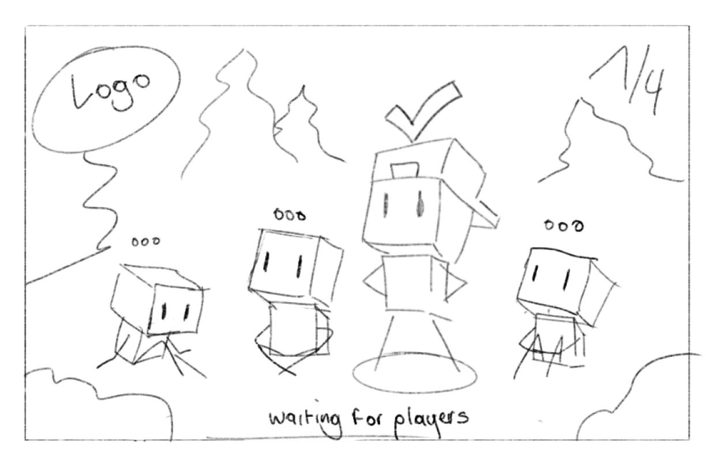
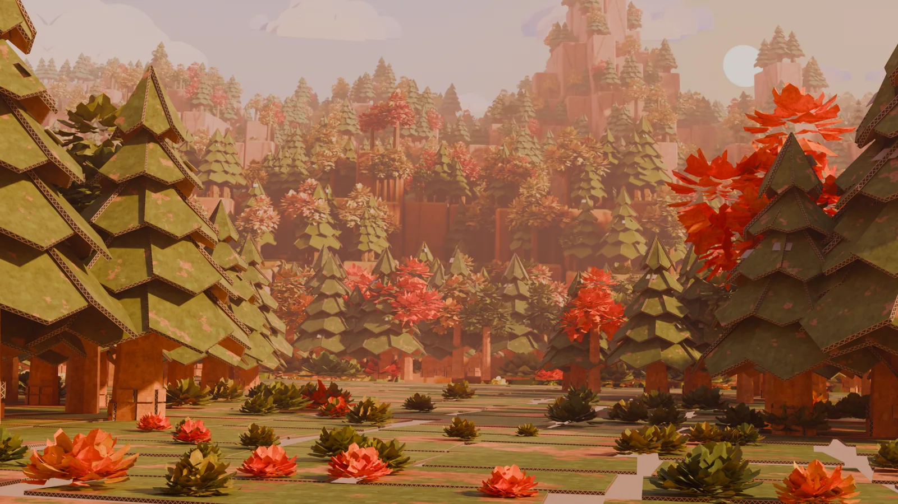
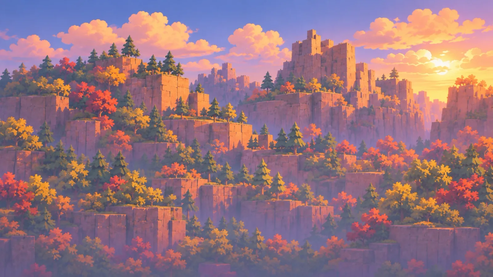
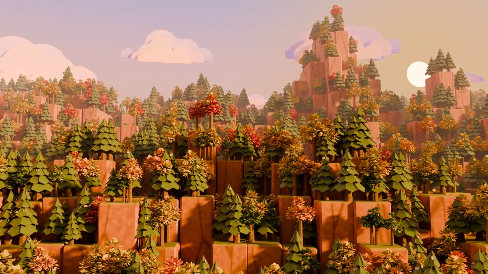
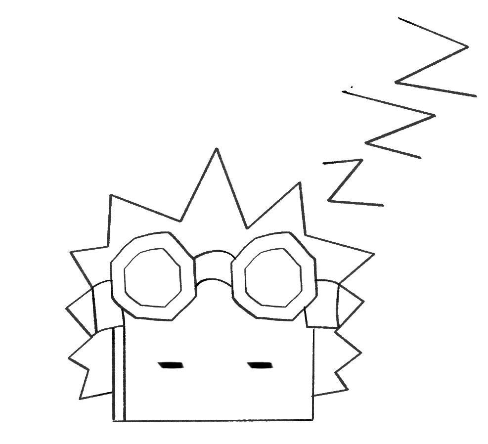

Most of the time at the festival, nobody is playing Samen in Balans. That's when the **idle screen** is on, and it has to make children want to step onto a platform. Nikola already researched what an idle screen has to do and drew four sketches (you can read about it in [Designing the Idle State](../idle-state/)). This week I started building it in 3D.

## The starting point: Nikola's sketch

I worked from Nikola's third sketch: the four Boxlings in the forest. With 0 players, all four Boxlings are already there, so the screen never looks empty. When a child steps onto a platform, their Boxling gets up and shows that it's ready.

## An empty forest

The idle screen takes place in the same forest as our first cutscene scene. I made a copy of that scene and removed all the characters, so only the environment is left: the cardboard pine trees, the red paper bushes, the grass and the lights. This empty forest is the stage where the Boxlings will wait.

## My own background instead of the AI image

Behind the forest hangs a big backdrop with cliffs and a sky. Until now, that was an image we had generated with AI. It looked nice, but it didn't fully match our world: the cliffs looked like stone ruins and the trees were painted, while everything in front of them is made of cardboard.

So I replaced it with a background I made in Blender. The cliffs are simple blocks in a pink cardboard colour, the trees are the same cardboard trees as in the forest, and the clouds are flat cut-outs layered on top of each other, like paper. I lit it with a warm, low sunset light so it blends in with the foreground.

Because it's a 3D scene of our own, we can now change anything we want: move a cliff, add trees or change the time of day, without having to generate a new image.

## 1. Not ready: the Boxling is asleep

In Nikola's sketch, a Boxling that isn't ready sits down with three dots above its head. I wanted it to feel a bit more alive, so I made it **sleep**: the Boxling folds into its box, closes its eyes and little Z's float up from its head. I drew it first:

Then I animated it on [RITS](../rits-boxling/):

- **Small eyes.** Two little cardboard eyelids slide over the eye holes and leave only a thin slit open. I tried scaling the eyes themselves first, but that stretched the cardboard texture around them. The eyelids use the same cardboard material as the face, so you don't see them.
- **zZZ.** Three cardboard Z's float up one after the other. They grow while they rise, wiggle a bit and then disappear again.
- **Breathing.** The box very slightly grows and shrinks, so you can see he's still alive.

The animation is a loop of 2.5 seconds, so it can keep playing for as long as nobody stands on the platform.

<video autoplay loop muted playsinline preload="metadata" poster="../../videos/idle-not-ready-poster.jpg" style="width: 100%; max-width: 600px; display: block; margin-inline: auto; border-radius: 14px; margin-block: 1.5rem;">
  <source src="../../videos/idle-not-ready.mp4" type="video/mp4" />
  Your browser can't play this video.
</video>

## 2. Ready: the Boxling wakes up

When a child steps onto their platform, their Boxling has to react straight away. In the **Ready** animation, RITS opens his eyes, jumps out of his box with his arms and legs spread out, and lands on his feet, ready to play.

<video autoplay loop muted playsinline preload="metadata" poster="../../videos/idle-wake-poster.jpg" style="width: 100%; max-width: 600px; display: block; margin-inline: auto; border-radius: 14px; margin-block: 1.5rem;">
  <source src="../../videos/idle-wake.mp4" type="video/mp4" />
  Your browser can't play this video.
</video>

I recorded myself while animating the jump. Here's that session sped up, with the parts where nothing happened cut out:

<video autoplay loop muted playsinline preload="metadata" poster="../../videos/ready-timelapse-poster.jpg" style="width: 100%; border-radius: 14px; margin-block: 1.5rem;">
  <source src="../../videos/ready-timelapse.mp4" type="video/mp4" />
  Your browser can't play this video.
</video>

## 3. Ready and waiting: looking around

Once RITS is ready, he has to wait until the other players join too. Standing completely still felt lifeless, so I made a separate animation for this moment: **ReadyIdle**. His body stays in the ready pose and only his head moves. He looks to the left, then to the right, and gives a little nod before looking forward again. It's a loop of 4 seconds, so it can keep going until the game starts.

<video autoplay loop muted playsinline preload="metadata" poster="../../videos/idle-ready-look-poster.jpg" style="width: 100%; max-width: 600px; display: block; margin-inline: auto; border-radius: 14px; margin-block: 1.5rem;">
  <source src="../../videos/idle-ready-look.mp4" type="video/mp4" />
  Your browser can't play this video.
</video>

## 4. Stepping off: back into the box

A child can also change their mind and step off the platform before the game starts. Then their Boxling has to go back to sleep, so I made one more animation: **UnReady**. RITS crouches, jumps up and folds his arms and legs into his body while he falls, so he lands as a box. He bounces once on the ground: the box squashes flat on impact, springs back up and lands again with a smaller bounce. While he settles, his eyes slowly close, so the sleeping animation can take over without a jump.

<video autoplay loop muted playsinline preload="metadata" poster="../../videos/idle-unready-poster.jpg" style="width: 100%; max-width: 600px; display: block; margin-inline: auto; border-radius: 14px; margin-block: 1.5rem;">
  <source src="../../videos/idle-unready.mp4" type="video/mp4" />
  Your browser can't play this video.
</video>

I recorded this one too, in two sessions. Here they are stuck together and sped up, with the parts where nothing happened cut out:

<video autoplay loop muted playsinline preload="metadata" poster="../../videos/unready-timelapse-poster.jpg" style="width: 100%; border-radius: 14px; margin-block: 1.5rem;">
  <source src="../../videos/unready-timelapse.mp4" type="video/mp4" />
  Your browser can't play this video.
</video>

## 5. All together

In the video below, all four animations play one after the other, just like it would happen at the festival: RITS sleeps, wakes up when a child steps onto the platform, looks around while he waits for the others, and folds back into his box when the child steps off again. Then he falls asleep and the loop starts over.

<video autoplay loop muted playsinline preload="metadata" poster="../../videos/idle-cycle-poster.jpg" style="width: 100%; max-width: 600px; display: block; margin-inline: auto; border-radius: 14px; margin-block: 1.5rem;">
  <source src="../../videos/idle-cycle.mp4" type="video/mp4" />
  Your browser can't play this video.
</video>

## Not in the forest yet

You might notice that the Boxlings in these videos are not standing in the forest yet. That's on purpose: the environment and the animations are made separately in Blender. Putting them together happens in **Unity**, where the game decides which Boxling is sleeping and which one is ready, depending on who is standing on a platform.

## Next steps

- Export the environment and the NotReady, Ready, ReadyIdle and UnReady animations to Unity, so Lomme can put the Boxlings in the forest.
- Play the Ready animation the moment a child steps onto their platform and UnReady when they step off, together with the check mark and the player count from the [UI sketches](../ui-sketches/).
- Make the same animations work on the other Boxlings.
