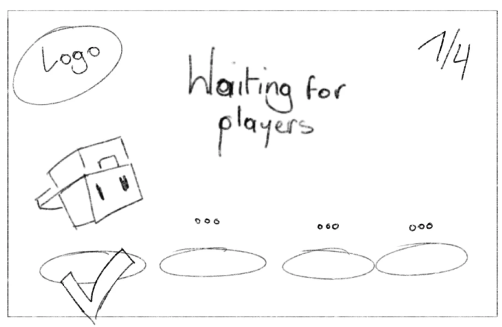
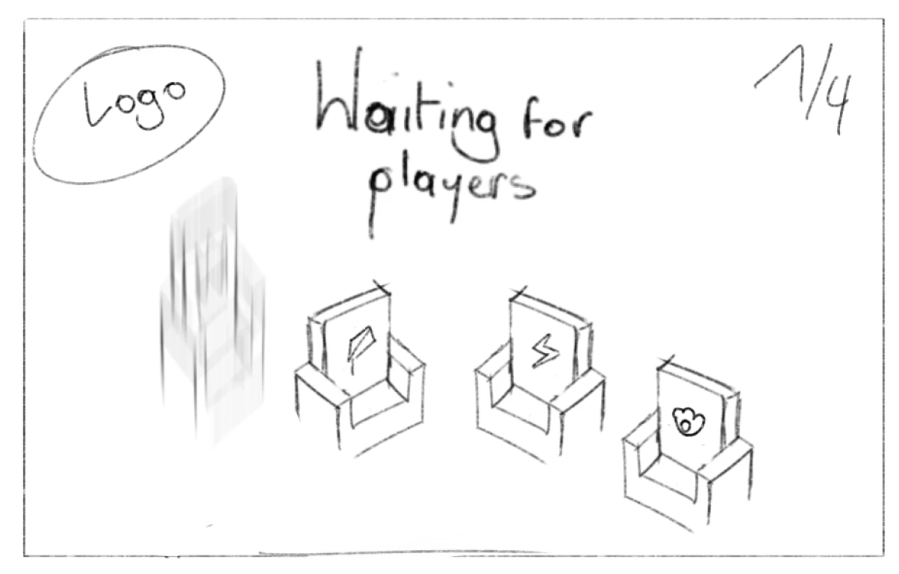
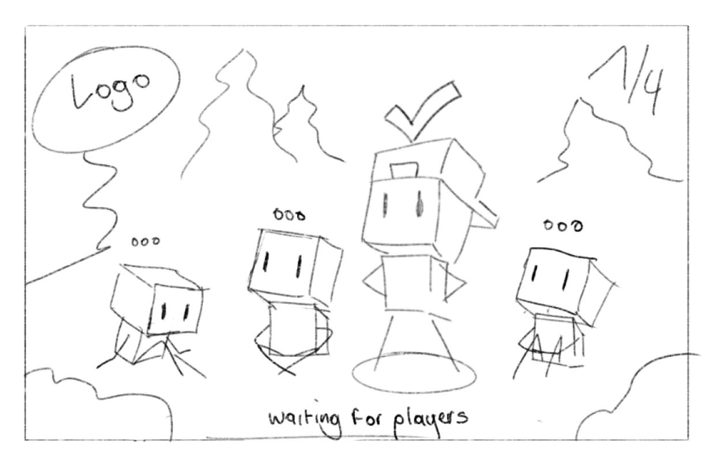
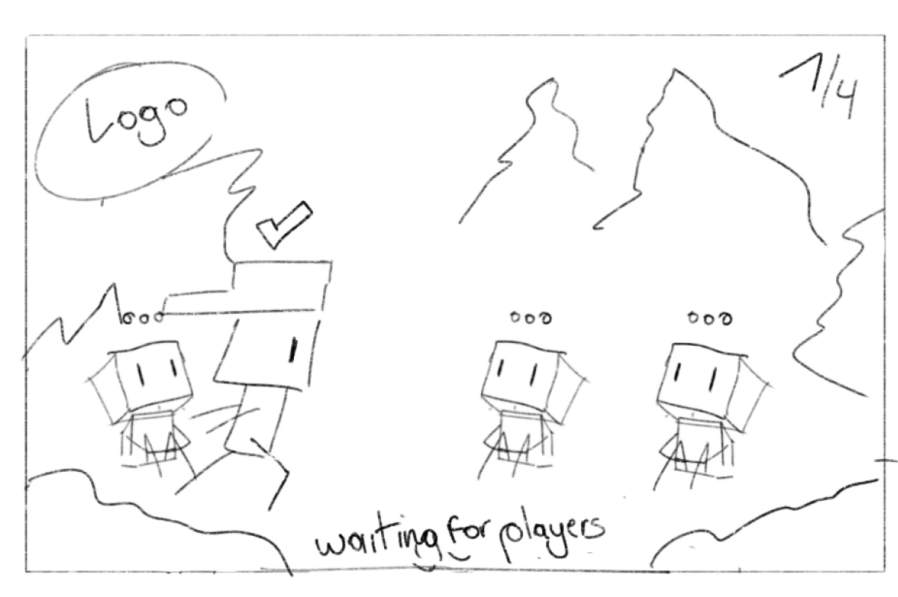

Most of the time at the festival, nobody will be playing Samen in Balans. Children walk past, groups wait for the next film, and the installation just stands there. That moment, the **idle state**, is the first thing a child sees, so it decides whether they ever step onto a platform. Before sketching, we looked into what research says about public interactive displays and wrote down what our idle screen has to do.

## What the idle screen has to do

### 1. Show that the screen is interactive

Passers-by often don't realise a screen is interactive. Researchers call this **interaction blindness**: people don't know a display can be used and assume it only shows things, like a TV (Hosio et al., 2016; Ojala et al., 2012). So the first job of our idle screen isn't to look pretty, but to make clear that **this is something you can play**.

### 2. Guide people through the stages before they play

People don't go from walking past to playing in one step. Brignull and Rogers (2003) divide it into three phases, from noticing a display to interacting with it directly. The Audience Funnel by Michelis and Müller (2011) goes further and describes six: passing by, viewing and reacting, subtle interaction, direct interaction, multiple interactions and follow-up actions. Our idle screen should help children move from "looking from a distance" to "stepping onto a pad".

### 3. React to the player straight away

In the Looking Glass study, a lot more passers-by interacted with a shop window display when it immediately showed their mirror image (+90%) or silhouette (+47%), compared to a classic attract loop with a call to action. The study also found that people need about 1.2 seconds to notice that a display is interactive (Müller et al., 2012).

We don't use cameras, but the same idea works for us. When a child steps onto a pad, the screen should respond **immediately**, for example by having their Boxling wake up. That instant reaction is our "mirror".

### 4. Let other players do the advertising

The **honeypot effect** describes how someone playing with an installation draws others in to watch, come closer and join (Kelly et al., 2019). In the Looking Glass study, people started interacting behind someone who was already using the display, forming several rows. The researchers also saw a **landing effect**: passers-by often notice the interactivity late and have to walk back to try it (Müller et al., 2012).

For us, this means the idle screen has to be readable from a distance, and the game itself has to be fun to watch, so the queue keeps building itself.

### 5. Make spectators part of the experience

Reeves et al. (2005) describe an "expressive" interaction, where both what a player does and its effect are visible, so spectators fully understand what's going on. Standing on a pad and seeing your Boxling react is exactly that: children who are waiting can see what to do before it's their turn.

### How other games do it

We also looked at how existing games handle joining and explaining the game: lobbies where players mark themselves as ready before a round starts (Jackbox Games, 2016; Unity Technologies, 2018), the instructions for an arcade dance game (Konami, n.d.), a UI that teaches you how to play while you play (Langlais, 2014), and ValoArena, an interactive play arena for four players (Valo Motion, 2025, n.d.).

## Sketching the idle state

With those five goals, we sketched four versions of the idle screen. All four have the logo in the top left, a player count in the top right (1/4 in these examples) and the text "Waiting for players". After each sketch, we wrote down what worked (green) and what didn't (red).

### Sketch 1: floating heads

Floating heads represent the players. When a player steps onto their platform, their character appears as a floating head with a check mark to show they're ready.

- **Worked:** it's simple, and it's clear when you're ready.
- **Didn't work:** it feels lifeless when there are 0 players, so it's hard to attract anyone.

### Sketch 2: thrones

When a player steps onto a platform, a chair drops down with their character sitting on it.

- **Worked:** it's still clear when you're ready.
- **Didn't work:** we hadn't seen chairs anywhere else in our concept, so why introduce them? Sitting also doesn't really feel like a "ready" state. And like the first sketch, it feels lifeless with 0 players.

### Sketch 3: Boxlings in the forest

In this version the idle state with 0 players already shows all four Boxlings sitting down, with dots above their heads. When a player joins, their character stands up and gets a mark above its head to show they're ready.

- **Worked:** the Boxlings show the difference between not ready and ready very clearly, and there's something to look at even when nobody is playing.
- **Didn't work:** it doesn't introduce the balance mechanic yet (balancing to move), and it looks a bit too much like Fortnite.

### Sketch 4: Boxlings that walk around

The last version starts the same way: four Boxlings sitting down with dots above their heads. When a player joins, their character stands up and can already walk around. To sit back down, the player just steps off the platform.

- **Worked:** again, the ready and not-ready states are very clear.
- **Didn't work:** the screen gets too busy.

## What we're taking with us

- **Never look empty.** The sketches with nothing on screen at 0 players felt lifeless. The sitting Boxlings give passers-by something to look at, even when nobody is playing.
- **React instantly.** A Boxling standing up the moment you step on is our version of the Looking Glass mirror.
- **Ready has to look ready.** Standing up with a mark above your head reads as "ready", sitting in a chair doesn't.
- **Stay within our own world.** Chairs, and anything that looks like another game, don't belong in Samen in Balans.
- **Teach the balance early, but keep it calm.** Letting players move in the idle state could introduce the balance mechanic, as long as the screen doesn't get too busy.

## Sources

- Brignull, H., & Rogers, Y. (2003). Enticing people to interact with large public displays in public spaces. In M. Rauterberg, M. Menozzi, & J. Wesson (Eds.), *Human-Computer Interaction – INTERACT '03* (pp. 17–24). IOS Press.
- Hosio, S., Kukka, H., Goncalves, J., Kostakos, V., & Ojala, T. (2016). Toward meaningful engagement with pervasive displays. *IEEE Pervasive Computing, 15*(4), 24–31. https://doi.org/10.1109/MPRV.2016.58
- Jackbox Games. (2016, June 20). *How to play* [Online forum post]. Steam Community. https://steamcommunity.com/app/442070/discussions/0/358415206096198643
- Kelly, R. M., Ferdous, H. S., Wouters, N., & Vetere, F. (2019). Can mobile augmented reality stimulate a honeypot effect? Observations from Santa's Lil Helper. In *Proceedings of the 2019 CHI Conference on Human Factors in Computing Systems* (Paper 167). ACM. https://doi.org/10.1145/3290605.3300515
- Konami. (n.d.). *Dance Dance Revolution SuperNOVA: How to play* [Operator manual]. Betson. https://www.betsonparts.com/downloads/dl/file/id/73/dance_dance_revolution_super_nova_how_to_play.pdf
- Langlais, Y. (2014, October 29). *Designing a playable UI that secretly teaches how to play*. Game Developer. https://www.gamedeveloper.com/design/designing-a-playable-ui-that-secretly-teaches-how-to-play
- Michelis, D., & Müller, J. (2011). The audience funnel: Observations of gesture based interaction with multiple large displays in a city center. *International Journal of Human-Computer Interaction, 27*(6), 562–579. https://doi.org/10.1080/10447318.2011.555299
- Müller, J., Walter, R., Bailly, G., Nischt, M., & Alt, F. (2012). Looking glass: A field study on noticing interactivity of a shop window. In *Proceedings of the SIGCHI Conference on Human Factors in Computing Systems* (pp. 297–306). ACM. https://doi.org/10.1145/2207676.2207718
- Ojala, T., Kostakos, V., Kukka, H., Heikkinen, T., Lindén, T., Jurmu, M., Hosio, S., Kruger, F., & Zanni, D. (2012). Multipurpose interactive public displays in the wild: Three years later. *Computer, 45*(5), 42–49. https://doi.org/10.1109/MC.2012.115
- Reeves, S., Benford, S., O'Malley, C., & Fraser, M. (2005). Designing the spectator experience. In *Proceedings of the SIGCHI Conference on Human Factors in Computing Systems* (pp. 741–750). ACM. https://doi.org/10.1145/1054972.1055074
- Unity Technologies. (2018). *Multiplayer lobby* (Unity Manual, Version 2018.4). https://docs.unity3d.com/2018.4/Documentation/Manual/UNetLobby.html
- Valo Motion. (2025). *ValoArena 4-player debuts at Amusement 360 and IAAPA Europe in September 2025* [Blog post]. https://www.valomotion.com/blog/valoarena-4-player-launch
- Valo Motion. (n.d.). *Frequently asked questions*. https://www.valomotion.com/contact/faq
