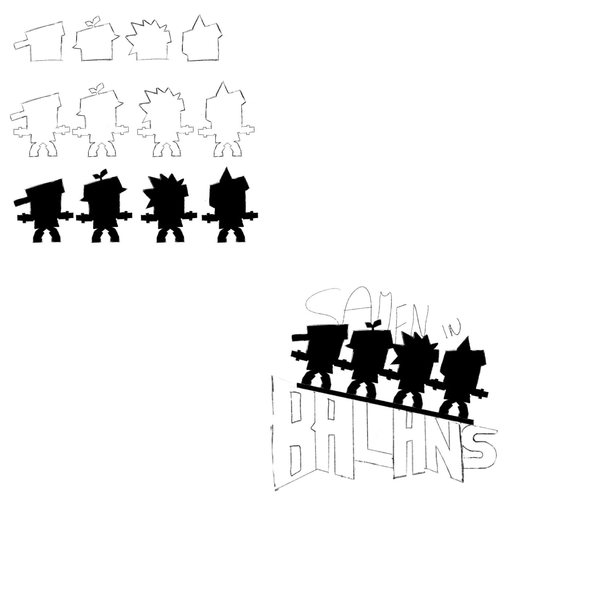
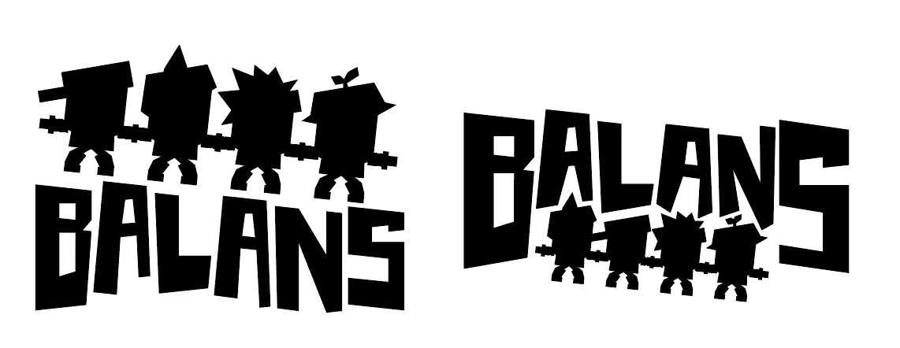
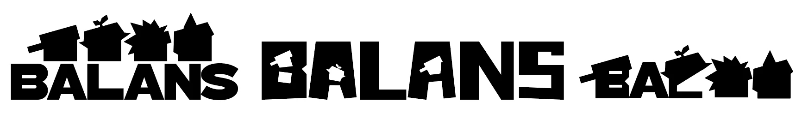
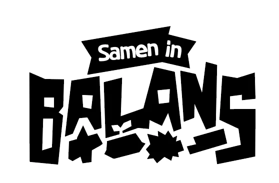
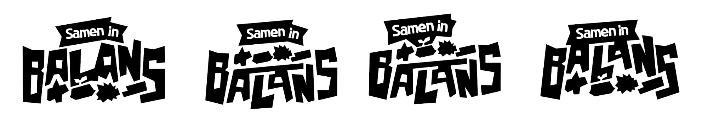
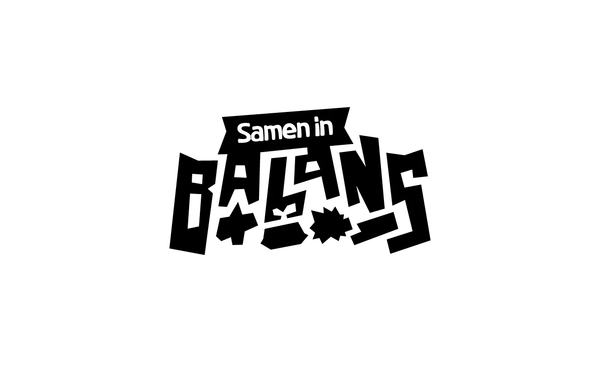

Every game needs a face, and for *Samen in Balans* that face is the logo. It's the first thing children see at the installation, so it had to say two things at once: these are the Boxlings, and this game is about balance. This post walks through the iterations, from the first pencil sketch to the final logo.

## Step 1: sketching the Boxlings

I already had an idea in my head, so I started by sketching the silhouettes of the four Boxlings: RITS with his cap, SPRIET with the sprout, KRABBEL with the spikes and PUK with the cat-like ears. I wanted them in the logo because players will recognise their features from the game.

The second thing the logo needed was balance, literally. So in the first rough version, the four Boxlings stand together on a tilted plank on top of the word BALANS, with "Samen in" written above them.

## Step 2: a boxy font

Next I looked for a font, and I went for a boxy one on purpose. The game takes place in a box world: you'll never see a rounded edge there. A rounded font would feel out of place, so the letters had to be just as angular as the world itself. The silhouettes are already boxy, so the font complements them and the whole logo shares that same feeling.

With the font in place, I tried out where the Boxlings should go: standing on top of the word, or squeezed in under the letters.

## Step 3: only the heads

Looking at those versions, I noticed the bodies didn't add anything. All the Boxlings share the same body, so the character is in the head. I cut the silhouettes down to just their heads and tried them on top of the word, inside the letters and as part of the letters.

I also tried a different font here, but I didn't like it as much as the first one, so I went back to that.

## Step 4: headgear and duct tape

Even the heads were still repetitive: every Boxling has the same box face. What really makes each one recognisable is what they wear on top. So I kept only the caps, helmets and headpieces and placed them under the letters, like little pieces lying at the bottom of the word.

The subtitle "Samen in" also needed more weight. On its own it felt loose next to BALANS, so I put it on a strip of **duct tape**: the same tape silhouette we had in mind for the characters. It ties the subtitle to the cardboard world and makes the logo feel complete.

## Step 5: a giant in the letters

TIPPER, the giant Boxling, is a big part of the game, so he deserved a place in the logo too. Instead of adding another shape, I tried to hide him in the letters themselves: the L and the A of BALANS together form a giant holding a plank, balancing something. I tried a few versions of how the letters lean and connect.

## Step 6: the final logo

For the final logo I combined the strongest parts of the previous iterations:

- **The boxy font** from step 2, because it matches the box world.
- **The headgear** of the four Boxlings from step 4, so every character is there without repeating the same face.
- **The duct tape** behind "Samen in" from step 4, to connect the subtitle to the wordmark.
- **The giant in the L and the A** from step 5, so TIPPER and the idea of balancing are both part of the word itself.

## What I'm taking with me

- **Translate the world into the shapes.** No rounded edges in the game means no rounded edges in the logo.
- **Keep only what's recognisable.** Bodies, then faces, were cut until only the headgear was left: the part that makes each Boxling unique.
- **Let the concept live in the letters.** The balancing giant works best as part of the word, not as an extra drawing next to it.
- **Iterate, then combine.** The final logo isn't one new idea, but the best piece of each earlier version put together.
