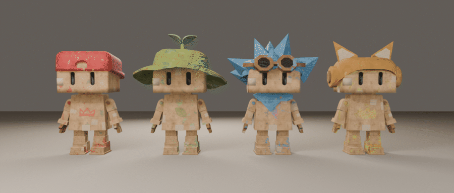
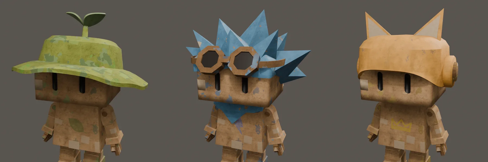
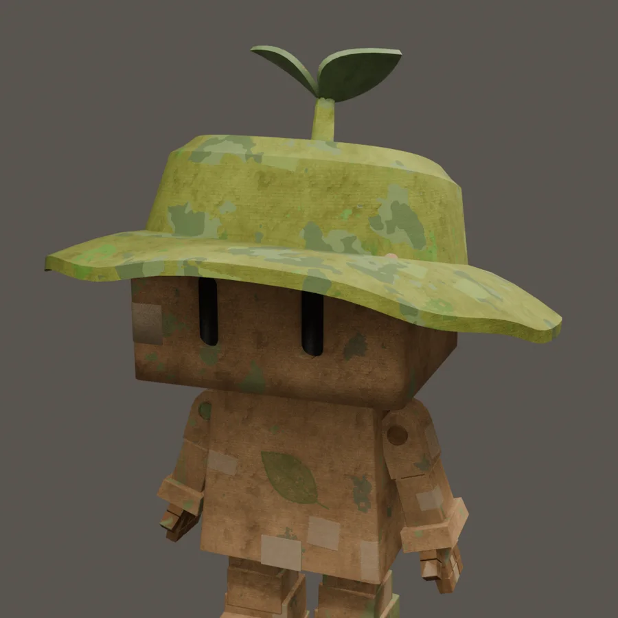
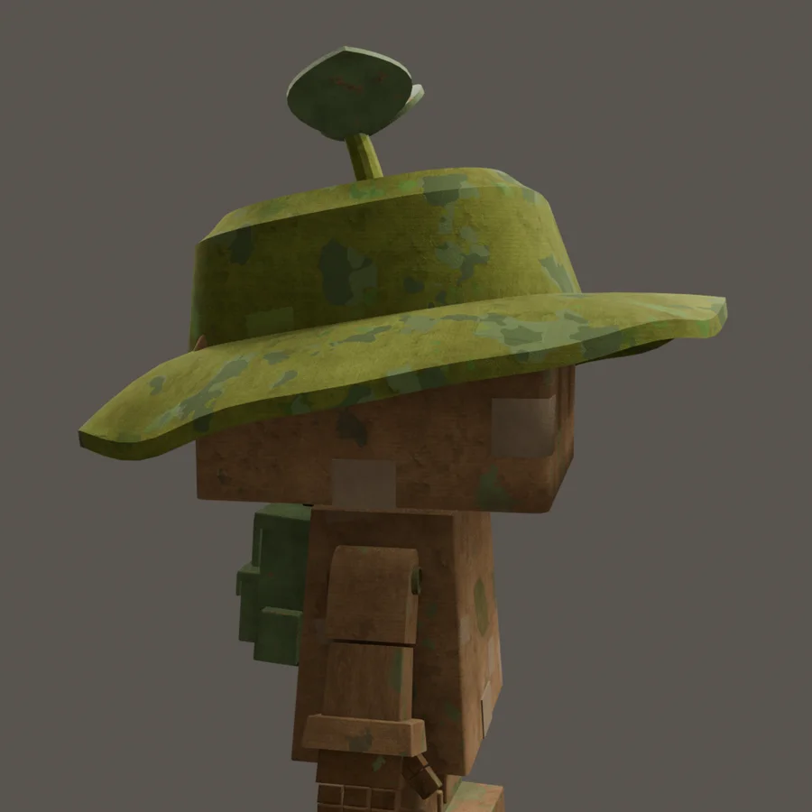
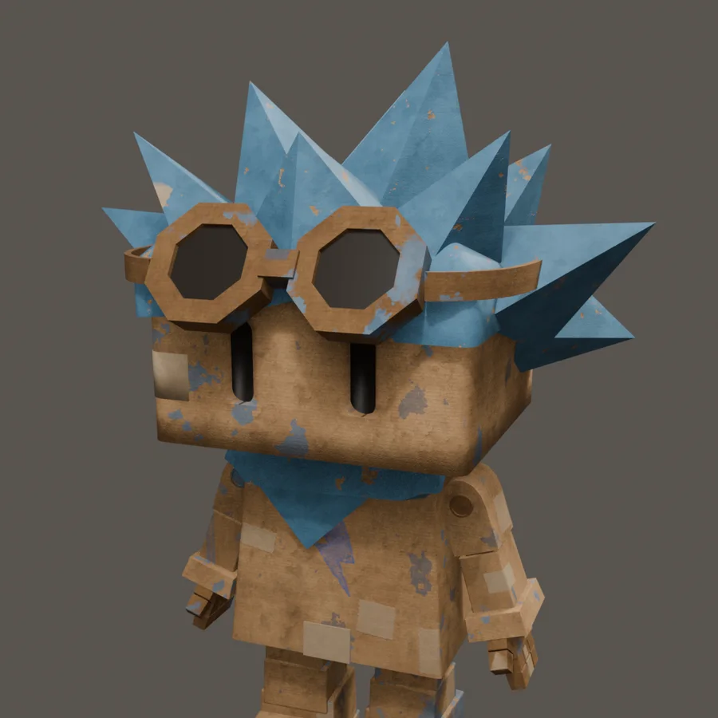
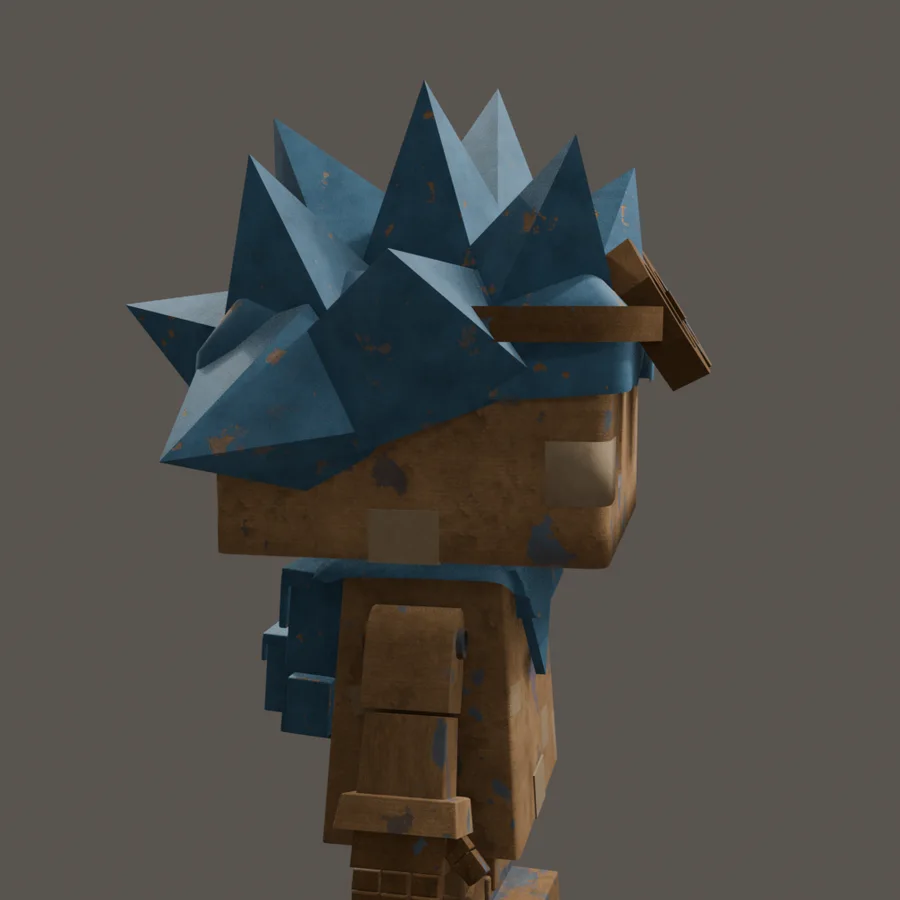
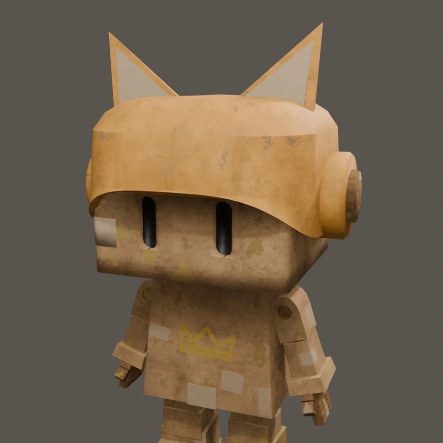
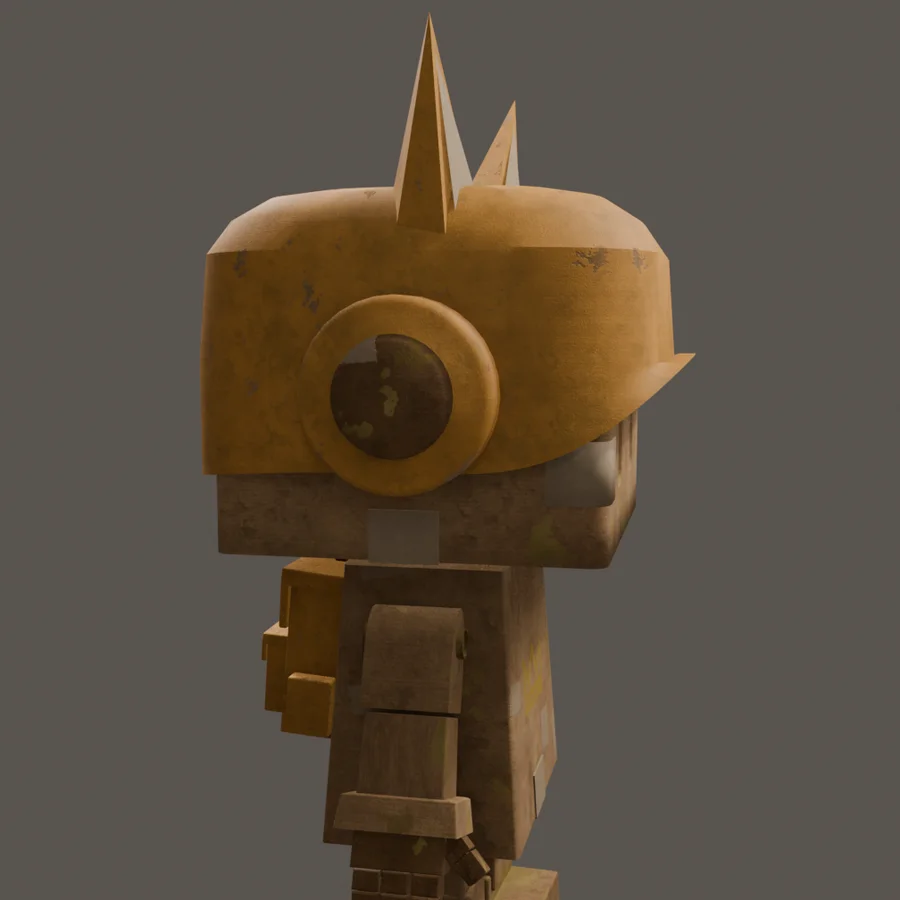

RITS isn't alone anymore. The Boxlings are a team of four, and this week the other three joined him: SPRIET, KRABBEL and PUK. Together they're the cast of the game, each with a personality you can read from a distance.

## One body, four characters

All four Boxlings share exactly the same body: the same blocky torso, arms, legs, hands and eyes, the same skeleton and the same animations. That was a deliberate choice. Because the rig and the weights are identical, the idle, the running cycle and the dust clouds I made for RITS work on every Boxling without changing a single key.

What makes them different is everything on top of that body:

- **A colour.** Red for RITS, green for SPRIET, blue for KRABBEL and yellow for PUK. The paint splotches, the backpack and the emblem all use it.
- **An emblem on the chest.** A crown for RITS, a leaf for SPRIET, a lightning bolt for KRABBEL and a paw print for PUK.
- **Headgear.** The biggest part of each silhouette, so you can tell them apart even when they're small on screen.

## SPRIET

SPRIET is the calm one, with a green cardboard bucket hat and a small seedling growing out of the top. His emblem is a painted leaf.

The hat took a few tries. My first version was much too tall, with a separate corrugated edge around the brim. In the end a lower crown with a wide, slightly drooping brim matched the design best. The hat is fully green now, with the cardboard texture and some darker green splotches still showing through.

The leaf on his chest also changed. The first version was a clean outline that looked like a vector sticker on the cardboard. Now it's painted: a thin, slightly transparent layer of green with brush strokes, darker lines for the veins and a few worn patches.

## KRABBEL

KRABBEL is the wild one: a mop of blue cardboard spikes, a pair of octagonal cardboard goggles on his forehead, a blue bandana around his neck and a lightning bolt on his chest.

The hair was the hardest part of all three. The first versions had far too many spikes, which turned his head into a hedgehog. Then they were too flat, like triangles instead of pieces of cardboard with volume. A smooth cap with a few spikes on top didn't work either: it looked like a helmet with decorations. In the end I modelled the hair myself, as a crown of separate, chunky cardboard spikes of different sizes, with no base layer underneath. Together they form one messy, spiky hairstyle.

The goggles only exist at the front: their strap disappears into the hair at the sides, so from behind you only see his spikes.

## PUK

PUK is the playful one, with a cardboard cap with cat ears and big round ear cups, like headphones. PUK's emblem is a yellow paw print.

The cap started out round and soft, but that didn't fit the rest of the Boxlings, so I made it more angular, like a folded piece of cardboard. I also remodelled the ears: two flat cardboard triangles standing straight up, with a lighter inside, which makes PUK look curious and alert. The yellow needed a second pass too: the first version leaned too much towards orange. And at first PUK wore the same crown as RITS; now PUK has a symbol of their own, a painted paw print that fits the cat ears.

## What I'm taking with me

- **Build a family on one base.** One body and one rig for four characters means every animation I make works for the whole team.
- **Let the silhouette do the work.** A hat, a hairstyle and ears are what you recognise first, so that's where the design time should go.
- **Paint, don't stick.** An emblem only feels part of the cardboard when it looks painted on, with brush strokes and wear.
- **Fewer, bigger shapes.** A handful of big spikes reads better than fifty small ones.
- **Some things you just do by hand.** Scripts got me far, but the final hair and ears only felt right once I modelled them myself.
