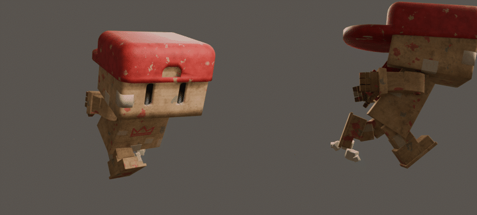
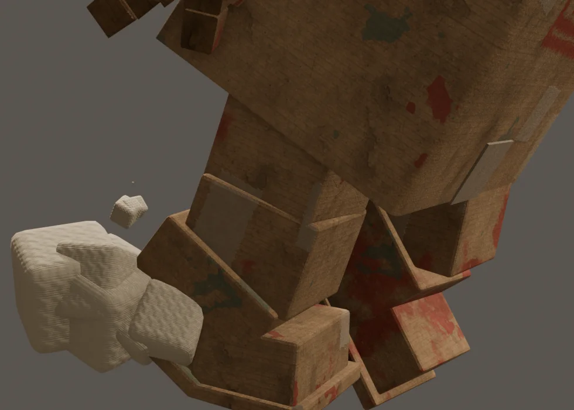
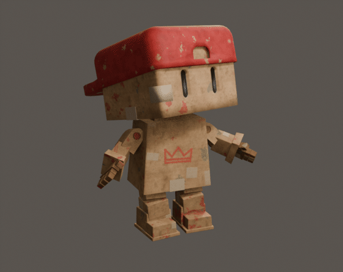
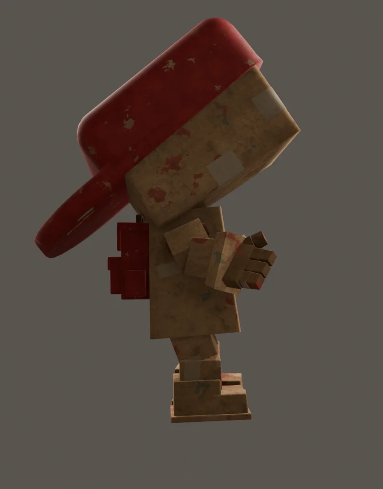
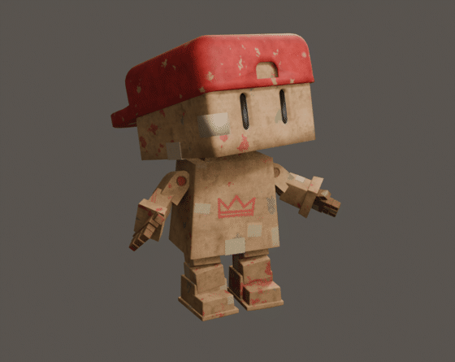

After the first wave, RITS needed the two animations he'll use most in the game: running and standing still. In the game, objects fall from the sky, so I wanted him to feel aware of that at every moment: busy and determined while he runs, curious and a little on edge when he stands still.

## 1. The running cycle

The run is a 24-frame loop that stays in place. In the game the world moves under him, so the animation itself never travels forward. Because his legs are so short compared to his huge head, he takes small, quick steps instead of big strides. He leans forward as if his head is pulling him along, and his arms pump against his legs.

## 2. Dust clouds made of cardboard

A running character feels much heavier when the ground reacts. Normal smoke or dust didn't fit RITS, so I made the dust out of the same material he is made of: small clusters of rounded cardboard blocks.

- **On landing:** when a foot hits the ground, a cloud of five blocks puffs up beside and behind the heel.
- **On push-off:** when a foot leaves the ground, a smaller cloud of four blocks kicks backwards.
- **The motion:** each block grows quickly, drifts back and up, tumbles a little and shrinks away again in about half a second.

The moments aren't placed by hand. A script follows the lowest point of each shoe through the animation and finds the frames where a foot lands and pushes off. So the clouds always match the footsteps, even after I change the run.

## 3. An idle that watches the sky

For the idle I started from my own standing animation, where RITS slowly turns his head from left to right. On top of that, he now looks up at the sky every now and then: slowly up, a curious tilt of the head, sometimes a quick double-check, and back down again.

The first version moved the head too fast. It felt nervous instead of curious, so I slowed everything down to half the speed. The idle is now about 18 seconds long: my own head-turning loop plays three times, but the looks at the sky are different each time, so it doesn't feel repetitive.

The body got subtle motion as well:

- **Breathing:** the chest rises and falls, and the hips sink a little with every breath, so the knees bend along.
- **Weight shift:** twice per loop he shifts his weight from one leg to the other. The feet stay exactly in place.
- **Ready to catch:** when he looks up, his arms come slightly forward and out, as if he's ready to catch whatever falls. His hands stay calm on purpose.

## 4. Making it work in the game

In the game RITS switches between the two animations all the time. The dust clouds may only appear while he runs, and that turned out to be the tricky part: the clouds are separate objects with their own animation, so they don't automatically know whether RITS is running or standing still.

The solution was a small, hidden bone in the rig that the clouds hang from. In the running cycle that bone has full size, so the clouds are visible. In the idle it's scaled to zero, so they're gone. Now the clouds simply follow whichever animation plays on the rig, both in Blender and in the game.

The switch between the two is a short crossfade of about a quarter of a second. When he stops running, the clouds shrink away by themselves and he goes back to watching the sky.

## What I'm taking to the next Boxlings

- **Style the effects too.** Dust made of cardboard blocks fits the world much better than realistic smoke.
- **An idle should be slow.** The calmer version reads as curious; the fast one read as nervous.
- **Attach effects to the animation.** Letting the clouds follow a bone in the rig means they can never get out of sync with what RITS is doing.
- **Protect your actions.** Blender throws away an animation that nothing uses when you save. Giving every animation a fake user keeps them safe.
