After texturing RITS, it was time to make him move. The goal for this step was small: one simple animation, a wave. But getting there meant building a skeleton, deciding how his cardboard blocks should follow it, and fixing a few things that only showed up once he started moving.

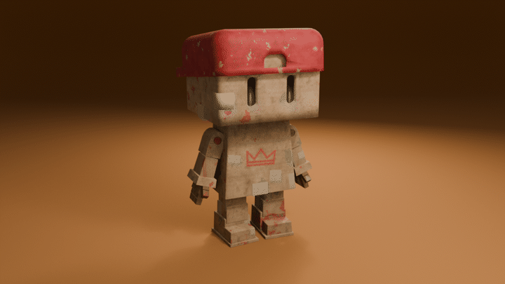

## 1. A skeleton that fits

I started from the human metarig of Rigify, Blender's rigging add-on. Out of the box it's made for a realistic human, so it was far too big for RITS, with long arms sticking out of his sides.

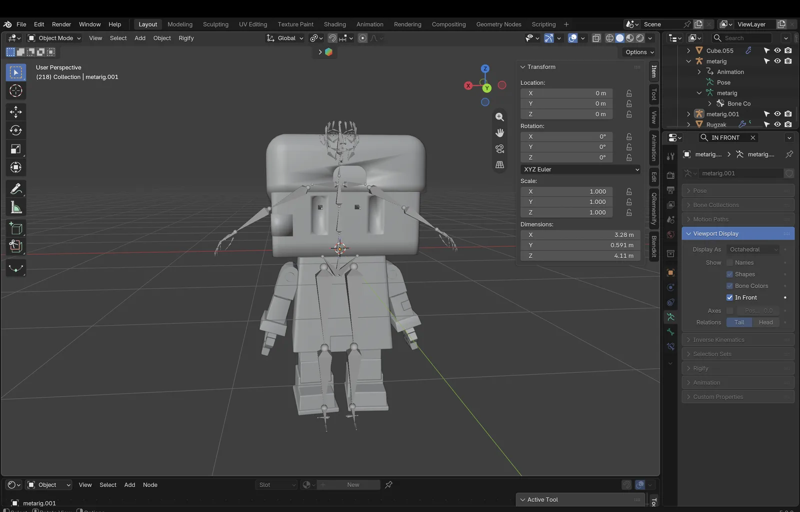

I scaled it down and moved every bone into place: the spine through the middle of the body, the head bone into the head, and the legs through the stacked leg blocks.

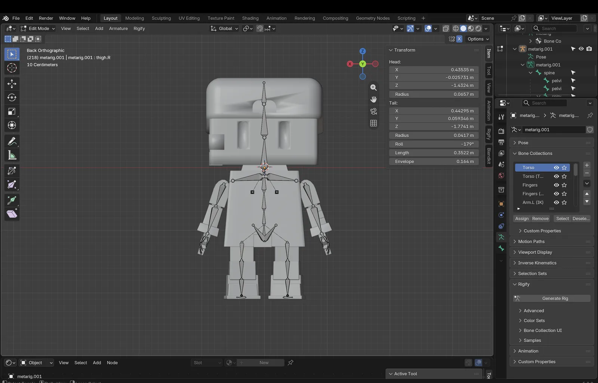

For the arms and hands precision matters, because the joints have to sit exactly in the round bolts. I snapped the 3D cursor to each bolt and then snapped the bone ends to the cursor. That way every elbow and finger joint rotates around the middle of its bolt.

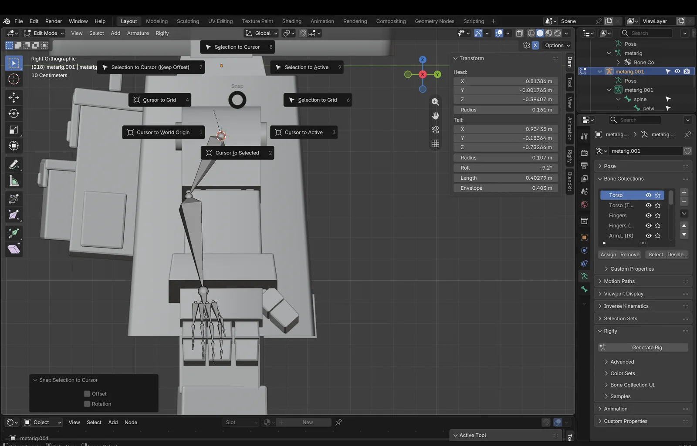

## 2. Fingers and a Rigify error

The first time I generated the rig, Rigify refused: *"Input to rig type must be a chain of 2 or more bones."* RITS's fingers are short blocks, so I had given each finger only one bone. Rigify's finger rig expects a chain.

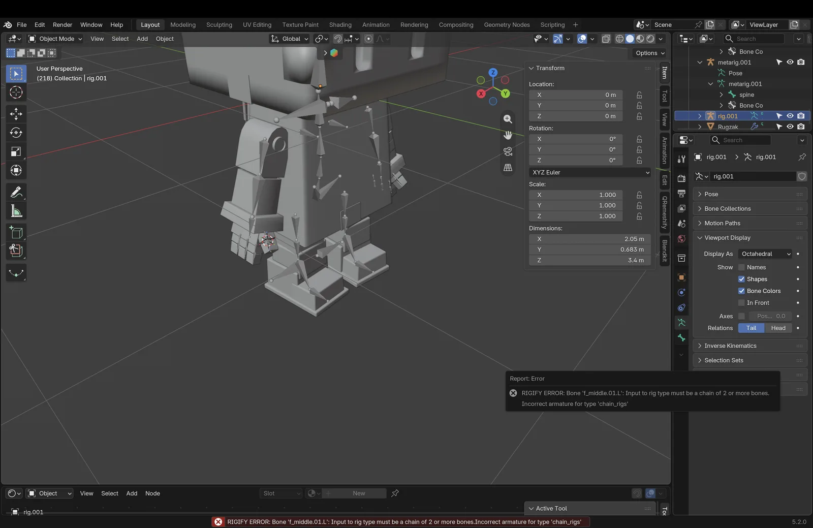

So every finger got two bones, one per finger block. After that the rig generated without problems, with its familiar control panel for the torso, arms, legs and fingers.

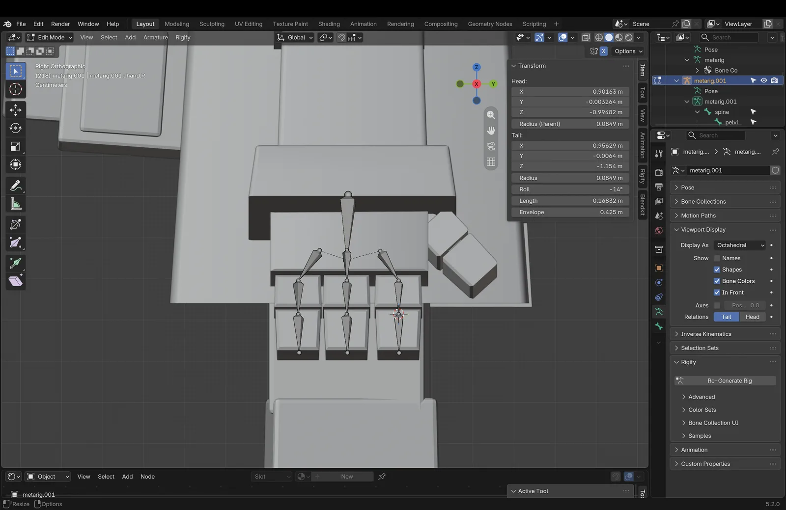

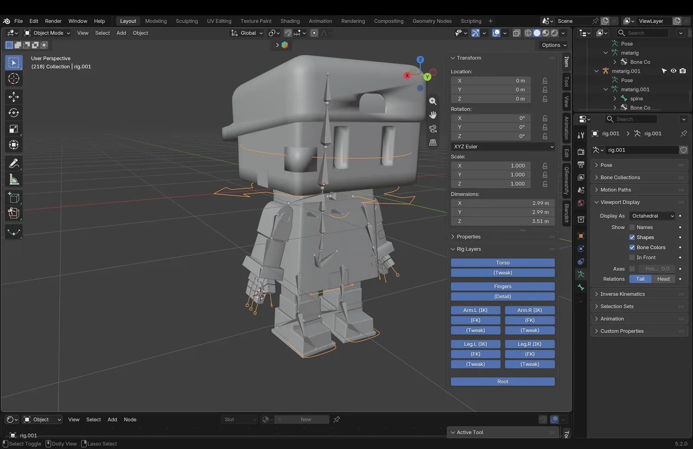

## 3. Automatic weights didn't work

Next I parented the model to the rig with *Automatic Weights*, which normally works out how much each bone moves each part of the mesh. For RITS it failed with a *"Bone Heat Weighting: failed to find solution"* error. Because RITS is built from many separate blocks instead of one closed mesh, Blender couldn't calculate weights for the head, the soles of the shoes, part of the backpack and the upper arms.

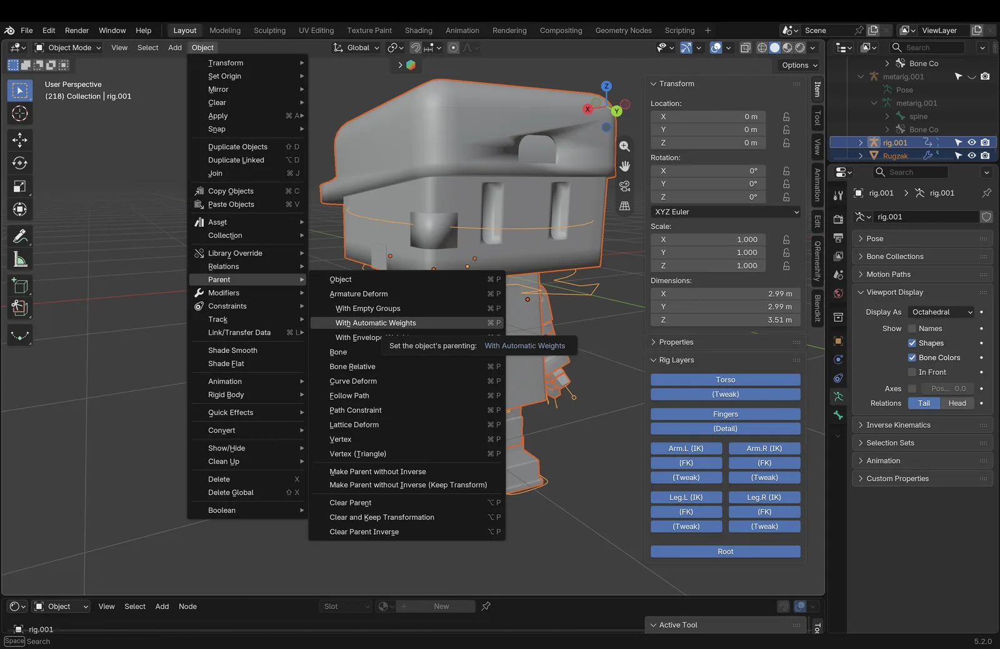

And even where it did work, it wasn't what I wanted. Automatic weights blend smoothly between bones, so the cardboard would bend like rubber at the elbows and knees.

## 4. Weighting him like a robot

RITS is made of rigid boxes, so he should move like a robot or a jointed toy. I used an earlier robot model as reference: there, every block belongs to exactly one bone. A block either follows a bone completely (weight 1) or not at all (weight 0). There's nothing in between.

I gave RITS the same setup:

- **Every block on one bone.** The head and cap follow the head bone, the body follows the chest, and each arm, hand and finger block follows its own bone.
- **Soft joints only in the bolts.** The round joint bolts between two finger blocks are the only parts with a soft transition, so they turn neatly along with both blocks.
- **A toe that can tip.** I split the sole of each shoe at the toe joint, so the toe block can tip up separately from the rest of the foot.
- **Animate the metarig directly.** Like in the robot model, I parented everything to the metarig and animate that, instead of the much heavier generated Rigify rig.

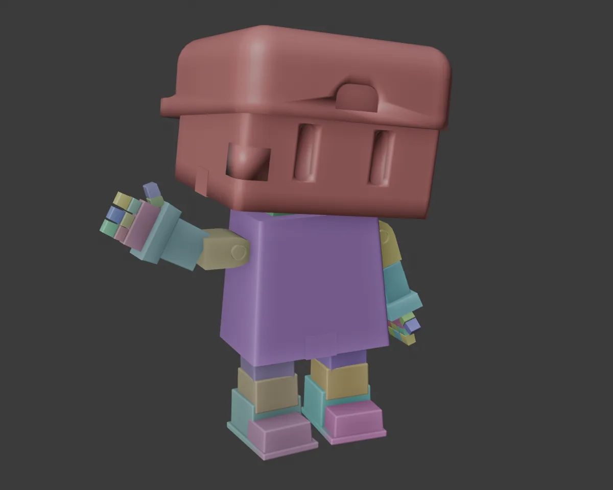

## 5. The first wave

With the weights in place I could finally pose him. In pose mode I raised his right arm, bent the elbow and keyed a wave of the hand back and forth: 96 frames, so four seconds at 24 frames per second.

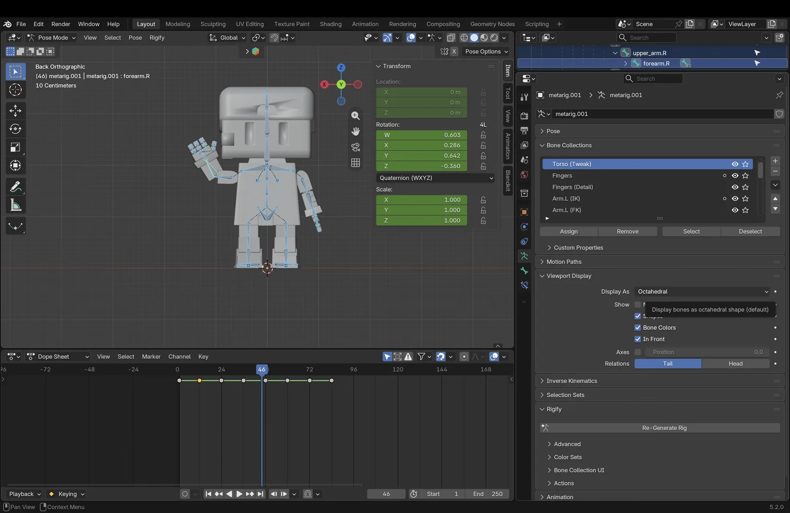

## 6. A texture that slid

Moving RITS showed a problem that wasn't visible in a still render: the texture slid over the cardboard. The paint, tape and cardboard relief are generated in the shader from the position of each point. But that position changes when a bone moves a block, so the texture started to slide over the arm while he waved.

The fix: just before the rig moves anything, a small Geometry Nodes step saves each point's original position and direction. The shader reads those saved values instead. Now the texture is stuck to the cardboard, however he moves.

## 7. Cleaning up the cap

Watching the animation, one more problem stood out: dark streaks next to the opening in the front of the cap. The opening had been cut in quickly, and the rounded corners were filled with thin triangles all coming from one point, next to large faces with five and eight corners. With smooth shading this gives crooked shadows.

I rebuilt that area with only four-sided faces: a ring of faces right along the edge of the opening, and neat strips out to the sides. I also put all the points exactly on the curve of the cap again, because the edge of the opening was sticking out slightly. The streaks are gone.

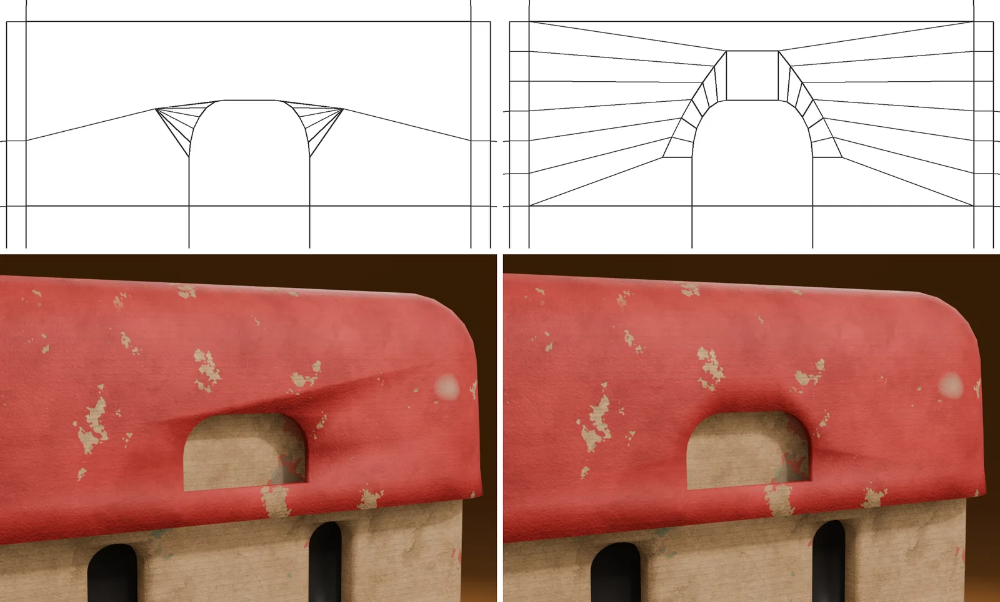

## What I'm taking to the next Boxlings

- **Match the rig to the character.** A cardboard figure shouldn't bend like rubber. Rigid weights, one bone per block, suit the style much better than automatic weights.
- **Plan the bones while modelling.** Two blocks per finger and a separate toe block made rigging easy. The other Boxlings will get the same joints from the start.
- **Test in motion early.** The sliding texture and the bad shading on the cap were invisible in still renders. A short test animation shows them right away.
- **Clean topology pays off.** A quick cut in the model can look fine at first, but it shows up in the shading later.
