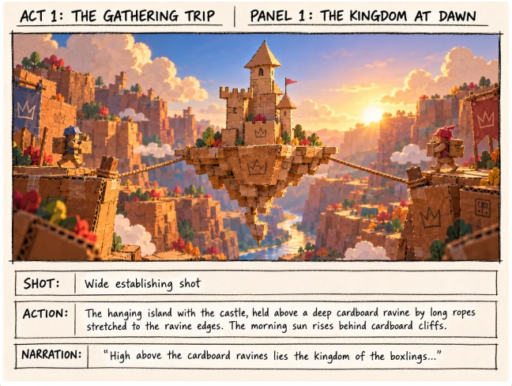
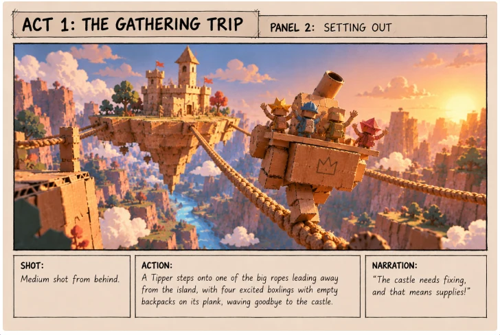
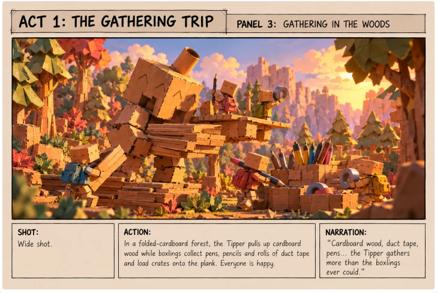
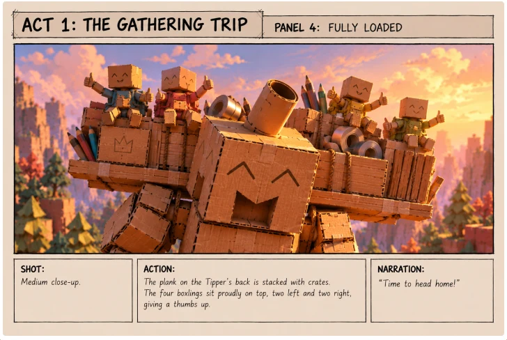
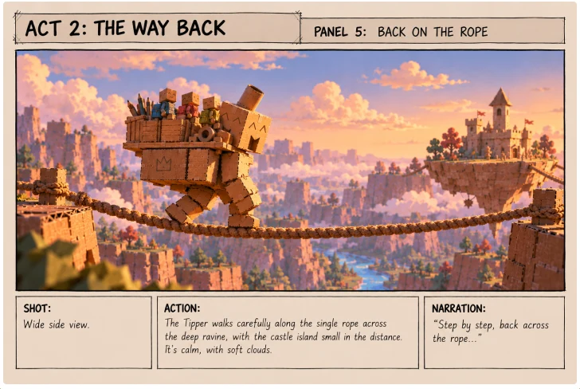
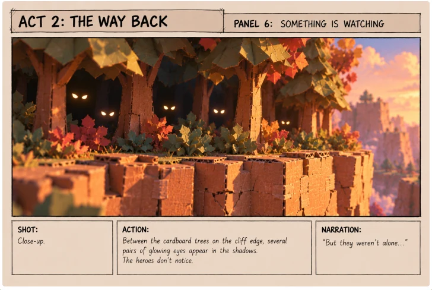
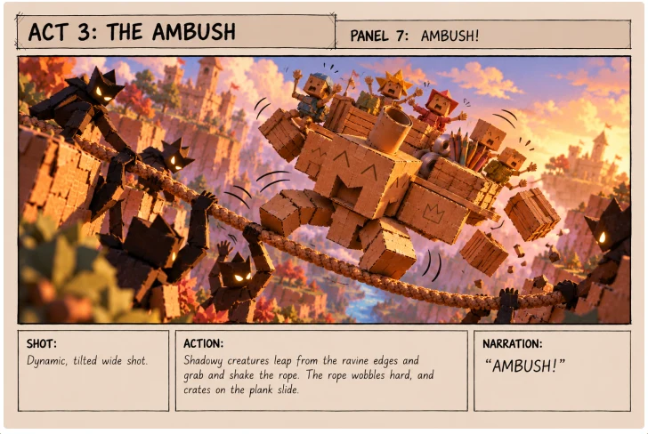
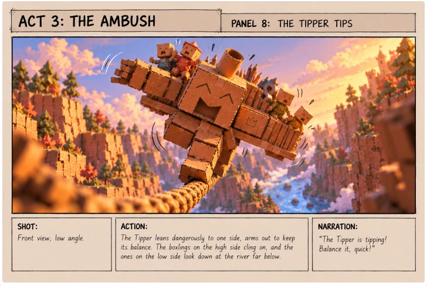
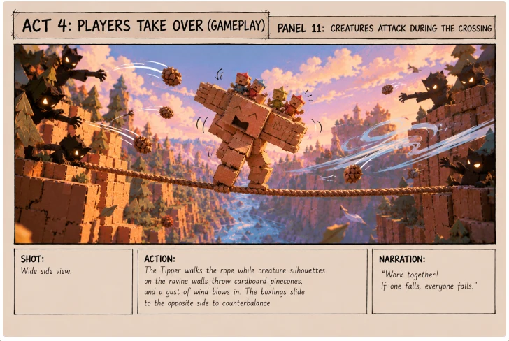
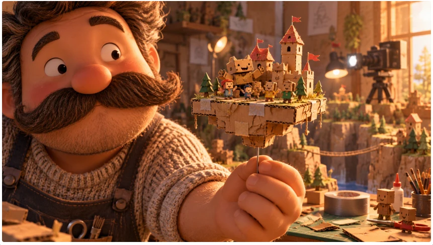

Before we build the game, we need to know what story it tells. Why is there a big cardboard creature walking on a rope? Why do the players have to keep it in balance? To answer those questions, we made a storyboard: thirteen panels in five acts, plus an ending.

Every panel describes the shot, the action and the narration. We used AI to turn those descriptions into images, so we could see the story instead of only reading it.

## Act 1: The gathering trip

The story starts in the kingdom of the Boxlings: a cardboard castle on an island that hangs above a deep ravine, held up by long ropes. The castle needs fixing, so the Boxlings set out to gather supplies.

They don't go alone. The Tipper, the big cardboard collector, carries the four Boxlings on a plank on its back and walks along one of the ropes, away from the island.

In the forest of folded cardboard trees, everyone collects materials: cardboard wood, giant pencils and rolls of duct tape. The Tipper carries more than the Boxlings ever could.

## Act 2: The way back

On the way home, the Tipper walks carefully along a single rope across the ravine. Everything is calm, but between the trees on the cliff edge, glowing eyes are watching.

We kept the creatures mysterious on purpose: only shadows and eyes, never scary. The game is for children, so it should feel exciting, not frightening.

## Act 3: The ambush

Dark shapes jump from the edges of the ravine and shake the rope. The crates slide, and the Tipper starts to tip.

This is the moment the whole story builds up to: the Tipper is about to fall, and somebody has to help it keep its balance.

## Act 4: The players take over

Here the story turns into the game. Four children stand on coloured pressure pads in front of a big screen that shows the Tipper on the rope. Each child controls one Boxling on the plank:

- **Lean left or right** and your Boxling moves to that side of the plank.
- **Stand on both feet** and your Boxling keeps moving in the direction it was already going.

While the Tipper crosses the ravine, the creatures throw cardboard pinecones and gusts of wind blow in. The players have to move their Boxlings to the other side to counterbalance. If one falls, everyone falls, so they can only make it by working together.

## Act 5: Home, together

When the players succeed, the Tipper steps onto the island, the creatures retreat into the shadows and the other Boxlings come running out of the castle to cheer. Together they unload the crates and use the cardboard and duct tape to fix the castle tower. The kingdom grows stronger thanks to the players.

## Optional ending: who made this world?

This ending is an extra. We will only make it if we have enough time, and right now it is unlikely that we will.

The idea is a final image that reveals the secret of the whole world: it is a handmade stop-motion set. The friendly stop-motion maker sits next to the finished cardboard world in his workshop, surrounded by tape, string, pens and scissors. He winks at the camera and holds out an empty cardboard box to the children.

His message: this whole world started with just a cardboard box and a big idea. Now it's your turn: what world will you make?

If we make it, this ending would connect the game to the film festival and tie the story back to our style: everything is cardboard because everything was made by hand.

## What the storyboard gave us

- **A reason to balance.** The Tipper carries the Boxlings home on a rope, and the players keep it from falling.
- **A reason to work together.** One player alone can't save the Tipper; the group has to move as one.
- **A clear list of what to make.** The castle on its hanging island, the ravine, the cardboard forest, the Tipper and the four Boxlings all come from these panels.
