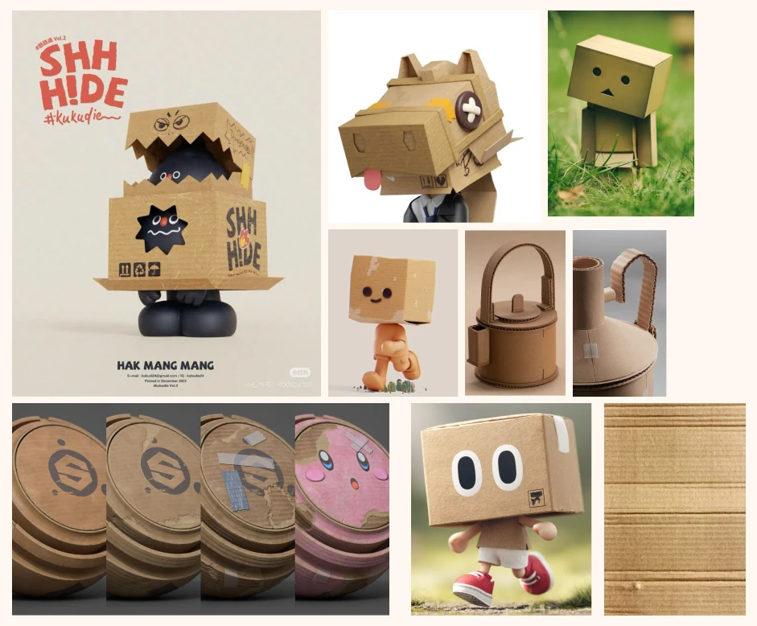
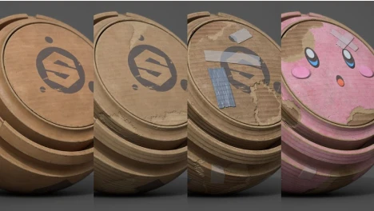
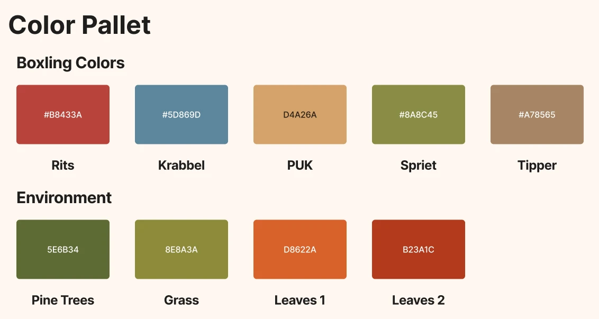

Before we start modelling the Boxlings and their world, we need a clear visual direction. Everything in Samen in Balans should feel like it was built by hand from old cardboard boxes, as if a stop-motion animator made the whole set on their kitchen table. To pin that feeling down, I made a styleboard and a colour palette.

## 1. From stop-motion to cardboard

Our project is made for the JEF film festival, so we looked at film for our style. Stop-motion was the clearest inspiration: every character and every set in a stop-motion film is made by hand, and you can see it. Small imperfections, visible materials and a bit of wobble are part of the charm.

We carried that idea through to our own visual style. Instead of copying the look of clay figures, we asked ourselves which material children recognise as "handmade" right away. The answer was cardboard. Almost every child has built something from an old box, and cardboard shows how it was made: you see the cut edges, the folds and the tape. That is why the whole world of Samen in Balans, from the Boxlings to the trees, is made of cardboard, as if a stop-motion animator built the set by hand.

## 2. The styleboard

The styleboard collects references from other artists that show what we are aiming for.

There are three kinds of references on the board.

**Cardboard characters.** Figures with a box as a head and simple, blocky bodies. What I like about them is how little they need: two dots or two lines for eyes is enough to give them a personality. The pose and the shape of the box do the rest. This is the starting point for the Boxlings.

**Cardboard objects.** A kettle and a jug built from cardboard. They show that even round shapes can work in cardboard, as long as you can see how they were made: the layers, the cut edges and the tape that holds it all together.

**The cardboard itself.** This is the most important part. We don't want clean, new cardboard. We want cardboard that has clearly been used: stains, patches where the top layer is torn off and the corrugation shows, pieces of tape, and colour that is painted on top instead of smooth plastic.

From the board we take a few clear rules for the rest of the project:

- **Everything is cardboard.** No shiny plastic or metal, also not for the colour.
- **Show how it is made.** Visible corrugated edges, tape and folds.
- **Simple faces.** Two marks for eyes, no complex expressions.
- **Used, not new.** Stains, torn patches and painted details.

## 3. The colour palette

The world is mostly cardboard brown, so colour has to do a lot of work. Every Boxling gets one signature colour, which goes on their headwear and backpack. The rest of the body stays plain cardboard.

**Boxling colours**

| Boxling | Colour | Hex |
| --- | --- | --- |
| RITS | Red | `#B8433A` |
| KRABBEL | Blue | `#5D869D` |
| PUK | Ochre | `#D4A26A` |
| SPRIET | Green | `#8A8C45` |
| TIPPER | Cardboard | `#A78565` |

TIPPER is the exception on purpose: he is the big collector and stays plain cardboard, so he looks different from the four player characters.

**Environment colours**

| Element | Hex |
| --- | --- |
| Pine trees | `#5E6B34` |
| Grass | `#8E8A3A` |
| Leaves 1 | `#D8622A` |
| Leaves 2 | `#B23A1C` |

The environment is an autumn forest: dark pine green and olive grass as a calm base, with orange and red leaves as accents.

## 4. Why these colours

The game is played in groups, and every child has to find their own Boxling on the screen in a second. That is why the four player colours are spread out as far as possible: red, blue, ochre and green. They are also a bit more saturated than the environment, so the characters stand out from the cardboard forest behind them.

We also kept colour-blind children in mind. Red and green can look alike for them, so the colours also differ in brightness, not only in hue. On top of that, every Boxling has its own shape of headwear, so they can be told apart even without colour.

## Next step

With the style and colours set, the next step is the first Boxling: RITS, with the red cap.
