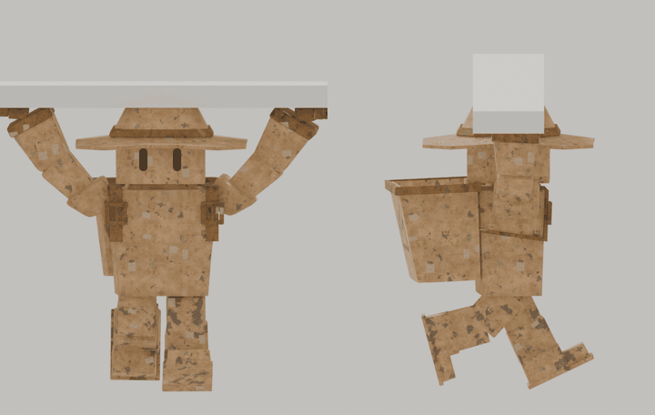
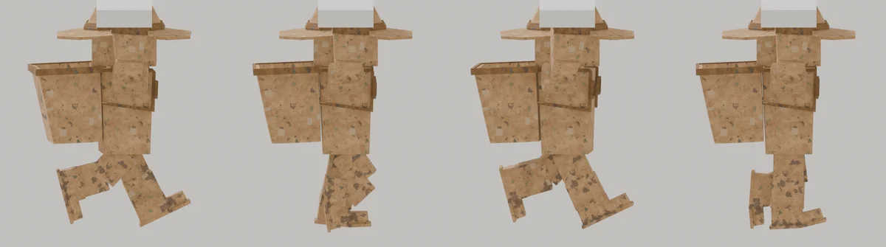
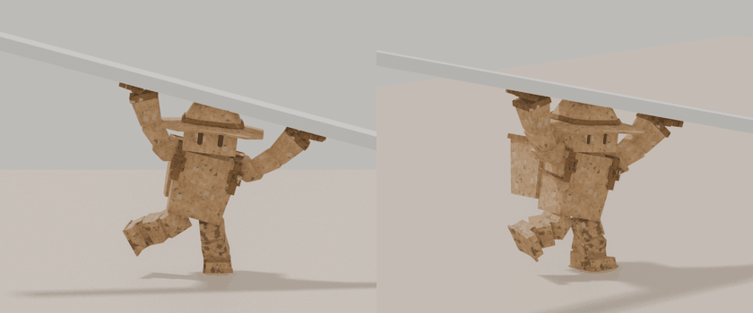
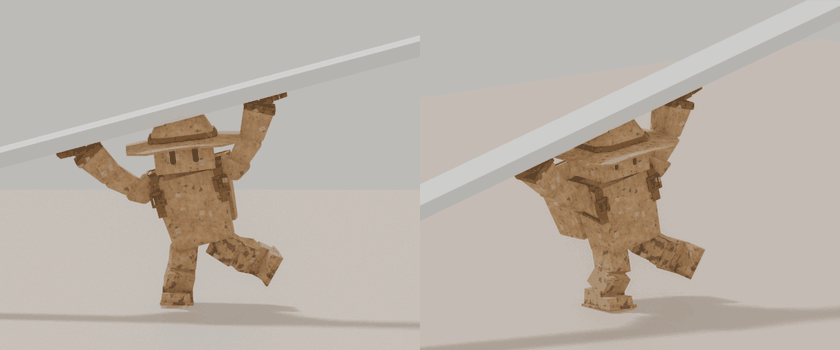

In our story, the Boxlings rely on TIPPER, the gentle giant who carries all the supplies home across the ropes. In the game, he carries the long plank the four Boxlings stand on. So after [building and rigging TIPPER](../tipper/), the next big step was making him walk, without dropping the plank.

## Walking with a plank

A normal walk cycle has swinging arms. TIPPER can't do that: his hands hold the plank above his head the whole time. That changes the whole walk:

- **The arms stay up.** Both arms hold the plank, so all the movement has to come from the legs and the body.
- **The legs do the work.** Every step has a clear lift, a step forward and a landing, so you can see the weight he's carrying.
- **In place.** Like the run of RITS, the walk stays on one spot. In the game the world moves under him, so the animation itself never travels forward.

The loop is 30 frames long. At 24 frames per second, one full cycle (a left step and a right step) takes a bit more than a second, which feels slow and heavy, like a giant carrying something important.

## The key poses

I started with the most important poses of one step: the moment a foot lands in front, the moment the other leg passes underneath him, and back again for the other foot.

## Making the toes work

When I started animating the feet, I noticed that the toe bones didn't do anything: I could rotate them, but the boot didn't bend. The front part of the boot was still following the foot bone instead of the toe bone. After the front of the boots was connected to the toe bones, TIPPER can roll over his toes when he pushes off, which makes every step feel a lot less stiff.

## One step, mirrored

A walk cycle is two steps that are each other's mirror image: what the left leg does in the first step, the right leg does in the second. Animating both steps by hand takes twice as long, and they never come out exactly the same, so the walk starts to limp.

So I only animated the first step myself. The second step is that first step, mirrored: every left bone gets the keyframes of the right bone, flipped to the other side, and the other way around. The last frame is exactly the same as the first, so the loop has no bump where it starts again.

## The arms that disappeared on frame 6

After mirroring, something strange happened: on frame 6, his arms suddenly folded away and came back again. The keyframes themselves were fine, but the movement between two of them wasn't.

The reason is how Blender stores rotations. A rotation can be written in two ways that mean exactly the same thing, one the "negative" of the other. If one keyframe uses one way and the next keyframe uses the other way, Blender doesn't turn the bone a little bit. It goes through "no rotation at all" on its way between them, and the arm collapses for a few frames. By making every keyframe use the same way as the one before it, the arms now move smoothly through the whole loop.

## Losing his balance

In the game, the plank tilts when too many Boxlings stand on one side. When it tilts too far, TIPPER has to show that he's struggling to keep everything up. So next to the walk cycle, he got a balancing animation:

- **He stops and stands on one foot,** the foot on the low side of the plank, right under the weight.
- **His other leg goes out to the side** as a counterweight.
- **The plank and his upper body tilt together,** about 15 degrees. That way his hands keep holding the plank, even when it's tilted.
- **He wobbles a little,** between 12.5 and 17.5 degrees. His free leg swings along and his head stays a bit straighter than his body, as if he's looking for his balance.

Just like the walk, I only needed one side: the animation for when the plank tips to the right is the mirrored version of the one for the left. Both are 2-second loops, so he can keep balancing for as long as the plank stays tilted.

In the game, TIPPER switches from walking to balancing when the plank tips too far, and back to walking when the players get it straight again. The switch is a short blend of less than half a second, so he never jumps from one pose to the other.

## What's next

- Put the walk and the balancing animations in Unity, and let the game switch between them depending on how far the plank tilts.
- Let his hands follow the plank in the game, so he keeps holding it at every angle, not only at the angle of the animation.
- Fine-tune the timing and the arms, so the plank feels heavy but stays steady for the players.

## What I'm taking with me

- **The props change the animation.** Because TIPPER holds the plank, his arms can't swing. All the life of the walk has to come from his legs and body.
- **Animate one step, mirror the other.** It saves time, and the two steps are always exactly the same.
- **Check the in-betweens too.** The keyframes looked right, but the problem was between them. Scrubbing through every frame is the only way to catch it.
- **Check the rig before animating.** The toe bones looked fine until I tried to use them.
- **Show the struggle.** A character that just tilts along with the plank feels stiff. Standing on one foot and wobbling makes it clear that TIPPER is fighting to keep his balance.
