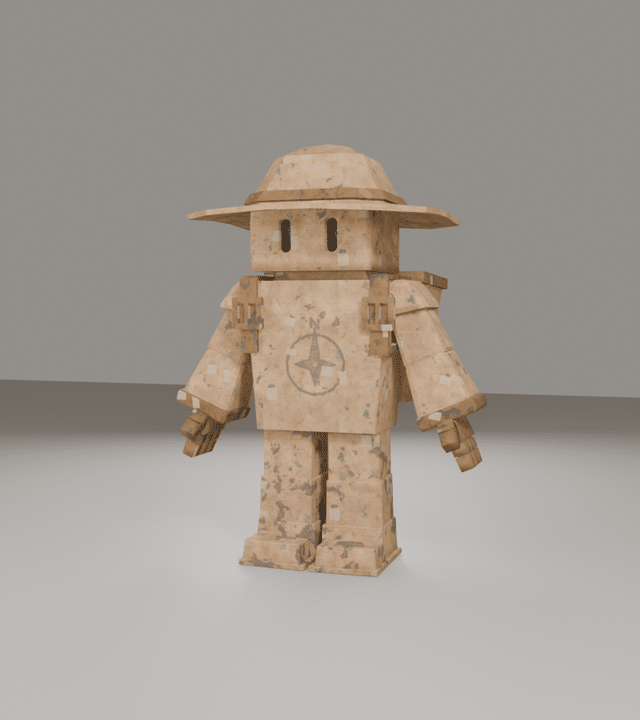
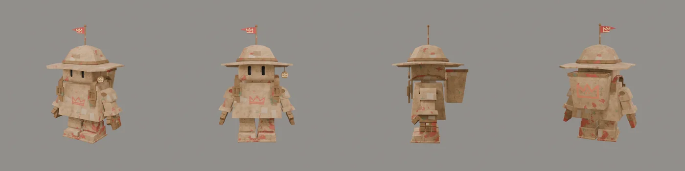
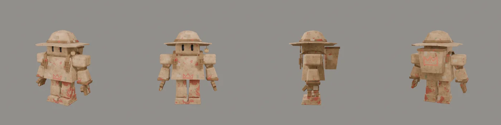
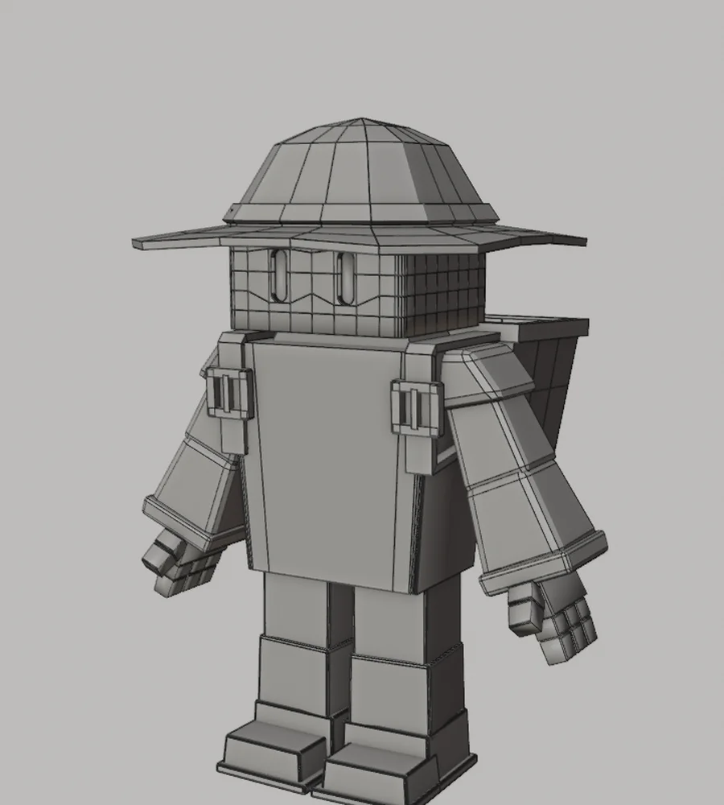
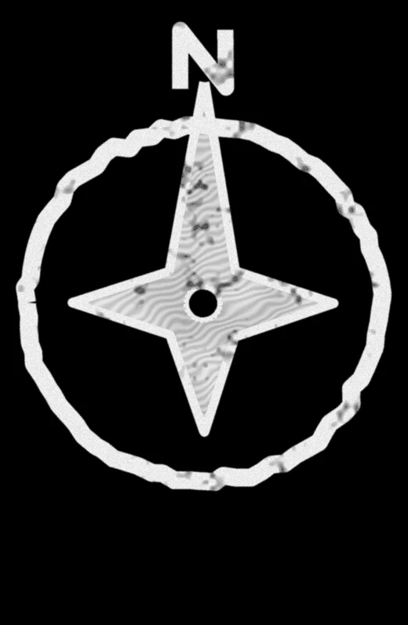
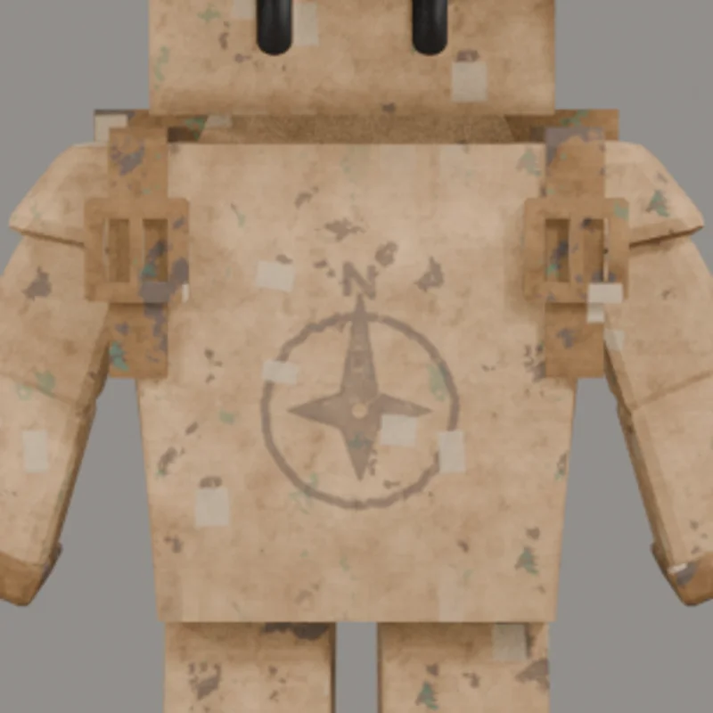
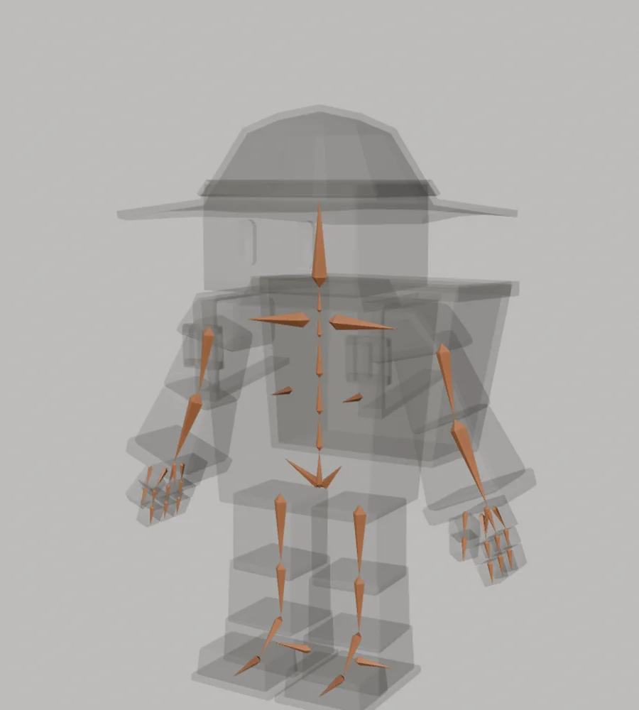
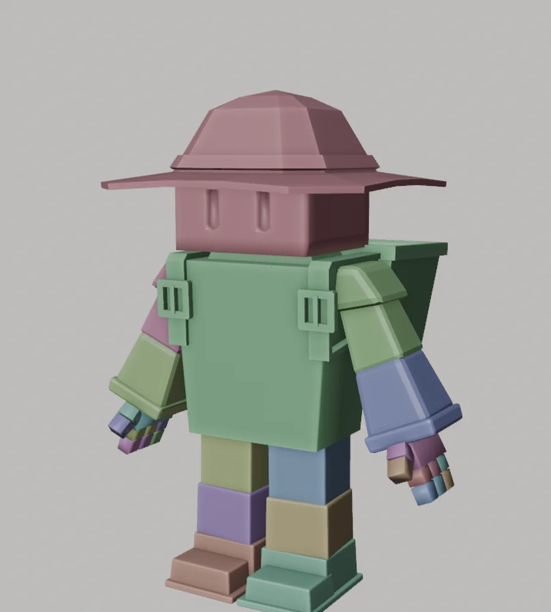
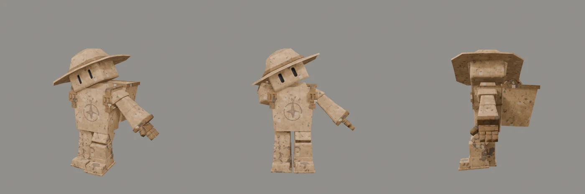

The Boxlings finally have a big friend. TIPPER is a giant Boxling: twice as tall, much wider, and he carries an open backpack for cargo and supplies. In the story he's the one who carries everything the Boxlings gather. This post walks through how he was built, step by step, including the more technical parts: the topology, the skeleton and the weights.

## Step 1: start from a Boxling

TIPPER had to feel like part of the same family, so I didn't start from scratch. I started from a copy of RITS and kept the parts that make a Boxling a Boxling:

- **The head and eyes.** The same boxy head with the same black capsule eyes, only bigger. Compared to his body it's actually smaller than on the Boxlings, which makes him read as big and strong instead of cute.
- **The hands.** The exact same hands with the same fingers, scaled up into big fists.
- **The cardboard material.** The same cardboard, tape patches and wear as the other characters.

Then I made him bigger and bulkier: twice the size, a wider and deeper torso, thicker legs and bigger boots. He also got the parts that make him TIPPER: an explorer hat, an open backpack and two straps with buckles.

## Step 2: longer legs and new arms

The first version was too squat compared to the design sheet. Two big changes fixed that:

- **Longer legs.** The legs got longer, and the whole upper body moved up with them, so his feet stay on the ground.
- **Completely new arms.** The arms of a Boxling are too thin for a giant, so TIPPER got his own: a big rounded shoulder pad, a thick upper arm, a dark elbow joint, and a chunky forearm that widens toward the wrist with a cuff. Only the hands are still Boxling hands.

I also removed the flag that was on top of the hat. It wasn't needed and only made the silhouette busier.

After this step I modelled the rest of TIPPER by hand until he looked exactly like I wanted: the proportions of the torso, the arms, the hands with three fingers and a thumb, the legs and the boots.

## Step 3: topology

TIPPER is built like the other Boxlings: out of separate, simple blocks instead of one smooth mesh. That fits the cardboard look and keeps him light enough for a game.

- **38 parts**
- **2,503 vertices and 2,112 faces** in the base mesh
- **2,595 vertices and 2,229 faces** after the bevel and thickness modifiers

The densest part is the head: it uses the same head as the Boxlings, with extra edge loops around the eye sockets so the eyes stay crisp. The rest is mostly simple boxes with bevelled edges.

## Step 4: a colour of his own

Each Boxling has its own colour: red for RITS, green for SPRIET, blue for KRABBEL and yellow for PUK. TIPPER needed a colour none of the others have, something more basic. I chose **charcoal**: all the paint that was red on RITS is now dark charcoal grey on raw cardboard. It makes him look sturdy and a little worn, like a big worker, and he stands out clearly against the warm sunset backgrounds in our storyboard.

## Step 5: a compass instead of a crown

The crown on the chest belongs to RITS and the others, so TIPPER got a symbol that fits his role as the explorer: a **compass rose**, with a circle, a four-pointed star, a long north point and an N on top. It's painted in the same brush style as SPRIET's leaf and PUK's paw print: a thin layer of paint with brush strokes, a thicker edge and some wear.

The emblem is projected onto the chest rotated 180 degrees, so it had to be drawn upside down. My first try came out too low on the chest and with a mirrored N, so I moved it up and turned the N around until the whole compass sat right in the middle.

## Step 6: rigging

TIPPER uses exactly the same skeleton as the Boxlings: 51 bones with the same names and the same hierarchy, plus one extra bone for the dust clouds. That means everything we make for the Boxlings can be reused for him. The bones are placed on his own body: hips, knees and ankles in his legs, shoulders, elbows and wrists in his arms, two segments per finger and thumb, and a neck right under the head so it turns from the bottom.

## Step 7: weights

Like the Boxlings, TIPPER is weighted in a "robot style": every part follows exactly one bone, with no blending between bones. A cardboard figure doesn't bend like skin, it hinges at the joints, so this keeps every block straight and clean when he moves. In the image below, every colour is one bone.

- **The head and hat** follow the head bone.
- **The torso, straps and backpack** follow the chest bone.
- **The shoulder pad and upper arm** follow the upper arm, the forearm and cuff follow the forearm.
- **Every finger piece and thumb piece** follows its own finger bone.
- **The thigh, shin and boot** each follow their own leg bone.

To test the rig, I put him in a pose: one arm forward with the fingers closed, the other arm out, one leg forward and the head turned. Every part moved with its bone and stayed attached at the joints.

## Step 8: a first wave

Because TIPPER has the same skeleton as the Boxlings, I could give him the same wave animation I made for RITS, without changing a single key. It's the first time he moves, and he already feels like one of the team. His own animations, like walking with a heavy backpack, come next.

## What I'm taking with me

- **Reuse what defines the family.** The same head, hands and material made TIPPER feel like a Boxling right away, even at twice the size.
- **Change what defines the character.** New arms, longer legs, a hat, a backpack, a colour and a symbol of his own make him clearly TIPPER.
- **Keep the skeleton the same.** One shared skeleton means one shared library of animations.
- **Rigid weights fit cardboard.** A cardboard figure hinges at its joints instead of bending, so one bone per part looks right and stays clean.
