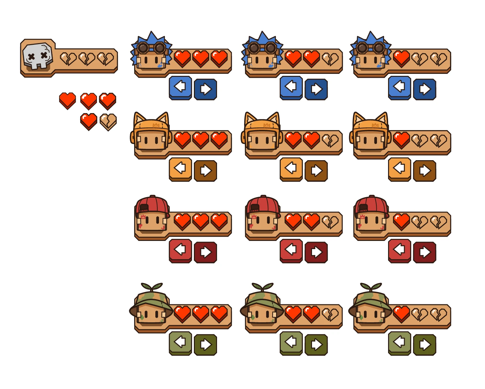
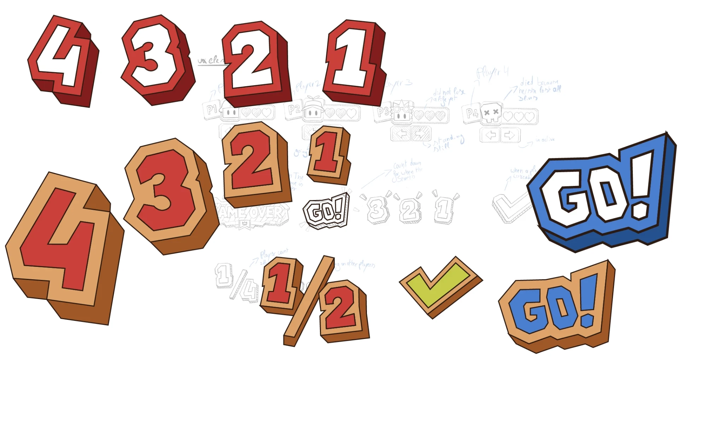
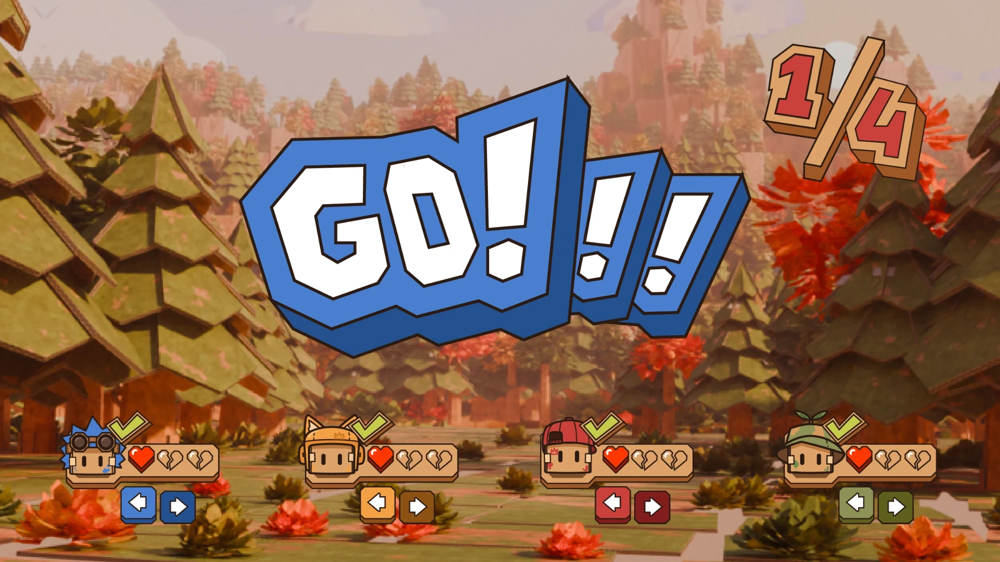

In [UI Sketches](../ui-sketches/), Ximen drew a first sheet with every UI element the game needs: the player cards with hearts and pedal arrows, the player count, the waiting dots, the ready check mark, the countdown and the game over banner. One of the next steps was to work those elements out digitally in our cardboard style. This post shows how we did that, and how the elements look on top of the game.

## The player cards

The player card is the element children look at the most during the game, so we started there. Every Boxling got their own card, drawn in three states: three lives, two lives and one life.

Compared to the sketch, a few things changed:

- **The Boxling's own colour.** Each card's pedal buttons use the colour of its Boxling: blue for KRABBEL, yellow-orange for PUK, red for RITS and green for SPRIET. The left button is a light shade and the right button a darker one. Together with the head and the headgear, the colour makes it easy for a child to find their own card on a big screen.
- **No more P1 to P4.** The sketch still had a label for the player number. With the colours and the heads, we didn't need it anymore, so the card got simpler.
- **Hearts that break.** A life you still have is a glossy red heart. A life you lost becomes a **broken heart** in the cardboard colour of the card, so it's still clear there was a heart there. That's easier to read than the empty outline from the sketch.
- **The skull card.** When a player loses all three lives, the head is replaced by a grey cardboard skull with crosses for eyes, all three hearts are broken and the pedal buttons disappear. The skull stays the same for every Boxling, so you can see at a glance who's out.

The card itself is a piece of cardboard with a darker edge underneath, the same chunky look as the logo and the Boxlings.

## The countdown, the player count and the check mark

For the big text elements, we drew digital versions straight on top of Ximen's sketch, and tried two colour styles next to each other.

- **Red and white.** White numbers with a thick red outline and a dark red side, which is bold and very readable.
- **Cardboard.** Red numbers in a thick cardboard border with a brown side, which looks like they were cut out of the same boxes as the Boxlings.

We did the same for **GO!**: once white with a blue outline, and once blue in a cardboard border. Blue is a nice contrast with the red numbers before it, so the moment the game starts feels different from the countdown.

The **player count** (here 1/2) and the **check mark** got the cardboard version too. The check mark is a bright lime green in a cardboard border, so "ready" stands out but still fits the world.

## Putting it on the screen

To see if everything works together, we placed the elements on a screenshot of the game: the cardboard forest from [the idle screen](../idle-screen/).

- The **four player cards** sit along the bottom of the screen, one for each platform, in the same order as the players stand. Each card has a green **check mark** on top, to show that player is ready.
- The **player count** sits in the top right corner in the cardboard style.
- **GO!** comes in big in the middle, in white with a blue outline and extra exclamation marks. Against the warm orange and green forest, the blue really jumps out.

The mockup also showed us that the elements are big enough to read on a large screen, and that the cardboard UI fits the environment without disappearing into it.

## What we're taking with us

- **Colour does the work.** Giving every card the colour of its Boxling made the P1 to P4 labels unnecessary.
- **Show what you lost.** Broken hearts tell a child how many lives they had, not just how many are left.
- **Test styles side by side.** Drawing both countdown styles over the same sketch made the choice easier to discuss.
- **Always check it on the game.** An element can look good on a white page and still disappear in the scene, so we test everything on top of the game.
