In [UI Elements: From Pencil Sketch to Cardboard](../ui-elements/), Nikola worked out our UI elements in the cardboard style: player cards, a player count, a check mark and a countdown. Now that the [idle screen](../idle-screen-unity/) and the [canyon](../canyon-unity/) run in Unity, we put those elements on top of real screenshots of the game. Some things worked straight away. Others took up too much room, or didn't tell the children enough. So we redesigned them, first for the idle screen and then for the game itself.

## The idle screen: telling children what to do

The idle screen has one job: getting a child to step onto a foot box. We started with a big card in the top right corner, with a drawing of a Boxling standing on a platform and the text "Sta op het platform!" (stand on the platform). The player count, 1/4, sat in the middle at the bottom.

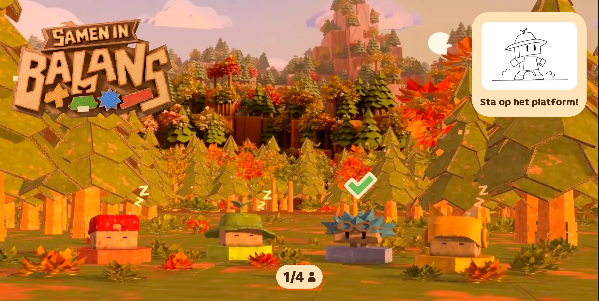

The text didn't say *why* you should stand on the platform, so it became "Sta op het platform om mee te doen!" (stand on the platform to join in). We also tried putting the player count on top of the card, so everything about joining is in one place.

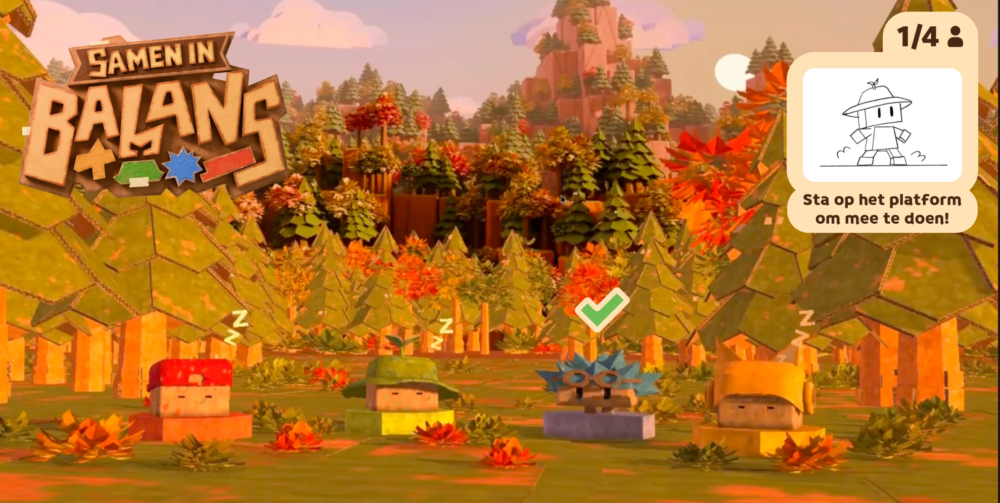

The card with the drawing was big, and it covered a lot of the forest. The Boxlings themselves already show what happens when you step on: they wake up and get a check mark. So we replaced the card with a small speech bubble with an exclamation mark, and moved the player count under the logo.

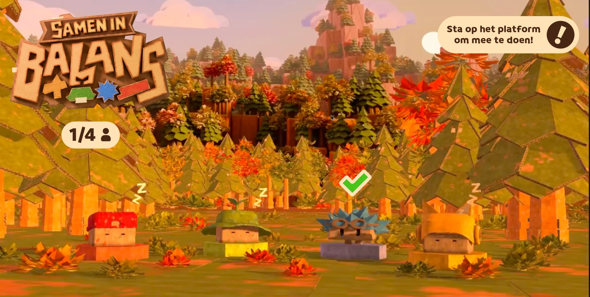

We also tried both small elements together in the bottom right corner. That left the top of the screen calm, but the call to action ended up next to the Boxlings, where it's easy to miss.

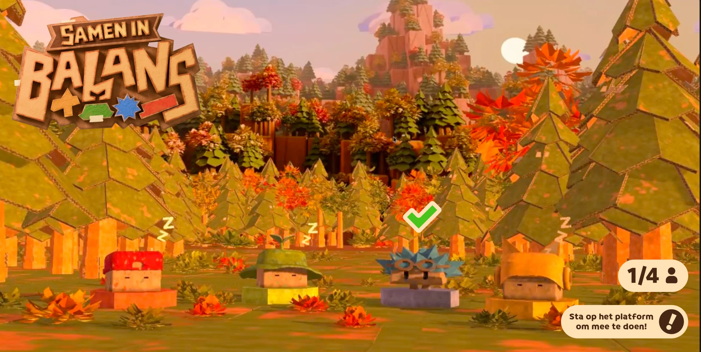

## A countdown that tells you how long to wait

Our client asked us to test how long children stay patient while they wait at the idle screen. A child who doesn't know how long they have to wait will walk away sooner. So we added a banner at the top: "We starten in 25s" (we start in 25 seconds). That way the players who are ready know how long they still have to wait, and the others know they still have time to join.

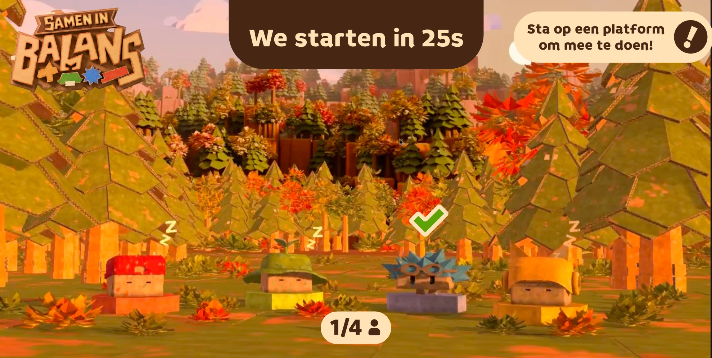

When the timer reaches 4 seconds, the big 3, 2, 1 from the first UI design appears right in the middle of the screen, in red with the thick cardboard border. This is the final version of the idle screen.

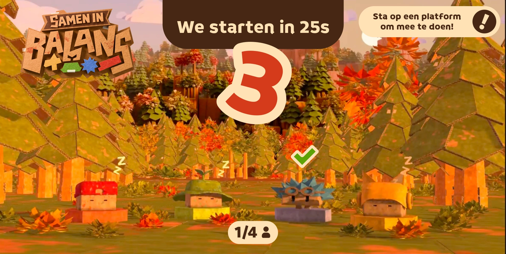

## Smaller player cards

In the game, the player cards stay on the screen the whole time, so they must not cover the plank or the canyon. We tried a lot of layouts next to each other: the head with the lives under it or next to it, and the left and right arrows under the card or on either side of the head.

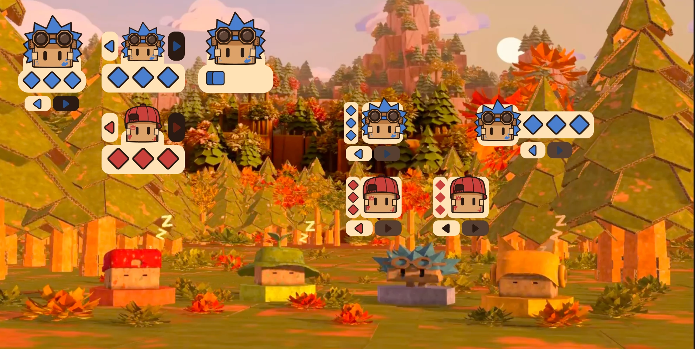

A few things changed compared to the first cards:

- **Diamonds instead of hearts.** The lives are now three diamonds in the Boxling's own colour. That makes the card smaller, and the colour links the lives to the right Boxling straight away.
- **The arrows show the pedals.** Every card keeps a left and a right arrow, one for each pedal of the foot box, so a child sees that those two pedals belong to their Boxling.
- **No card around everything.** The head, the lives and the arrows each sit on their own small cream shape, so the card takes less room and you see more of the game behind it.

## Where the cards go

Then we tried where the four cards should go. Next to each other in one corner felt messy, and it was hard to tell which card belongs to which foot box.

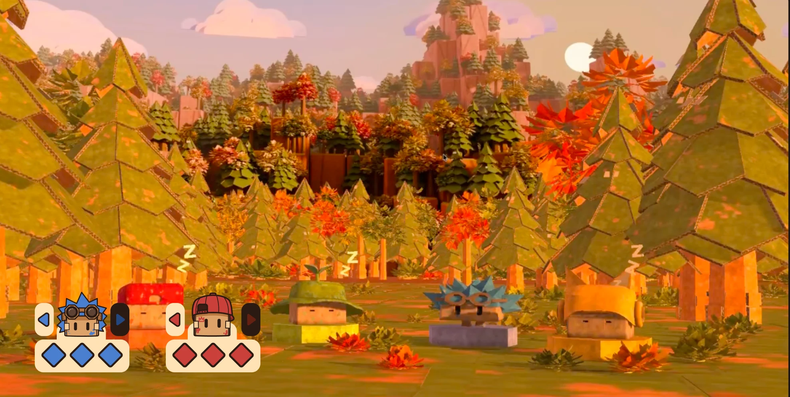

In the four corners of the screen, the cards were far apart and hardly covered anything, but the order didn't match the order of the foot boxes anymore.

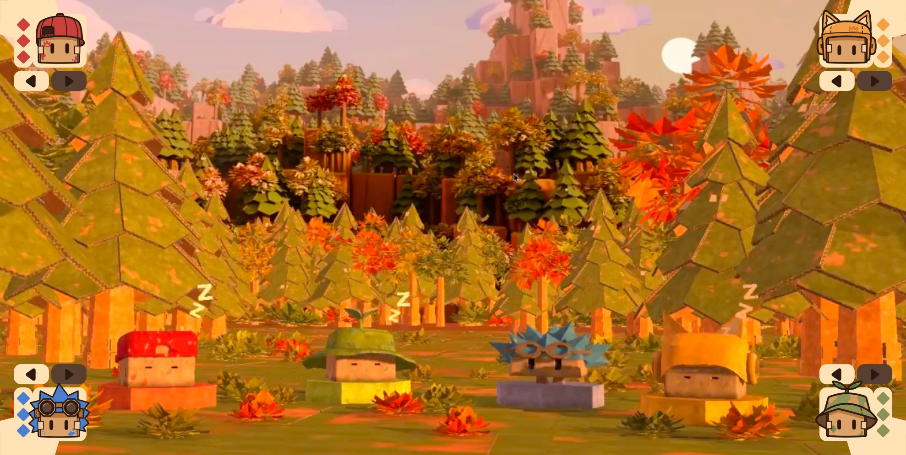

So the cards went along the bottom of the screen, in the same order as the foot boxes. We tried them with the diamonds next to the head and the arrows underneath, and with the arrows on top and the diamonds standing upright next to the head.

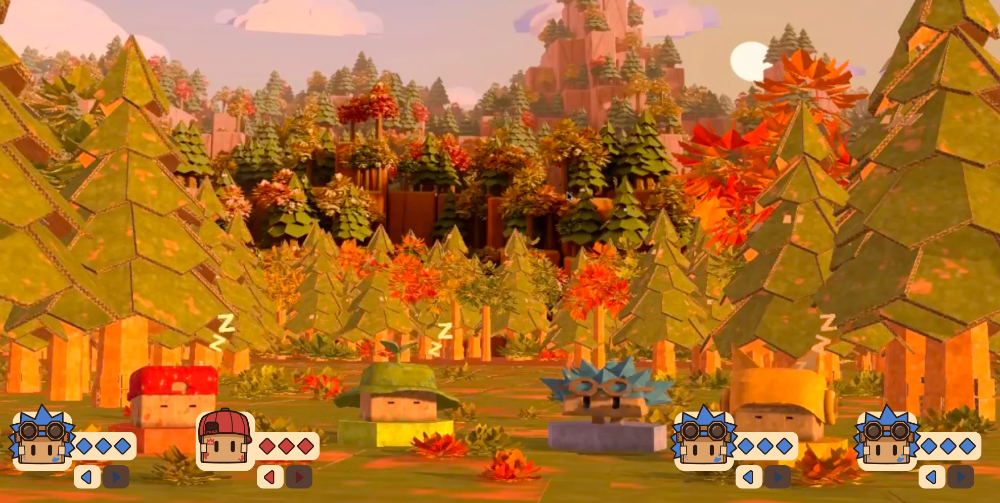

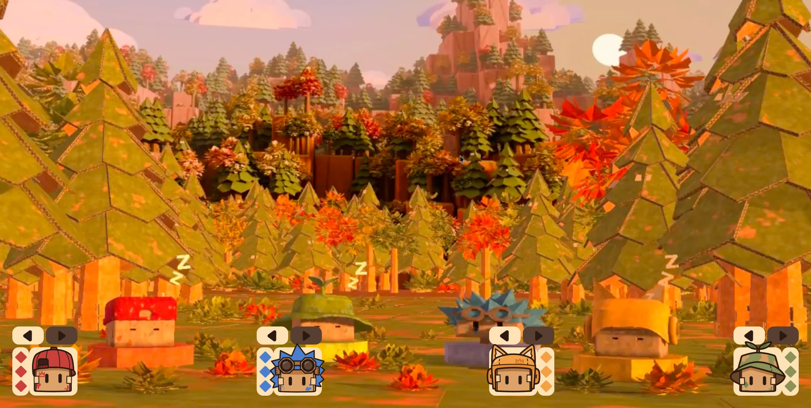

The first version reads best: head, lives, then the pedals, like a line you read from left to right.

## In the game

This is the final version of the cards in the game. With four players, the four cards sit along the bottom of the screen, in the corners and in the gaps under the plank, so they never cover the Boxlings.

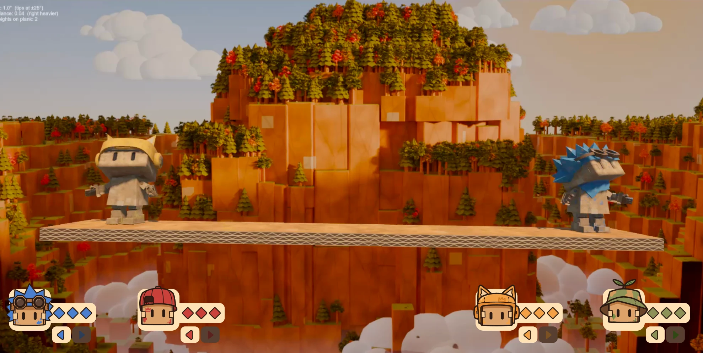

When fewer children are playing, only the cards of the players who are really playing appear. A card of a Boxling that isn't playing would only confuse the children. With two players, their cards move to the bottom corners.

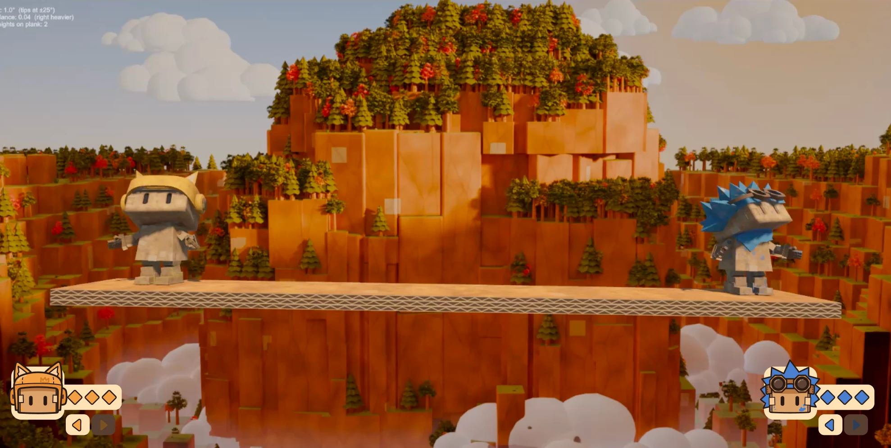

## What's next

The next step is building these elements in Unity: the speech bubble, the countdown banner and the player cards. After that, we'll test them with children, and check if they understand the call to action and the countdown.

## What we're taking with us

- **Test the UI on the real game.** On a white page, the big card looked fine. On top of the forest, it covered too much.
- **Let the game do the explaining.** The Boxlings waking up already show what stepping on does, so the text can be short.
- **Tell people how long they have to wait.** A countdown makes waiting easier, and it tells the others they can still join.
- **Only show what matters.** Cards of players who aren't playing were just noise.
