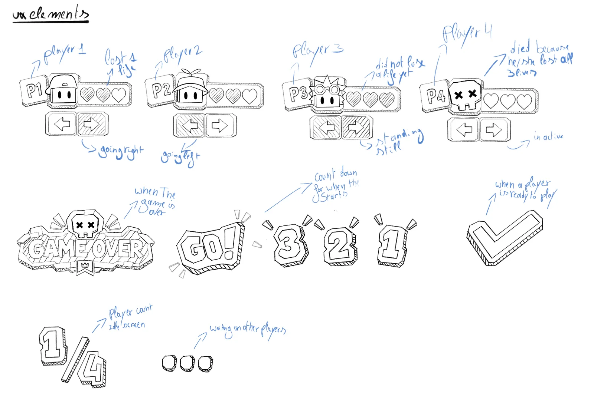
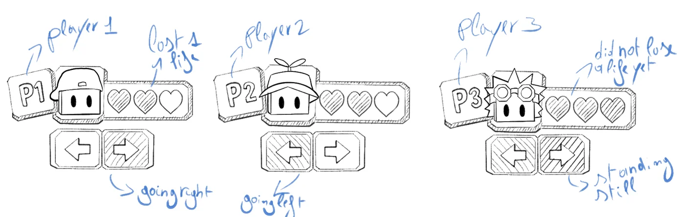
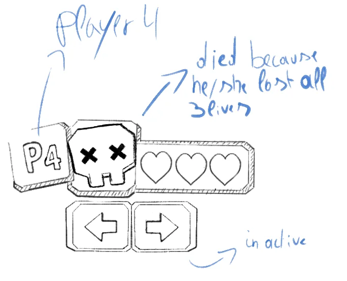
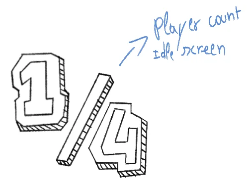
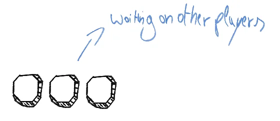
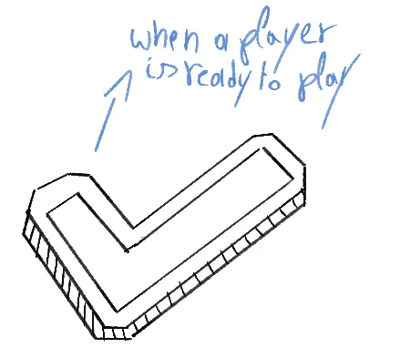
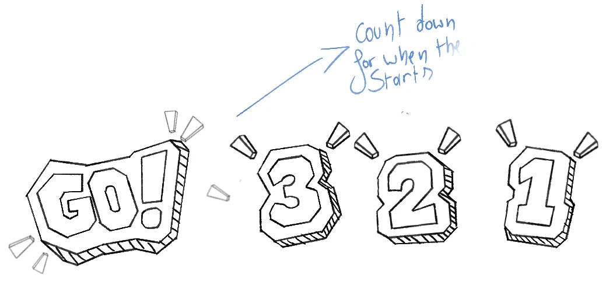
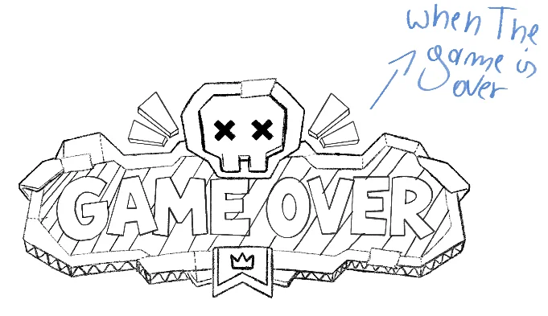

We already knew how the game flows: players join, a countdown starts, they play and the game ends (you can read about it in [the game flow](../game-flow/)). But we had never drawn what the players actually see on screen during all of that. So I made a first sheet with all the UI elements we need.

Below I go through the elements one group at a time.

## The player cards

Every player gets a small card on the screen. It shows three things:

- **Who you are.** A P1 to P4 label and the head of your Boxling: RITS with his backwards cap, SPRIET with the bucket hat and the sprout, and KRABBEL with his spikes and goggles. A child who forgets which Boxling is theirs only has to look for their hat.
- **How many lives you have left.** Three hearts. A full heart is a life you still have, an empty heart is a life you lost. P1 has already lost one, P3 hasn't lost any yet.
- **What your feet are doing.** Two arrows for the two pedals. The arrow of the pedal you press lights up, so you see the link between your feet and your Boxling right away. P1 presses right and goes right, P2 goes left, and P3 presses both pedals and stands still.

## Out of the game

The card also shows the two ways a player can be out of the game. When a Boxling loses all three lives, his head turns into a **skull** with crosses for eyes and all hearts are empty. When a player steps off the pedals, both arrows stay dark and the Boxling is **inactive**. That way the other players see straight away who is still in the game.

## Joining: the player count, waiting and ready

On the idle screen, **1/4** shows how many of the four Boxlings are taken. It changes every time a child steps onto a platform, so the next child sees there's still room to join.

**Three dots** mean we're waiting for other players. They can bounce one after the other, like a loading animation, so the screen never looks frozen.

**A check mark** appears above a player as soon as they're ready to play. It matches the ready mark in [the idle state](../idle-state/) sketches.

## The countdown

Right before the game starts, **3, 2, 1, GO!** pops up in the middle of the screen. The small spikes around the numbers make them pop, like in a cartoon. GO! is tilted and a bit bigger than the numbers, so it feels like the moment everything starts moving.

## Game over

When the game is over, a big **GAME OVER** banner appears with a skull on top, the same skull as on the card of a player who is out. The small ribbon with the crown underneath links it to the crown on the cardboard box and on RITS.

## The style

Everything is drawn as if it was cut out of thick cardboard: chunky letters with a thick edge on the side, hatching for the shadows and slightly crooked lines. That's on purpose. The Boxlings, the logo and the falling objects are all made of cardboard, so the UI should look like it was made from the same boxes.

## Next steps

- Check the sketches with Nikola, so the UI fits the idle state and the game flow.
- Draw the PUK card, so all four Boxlings have one.
- Work the elements out digitally in the cardboard style, and test from a distance whether children can read the hearts and arrows.
- Give the elements to Lomme so he can put them in Unity.
