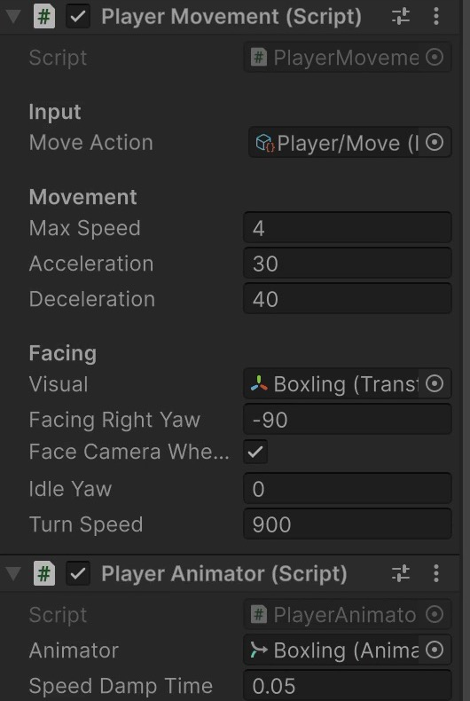
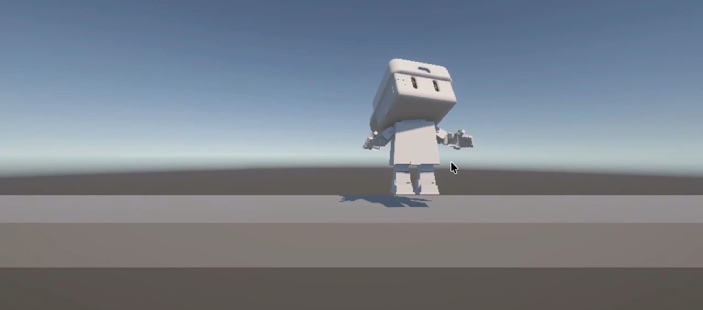
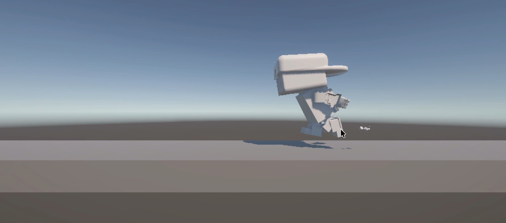

In Samen in Balans, every player controls one Boxling by leaning left or right. Before anything else, a Boxling has to be able to do exactly that in Unity: walk left, walk right and stand still. This post is about that first playable test, first with only RITS and later with all four Boxlings.

<video autoplay loop muted playsinline preload="metadata" poster="../../videos/rits-first-movement-poster.jpg" style="width: 100%; border-radius: 14px; margin-block: 1.5rem;">
  <source src="../../videos/rits-first-movement.mp4" type="video/mp4" />
  Your browser can't play this video.
</video>

## Step 1: a small test scene

I started with the simplest scene possible: a camera, a light, a long ground plane and one Boxling. RITS came straight from Ximen's Blender file, with his rig and his animations. No level, no menus and no story yet. The only question this scene had to answer: does it feel good to move a Boxling left and right?

The game is played from the side, like a side-scroller. That's why RITS can only move along one axis. He can't walk towards the camera or away from it.

## Step 2: moving left and right

The movement is done with physics: RITS has a Rigidbody, and the script changes its speed every physics step instead of moving him directly. That way he will later react properly to the plank, the falling objects and the other Boxlings.

- **One input, many controllers.** The script reads one action, *Move*, from Unity's Input System. The arrow keys, A and D and a gamepad stick all work right away, and later our own Arduino controllers can use the same action.
- **Speeding up and slowing down.** RITS doesn't start or stop instantly. He speeds up to his top speed of 4 m/s and slows down slightly faster than he speeds up, so stopping feels tight.
- **Staying on the line.** The Rigidbody can't rotate and can't move forwards or backwards. Without this, a small bump would make him tip over or slide out of the scene.

All these values are fields in the Inspector, so we can tune how he feels without touching the code.

## Step 3: turning around

A Boxling should look where he's going. While you walk, the model turns smoothly to the left or the right. When you let go, RITS turns back towards the camera, so he looks at the players while he waits.

Only the model turns, not the physics body. That keeps the movement and the looks separate: the body slides left and right, the model on top of it decides where RITS looks.

## Step 4: idle and run animations

Ximen had already made two animations for RITS: a watchful idle and a running cycle with little dust clouds. In Unity, an Animator switches between the two based on one number: how fast RITS is moving. Standing still plays the idle, walking plays the run. That number is smoothed a little, so the switch between the two never looks jumpy.

The movement script doesn't know anything about animations, and the animation script only reads the speed. Because of that, I can change one without breaking the other.

## Step 5: getting the colours into Unity

You might have noticed that RITS is completely white in the video. His cardboard look in Blender is made with a procedural shader: a node setup that calculates the colours, the grain and the tape. Unity can't read that, so only the shape came along.

The fix is a small Blender script that **bakes** the shader into one image: it renders all the colours of the character onto a single texture and exports the model to Unity with that texture attached. The Blender file itself is never changed. Now every Boxling arrives in Unity with his own colours.

## Step 6: from one Boxling to four

Setting up one Boxling by hand is fine. Doing it four times, and again every time a model changes, is not. So I made a setup tool in Unity: one menu item that does everything for every Boxling.

- **One shared brain for the animations.** All Boxlings use the same idle-and-run logic. Each one only brings his own two animations, so a change in the logic works for all four at once.
- **A prefab per Boxling.** Each Boxling becomes a ready-made prefab with his physics, his scripts and his model. Changing the prefab changes him everywhere he's used.
- **Into the scene, side by side.** The tool places RITS, SPRIET, KRABBEL and PUK next to each other, ready to test.

## What's next

Right now, every Boxling still listens to the same keys. The next step is giving each player their own controls. Our Arduino already sends a left or right arrow key when you press a button, so Unity sees it as an ordinary keyboard and the movement works without extra code. After that, the four Boxlings go onto the plank together.

## What I'm taking with me

- **Start with the smallest test.** One Boxling in an empty scene was enough to find out how the movement should feel.
- **Keep movement, looks and animation apart.** Physics moves the body, the model turns on top of it and the animations only listen to the speed. Each part can change on its own.
- **Automate what you'll repeat.** A setup tool takes a moment to make, but it turns four Boxlings, and every new version of them, into one click.
- **Not everything travels between programs.** A shader from Blender doesn't work in Unity, so the colours have to be baked into a texture first.
