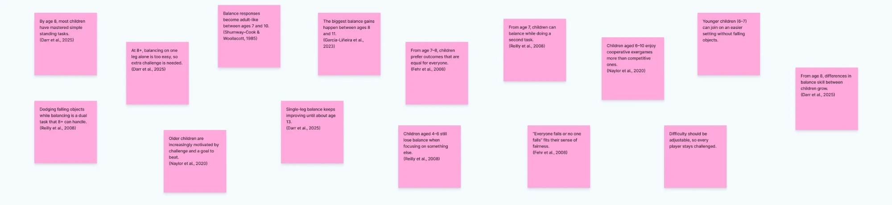
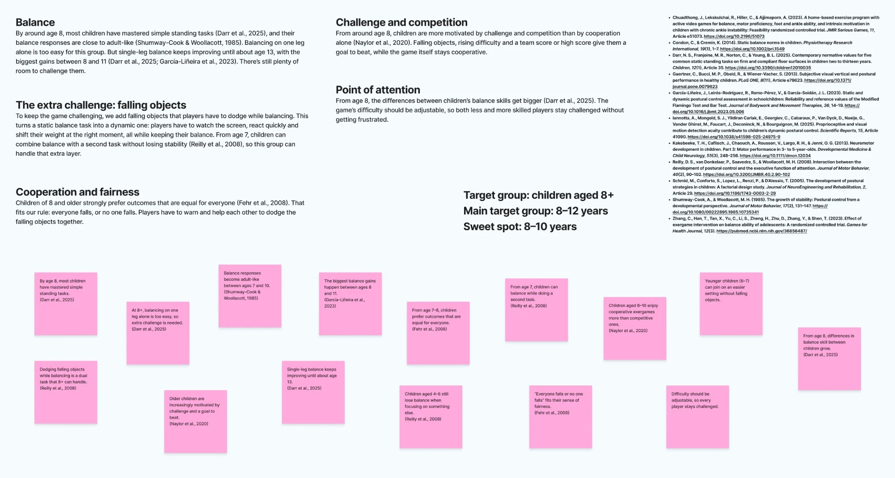
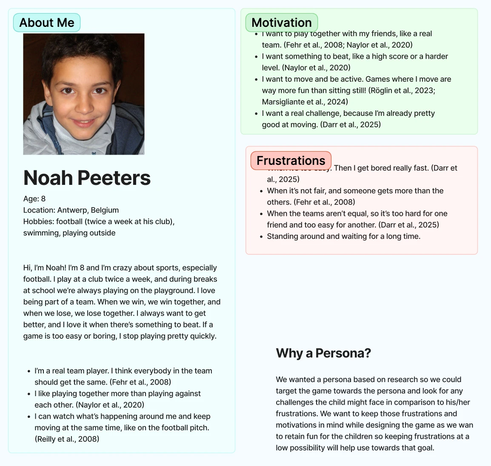

Before designing a game for children, you need to know which children. A five-year-old and a twelve-year-old move, think and play very differently, and a balance game has to fit their bodies as much as their minds. So we went into the research: what can children do with their balance at different ages, what motivates them, and what makes a game feel fair to them? This post shows how we got from loose findings to a clear target group and a persona.

## Collecting the findings

We started by reading studies on balance development, dual tasks, motivation and fairness in children, and wrote every useful finding on a sticky note with its source. That gave us a wall of small facts: when children master simple standing tasks, when their balance becomes adult-like, from what age they can do two things at once, and what kind of play they prefer.

Then we grouped the notes into themes. Each theme answers one question about the game.

## Balance

By around age 8, most children have mastered simple standing tasks (Darr et al., 2025), and their balance responses are close to adult-like (Shumway-Cook & Woollacott, 1985). Balancing on one leg alone is too easy for this group. But single-leg balance keeps improving until about age 13, with the biggest gains between 8 and 11 (Darr et al., 2025; García-Liñeira et al., 2023). There's still plenty of room to challenge them.

## The extra challenge: falling objects

To keep the game challenging, we add falling objects that players have to dodge while balancing. This turns a static balance task into a dynamic one: players have to watch the screen, react quickly and shift their weight at the right moment, all while keeping their balance. From age 7, children can combine balance with a second task without losing stability (Reilly et al., 2008), so this group can handle that extra layer. Younger children, aged 4 to 6, still lose their balance when they focus on something else (Reilly et al., 2008).

## Cooperation and fairness

Children of 8 and older strongly prefer outcomes that are equal for everyone (Fehr et al., 2008). That fits our rule: **everyone falls, or no one falls.** Players have to warn and help each other to dodge the falling objects together.

## Challenge and competition

From around age 8, children are more motivated by challenge and competition than by cooperation alone (Naylor et al., 2020). Children aged 6 to 10 enjoy cooperative exergames more than competitive ones, but older children increasingly want a goal to beat. Falling objects, rising difficulty and a team score or high score give them that goal, while the game itself stays cooperative.

## Point of attention

From age 8, the differences between children's balance skills get bigger (Darr et al., 2025). The game's difficulty should be adjustable, so both less and more skilled players stay challenged without getting frustrated. Younger children (6 to 7) could join in an easier setting without falling objects.

## Our target group

Putting the themes together gave us a clear answer:

- **Target group:** children aged 8 and up
- **Main target group:** 8 to 12 years
- **Sweet spot:** 8 to 10 years

At 8, children have the balance, the focus and the sense of fairness the game asks for, while there's still enough room to challenge them.

## Meet Noah

A target group is still abstract, so we turned the research into a persona: **Noah Peeters**, 8 years old, from Antwerp. He plays football at his club twice a week, swims and plays outside a lot. He loves being part of a team, always wants to get better, and drops a game quickly when it's too easy or boring.

Every part of Noah is based on the research above:

**About Noah**
- He's a real team player and thinks everybody in the team should get the same (Fehr et al., 2008).
- He likes playing together more than playing against each other (Naylor et al., 2020).
- He can watch what's happening around him and keep moving at the same time, like on the football pitch (Reilly et al., 2008).

**What motivates him**
- Playing together with his friends, like a real team (Fehr et al., 2008; Naylor et al., 2020).
- Having something to beat, like a high score or a harder level (Naylor et al., 2020).
- Moving and being active: games where he moves are way more fun than sitting still (Röglin et al., 2023; Marsigliante et al., 2024).
- A real challenge, because he's already pretty good at moving (Darr et al., 2025).

**What frustrates him**
- When it's too easy, because then he gets bored really fast (Darr et al., 2025).
- When it's not fair and someone gets more than the others (Fehr et al., 2008).
- When the teams aren't equal, so it's too hard for one friend and too easy for another (Darr et al., 2025).
- Standing around and waiting for a long time.

## Why a persona?

We wanted a persona based on research so we could aim the game at a real kind of player and spot the challenges a child like Noah might run into, compared to his frustrations. While designing the game, we keep his motivations and frustrations in mind. The goal is to keep the game fun, and keeping the chance of frustration low helps us get there.

## What we're taking with us

- **Eight is the starting point.** From that age, children have the balance, the dual-task skills and the sense of fairness the game needs.
- **Balance alone isn't enough.** The falling objects add the challenge this age group needs.
- **Together, but with a goal.** The game stays cooperative, with a team score to beat.
- **Make difficulty adjustable.** Skill differences grow from age 8, so the game has to fit both less and more skilled players.

## Sources

- Chuadthong, J., Lekskulchai, R., Hiller, C., & Ajjimaporn, A. (2023). A home-based exercise program with active video games for balance, motor proficiency, foot and ankle ability, and intrinsic motivation in children with chronic ankle instability: Feasibility randomized controlled trial. *JMIR Serious Games, 11*, Article e51073. https://doi.org/10.2196/51073
- Condon, C., & Cremin, K. (2014). Static balance norms in children. *Physiotherapy Research International, 19*(1), 1–7. https://doi.org/10.1002/pri.1549
- Darr, N. S., Franjoine, M. R., Norton, C., & Young, B. L. (2025). Contemporary normative values for five common static standing tasks on firm and compliant floor surfaces in children two to thirteen years. *Children, 12*(1), Article 35. https://doi.org/10.3390/children12010035
- Gaertner, C., Bucci, M. P., Obeid, R., & Wiener-Vacher, S. (2013). Subjective visual vertical and postural performance in healthy children. *PLoS ONE, 8*(11), Article e79623. https://doi.org/10.1371/journal.pone.0079623
- García-Liñeira, J., Leirós-Rodríguez, R., Romo-Pérez, V., & García-Soidán, J. L. (2023). Static and dynamic postural control assessment in schoolchildren: Reliability and reference values of the Modified Flamingo Test and Bar Test. *Journal of Bodywork and Movement Therapies, 36*, 14–19. https://doi.org/10.1016/j.jbmt.2023.05.006
- Iannotta, A., Mongold, S. J., Yildiran Carlak, E., Georgiev, C., Cabaraux, P., Van Dyck, D., Naeije, G., Vander Ghinst, M., Foucart, J., Deconinck, N., & Bourguignon, M. (2025). Proprioceptive and visual motion detection acuity contribute to children's dynamic postural control. *Scientific Reports, 15*, Article 41090. https://doi.org/10.1038/s41598-025-24975-9
- Kakebeeke, T. H., Caflisch, J., Chaouch, A., Rousson, V., Largo, R. H., & Jenni, O. G. (2013). Neuromotor development in children. Part 3: Motor performance in 3- to 5-year-olds. *Developmental Medicine & Child Neurology, 55*(3), 248–256. https://doi.org/10.1111/dmcn.12034
- Reilly, D. S., van Donkelaar, P., Saavedra, S., & Woollacott, M. H. (2008). Interaction between the development of postural control and the executive function of attention. *Journal of Motor Behavior, 40*(2), 90–102. https://doi.org/10.3200/JMBR.40.2.90-102
- Schmid, M., Conforto, S., Lopez, L., Renzi, P., & D'Alessio, T. (2005). The development of postural strategies in children: A factorial design study. *Journal of NeuroEngineering and Rehabilitation, 2*, Article 29. https://doi.org/10.1186/1743-0003-2-29
- Shumway-Cook, A., & Woollacott, M. H. (1985). The growth of stability: Postural control from a developmental perspective. *Journal of Motor Behavior, 17*(2), 131–147. https://doi.org/10.1080/00222895.1985.10735341
- Zhang, C., Han, T., Tan, X., Yu, C., Li, S., Zheng, H., Zhu, D., Zhang, Y., & Shen, T. (2023). Effect of exergame intervention on balance ability of adolescents: A randomized controlled trial. *Games for Health Journal, 12*(3). https://pubmed.ncbi.nlm.nih.gov/36856487/
