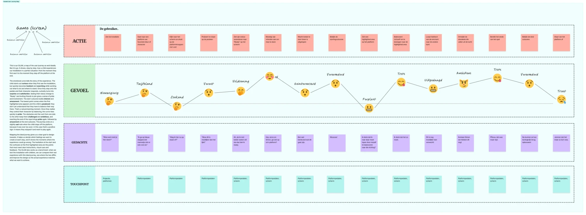
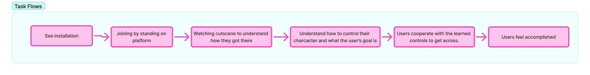
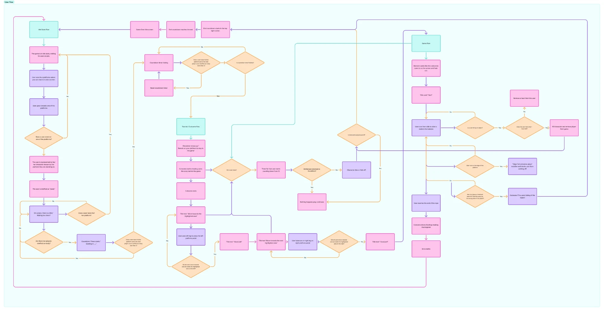

With our target group and our persona Noah in place, the next question was: what should playing Samen in Balans actually feel like, from start to finish? And what does the installation need to do at every moment to get there? We answered those two questions with two diagrams: a **Goaled User Journey Map** for the experience, and a **User Flow** for the logic behind it.

## The Goaled User Journey Map

Our GUJM is a map of the user journey as we'd ideally like it to go. It shows, step by step, how a child experiences our installation in a perfect situation: from the moment they first see it to the moment they step off the platform at the end.

Every step has four layers:

- **Action:** what the child does.
- **Feeling:** how they feel, drawn as an emotional curve.
- **Thought:** what goes through their head.
- **Touchpoint:** what part of the installation they're using: the projection, the platform pedals or the screen.

| # | The child... | Feels | Thinks | Touchpoint |
|---|---|---|---|---|
| 1 | Sees the installation | Curious | "Wow, what do you do here?" | Projection, platforms |
| 2 | Goes to the platform with their favourite colour or character | Hesitant | "I'll step on blue, that little guy looks cool too." | Platform pedals |
| 3 | Looks at the screen and presses the platform buttons with their foot | Searching | "Am I allowed to stand on this now?" | Platform pedals |
| 4 | Tries to stand on the pedals | Surprised | "Wow, this is harder than it looks!" | Platform pedals |
| 5 | Sees their status change to "Ready" on the screen | Satisfied | "Ah, if I stand still with both feet, I'm ready." | Pedals, screen |
| 6 | Encourages their friends to join | Proud and involved | "Hey Jarno and Simon, go stand on one of those platforms too?" | Pedals, screen |
| 7 | Waits until the start timer runs out | Interested | "I'm curious what this is going to be." | Pedals, screen |
| 8 | Watches the starting cutscene | Amazed | "Woooow!" | Pedals, screen |
| 9 | Sees a highlighted area on the platform | Perplexed | "I think I have to walk there by balancing myself in that direction?" | Pedals, screen |
| 10 | Balances to move to the highlighted area | Proud | "I think this is how it works." | Pedals, screen |
| 11 | Runs hectically from one side to the other | Challenged | "This is even harder than I expected!" | Pedals, screen |
| 12 | Dodges the obstacles falling from the sky | Ambitious | "Come on Simon, we've got this!" | Pedals, screen |
| 13 | Reaches the end of the game | Proud | "Phew, that was close." | Pedals, screen |
| 14 | Watches the ending cutscene | Amazed | "Now they can rebuild their kingdom!" | Pedals, screen |
| 15 | Steps off the platform | Sad | "Too bad it was so short." | Pedals, screen |

*The original sticky notes are in Dutch, the language our players speak. They're translated here.*

### The emotional curve

The curve tells the story of the experience. The child starts out **curious** when they first see the installation, but quickly becomes **hesitant** and **searching** while working out what to do and where to stand. Once they step onto the pedals and their character responds, curiosity turns into **surprise** and **satisfaction**. Seeing their status change to "Ready" and inviting friends to join gives a sense of pride and involvement. The start cutscene builds **interest** and **amazement**.

The lowest point comes when the first highlighted area appears and the child is **perplexed**: they don't yet understand that they have to balance their way there. That's a natural learning moment. Once they realise they control their character by balancing, the curve rises quickly to **pride**. The obstacles and the rush from one side to the other keep them **challenged** and **ambitious**, and reaching the end of the rope brings pride again, followed by **amazement** at the end cutscene.

The journey ends on a slightly **sad** note when the child steps off the platform, because it was over too soon. In this case that's a positive sign: it means they enjoyed it and want to play again.

### Why map the ideal journey?

Mapping the ideal journey gives us a clear goal to design towards. It helps us decide which feelings we want to create at each step, and it shows the moments where the experience could go wrong. The hesitation at the start and the confusion at the first highlighted area are the points that most need clear instructions, visual cues and feedback.

The GUJM also works as a benchmark. When we test the installation with children, we can compare their real experience with this ideal journey, see where the two differ, and improve the design so the actual experience matches what we want to achieve.

## The task flow

Before going into the details, we summarised the journey as a short task flow: the main steps a group of players goes through.

1. See the installation.
2. Join by standing on a platform.
3. Watch the cutscene to understand how they got there.
4. Understand how to control their character and what the goal is.
5. Cooperate with the learned controls to get across.
6. Feel accomplished.

## The User Flow

The journey map shows what the child experiences. The User Flow shows what the installation has to do to make that happen: every screen, every check and every decision, including what happens when something doesn't go as planned.

It's split into three parts.

### 1. Idle state: waiting for players

- The game is in an idle state, waiting for players. A child sees four platforms and a screen, and walks towards one of them.
- As soon as someone stands on a platform, they're represented by the character that belongs to that platform, and they're marked as **ready**.
- The screen shows "Waiting for others". When **two players** are ready, a countdown starts: "Starting in...".
- If a player steps off during the countdown and fewer than two ready players are left, the game goes back to waiting for others. If there are still enough ready players, the countdown resets and starts again. When the countdown finishes, the game starts.

### 2. Tutorial and cutscene

- A disclaimer appears first: "Remain on your platform to stay in the game".
- The cutscene shows the players the story behind the game.
- Then the tutorial starts. The screen says "Move towards the highlighted area", and the players use their **left leg** to press the left pedal. Only when **all** players are inside the highlighted area on the left does the screen say "Good job!".
- The same happens for the right side: they balance on their right leg until everyone is in the area on the right.

During the cutscene and tutorial the game keeps checking whether someone leaves. If a player steps off, a 10-second timer starts for that player. If they come back, nothing happens and play continues. If not, their character falls off. If no active players are left, the game goes back to the idle state.

### 3. The game

- Monster cards, in the same style as the cutscene, come in on the screen and fade out. Then a title card says **"Run!"**.
- The players run from side to side to keep the balance, while the game keeps checking three things:
  - **Is a player hit by an object?** They lose a heart. If it was their last heart, their character is removed from the game.
  - **Does a player run to the edge of the platform?** An "edge fall" animation plays, and an invisible wall stops them from walking off.
  - **Is the balance threshold hit,** with the players on the wrong side of the plank? A cutscene plays where the players fall off the giant, TIPPER.
- When the players reach the end of the rope, a cutscene shows the Boxlings rebuilding their kingdom, followed by the end credits.
- Finally, an end countdown starts in the top right corner. When it reaches the end, the game over title screen appears and the installation goes back to the idle state, ready for the next group.

## How the two fit together

The journey map and the user flow describe the same 2 to 5 minutes from two sides. The low points in the journey map tell us where the flow needs the most support: the hesitation at the start is answered by the "Waiting for others" screen and the ready status, and the confusion at the first highlighted area is answered by a tutorial that only moves on when every player gets it. The flow also covers what the journey map leaves out: what happens when a child walks away, gets hit or runs too far.

## What we're taking with us

- **Design the feelings, not just the screens.** The emotional curve shows what each moment should feel like, and the flow has to deliver exactly that.
- **The low points need the most care.** The start and the first highlighted area are where children get confused, so that's where we add instructions and feedback.
- **Nobody moves on alone.** The tutorial waits until all players get it, which fits our rule that everyone plays together.
- **Plan for the unexpected.** Children walk away, get hit and run to the edge, so the flow handles each of those without breaking the game.
- **A benchmark for testing.** When we test with children, we'll compare their real journey with this ideal one.
