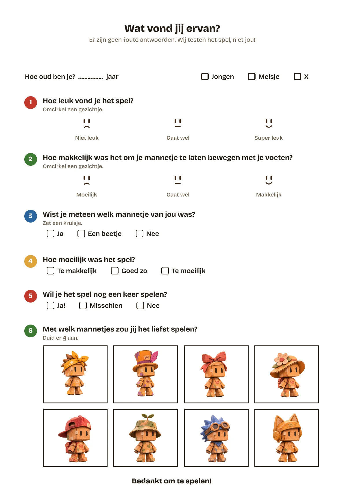
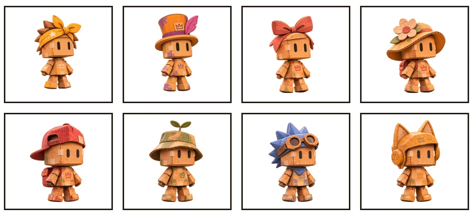

Our first user tests with children from the Chiro are coming up. Watching them play tells us a lot, but we also want to hear what they think. So after playing, every child fills in a short **questionnaire**.

## What we want to know

Every question on the form has a reason. We want to find out:

- **Is it fun?** Do they like the game, and do they want to play again?
- **Is it clear?** Do they know which Boxling is theirs?
- **Do the controls work?** Is it easy to move your Boxling with your feet?
- **Is the difficulty right?** Too easy, good, or too hard?
- **Which characters do they like?** In the peer-to-peer feedback someone said our characters feel mostly male. So we want the children to help us choose. You can read more in the [peer-to-peer feedback](../../feedback/peer-2026-11-20/).

Some things don't belong on the form. How hard they stamp on the pedals, whether something breaks, and how long it takes before they understand the controls are things we write down ourselves while we watch them play.

## Writing for children

The children are 8 years and older, so the form has to be short and easy. I kept it to six questions on one page, so they don't lose interest. A few rules I used:

- **Short sentences and simple words.** I wrote "move your Boxling with your feet" instead of "use the pressure pads", and I used "mannetje" (little guy) instead of "character".
- **No leading questions.** Instead of "Did you like the game?" I asked "How fun was the game?", with the whole scale to choose from.
- **Pictures instead of writing.** The children circle a smiley or tick a box. They don't have to write anything except their age.
- **A small instruction under every question**, like "Circle a face" or "Tick a box", so they know what to do.
- **"There are no wrong answers. We are testing the game, not you!"** at the top, so they feel free to be honest.

## The design

I designed the form in Figma on one A4 page, and kept it simple and printer-friendly:

- **A white page** with black lines, so it prints well on any printer.
- **Lots of white space** between the questions, so the page doesn't feel busy.
- **Numbered questions** in the colours of our Boxlings, so the children can easily follow along.
- **Simple faces** without colours, so no answer looks "better" than another.
- **Big character pictures** in a clear black frame.

## Choosing the characters

The last question is the most important one for the design. The children see eight characters: the four Boxlings we have now, and four new designs with more variation, like a bow, a flower hat and a top hat. All eight stand in the same pose, so the children compare the designs and not the poses. Their names are not on the page, so they choose only by how the characters look.

The children **pick four**: the same number as there are players in the game. After the tests, we count which characters were chosen the most, and those become our four Boxlings.

## Next steps

- Print the forms and take them to the user tests with the Chiro.
- Let the children fill them in on their own, right after they played, and read the questions out loud for the younger ones.
- Count the results and pick the four characters the children liked the most.
