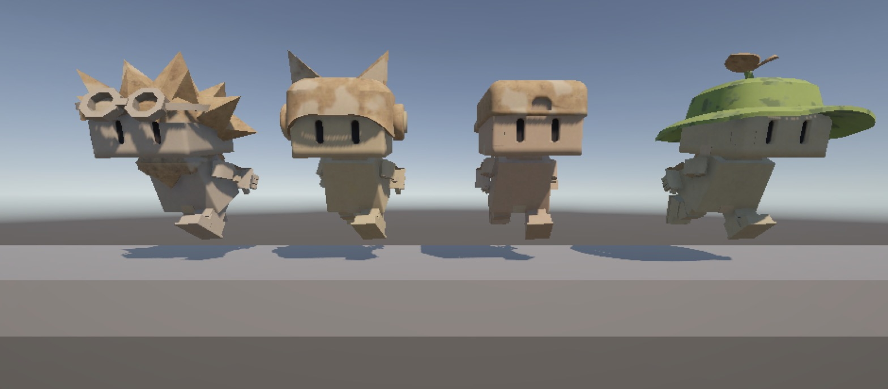
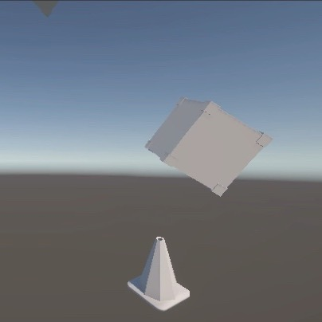
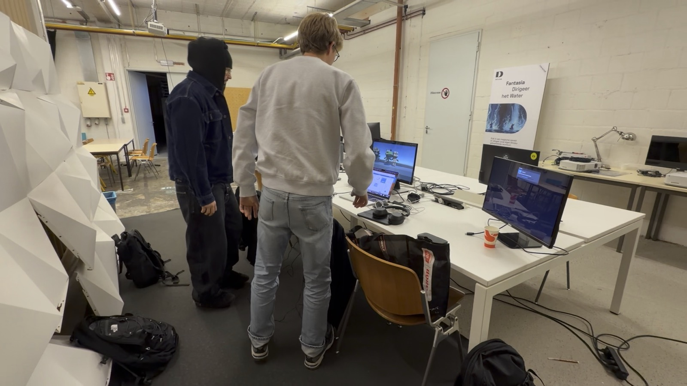
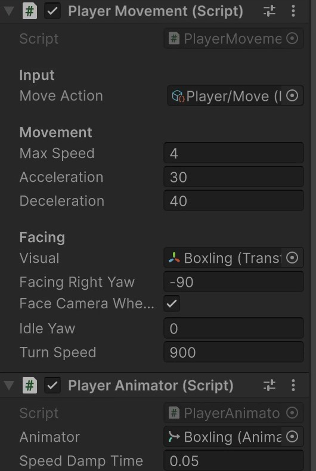

Samen in Balans will run for three weeks at a film festival: one computer, one big screen, four players on pedals. Before we wrote much code, we had to pick the engine everything runs on. We looked at two options: **Unity**, a game engine, and **Three.js**, a library for 3D in the browser. In our [development expert consult](../../feedback/experts-development-2026-11-13/) we were asked to explain choices like this one, so here is why we went with Unity.

  <figure><figcaption>Blender</figcaption></figure>
  →
  <figure class="main"><figcaption>Unity</figcaption></figure>
  ←
  <figure><figcaption>Arduino</figcaption></figure>

Our pipeline: the models and animations come from Blender, the pedals talk to the game through an Arduino, and Unity brings it all together. Logos belong to their owners.

## The two options

  

    <h4>Unity Chosen</h4>
    
    <ul>
      <li class="pro">A complete game engine with an editor</li>
      <li class="pro">Physics, animation and input built in</li>
      <li class="pro">Builds a standalone app that runs fullscreen</li>
      <li class="con">A big program to install and learn</li>
    </ul>
  

  

    <h4>Three.js</h4>
    
    <ul>
      <li class="pro">Runs in any browser, no install</li>
      <li class="pro">Light and easy to share with a link</li>
      <li class="con">No editor: scenes are built in code</li>
      <li class="con">Physics and game logic come from extra libraries or our own code</li>
    </ul>
  

Three.js is a great library. If we were making a game that people play at home through a link, it would be a strong choice. But our game is an installation on one computer, and that changes what matters.

## Why Unity fits our project

### 1. Our characters come straight from Blender

All our Boxlings, the Tipper and the falling objects are modelled, rigged and animated in Blender. Unity reads those files with their rig and animations, like the idle, the run and the hit animation. In Unity's Animator we can then switch between those animations without writing much code. In Three.js the models load fine too, but the logic for which animation plays when is something we would have to write ourselves.

### 2. Physics is built in

Our game is all about things falling and balancing: crates, cones and a rubber duck falling onto a plank that tips left and right. Unity has a physics engine built in, with gravity, collisions and rigidbodies. That gave us falling objects in a few steps. In Three.js we would first have to add and connect a separate physics library.

### 3. Our pedals just work

The players control the game with pedals, connected through an Arduino. The Arduino acts like a keyboard, and Unity's Input System reads one *Move* action for every Boxling. So when we plugged in the Arduino, and later the foot switches, the Boxlings moved without extra code. You can read how in [Boxlings on Buttons](../arduino-buttons/) and [Boxlings on Pedals](../foot-pedals-movement/).

### 4. The editor lets the whole team work on it

Unity has a visual editor. We can place models in a scene, move the camera and change values like speed and acceleration in the Inspector, without touching code. That matters in our team: not only the developer, but also the designers can build scenes and tweak how the game feels.

### 5. It runs on its own for three weeks

At the festival, the game has to start, run fullscreen and keep running all day, for three weeks, without anyone fixing things. Unity builds a standalone app that runs offline, without a browser in between. With Three.js the game would run inside a browser, which adds tabs, pop-ups, updates and browser settings that could get in the way.

## Side by side

| | Unity | Three.js |
| --- | --- | --- |
| Blender models and animations | Imported with rig, Animator for switching | Imported, switching written in code |
| Physics | Built in | Extra library |
| Pedals via Arduino | Read as a keyboard by the Input System | Works too, through the browser |
| Building scenes | Visual editor | In code |
| Running at the festival | Standalone fullscreen app | Inside a browser |
| Sharing online | Needs a download or WebGL build | Just a link |

## Our choice

For a game that runs on one computer at a festival, with characters from Blender, physics and our own pedals, Unity gives us the most out of the box. Three.js would be the better fit for something on the web, but that is not what Samen in Balans is.
